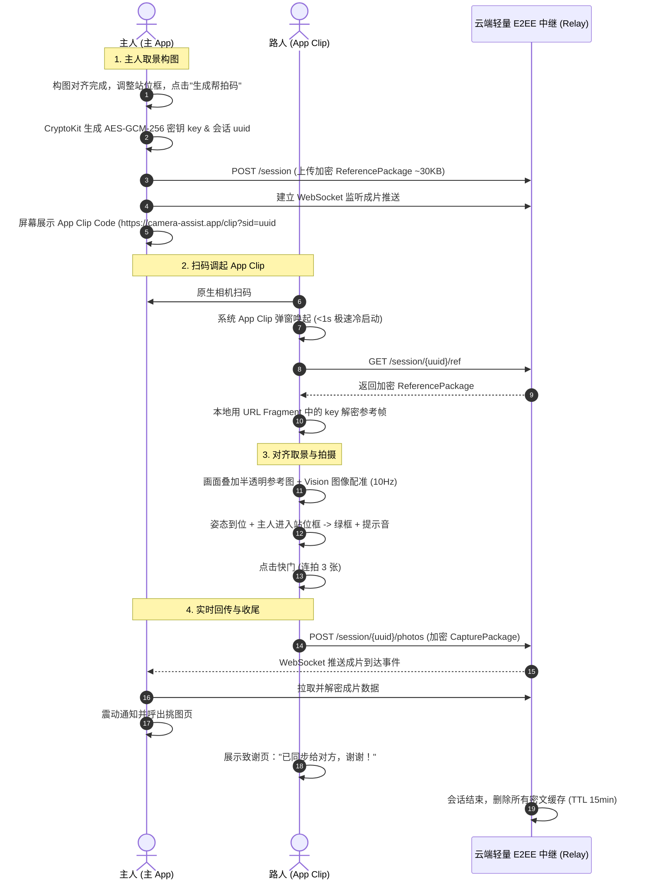

# 帮拍相机 iOS App 开发方案 v1.6

> - **范围**：iOS 实时帮拍相机。事后的照片复盘是独立应用，见 `photo-review-app-plan.md`；两者共用 Rust 规则核心 `compose-core`。全项目研发优先级与排期对齐见 `development-priorities.md`。
> - **前身**：本文档合并并替代三份早期文档（已移到 `archive/`：`composition-rule-engine-ios.md`、`native-camera-leverage-ios.md`、`light-distance-advisor-ios.md`）；帮拍辅助功能来自 `helper-mode-features-research.md`。版本变化见附录 A。
> - **约定**：【待验证】表示需要真机 spike 确认（汇总在第 20 节）。文中代码为设计级示例，未经编译，API 名称以最新 SDK 为准。第 7、8 节中属于 `compose-core` 的 Swift 代码是**算法规格**，实际实现为 Rust。

---

## 目录

1. 关键设计决策
2. 产品定义
3. 平台与系统版本策略
4. 系统能力利用策略
5. 总体架构
6. 采集层 CaptureKit
7. 感知层 PerceptionKit
8. 规则引擎（Rust compose-core + Swift 封装 ComposeKit）
9. 自动设置 AutoSettings
10. 照片复盘（已拆分为独立应用）
11. 帮拍辅助功能：路人帮拍模式（App Clip 扫码拍摄 + 自动回传 / 单机备选）、语音播报
12. 入口与扩展（含 App Clip 唤起与配置）
13. UI / UX
14. 隐私与合规
15. 工程规范
16. 测试与评测
17. 埋点与指标
18. 里程碑与团队
19. 风险
20. 待验证 spike 汇总
21. 后续路线图
22. 参考资料
- 附录 A：修订记录

---

## 1. 关键设计决策

| # | 决策 | 理由 | 详见 |
|---|---|---|---|
| 1 | **自建取景器，但成像全部交给系统管线**（多帧融合、24MP、延迟处理、零快门延迟、虚拟设备自动切镜头） | iOS 不允许在原生相机上叠加提示；系统管线让画质接近原生，相机相关自研只剩薄壳 | 4、6 |
| 2 | **规则引擎用 Rust `compose-core`**，与照片复盘应用共用；iOS 侧只有 Swift 薄封装 `ComposeKit` | 规则只有一份实现，阈值调整不会在两个应用之间走样 | 5、8 |
| 3 | **感知用 Apple Vision**（姿态、实例掩码、人脸、图像配准），IMU 和定位用 CoreMotion / CoreLocation | 走神经网络引擎、无需打包模型；与照片复盘 iOS 应用共用 `PerceptionVision` | 7 |
| 4 | **一次只给一条提示**：仲裁器负责防抖、优先级、冷却、手动时静默 | 帮拍者无法同时处理多条提示；被忽略的提示不反复打扰 | 8.5、8.6 |
| 5 | **预测是先验、实测为准**：太阳位置和天气只用来解释原因，逆光、阴影以相机实测为准 | 楼影、树荫、室内会让预测失效 | 7.9 |
| 6 | **自动设置只做安全、可撤销的项**（曝光补偿、一键补光、一键焦段），不做手动 ISO / 快门 | 手动曝光只在 `speed` 优先级下生效，会失去多帧融合 | 9 |
| 7 | **帮拍辅助：App Clip 扫码帮拍（免交接，首选）+ 单机交接（备选）+ 语音播报** | 扫码帮拍彻底消除手机交接的防盗抢与隐私焦虑；零安装极速调起，成片自动回传本人手机 | 11 |
| 8 | **相册只申请"仅添加"权限**；路人帮拍的照片先在 App 内挑选，只保存保留的 | 最小权限；不在相册里留下废片 | 6.4、11.1.10 |
| 9 | **最低 iOS 18**，iOS 26 的能力（镜头脏污检测、deferred start）按需启用 | 相机控制按键 API、锁屏扩展需要 iOS 18 | 3 |
| 10 | **全部本地处理**，不上传画面、人脸和精确位置 | 隐私与合规 | 14 |
| 11 | **App Clip 架构极简、零 Rust 依赖，包体积 < 5 MB** | 严格遵守 Apple 15 MB 体积上限；构图决策由主人端完成，App Clip 仅做 Vision 配准与回传；数据通道采用端到端加密（E2EE）短时中继 | 5.1、11.1、12.3 |

---

## 2. 产品定义

### 2.1 定位

**一句话**：教帮拍的人在旅途中把人拍好。

**判断依据（来自前期评估）：**
- "帮拍的人不会拍"是强痛点，传播性好（"男友拍照"话题）。
- 单项技术门槛低，难点在于"提示是否真的有用"的打磨。
- 主要风险：旅行是低频、季节性场景；手机厂商在把构图指导做成系统功能（如 Pixel 10 Camera Coach）；单个功能容易被大厂复制。
- 因此 MVP 只验证一件事：**用本 App 拍出来的照片，被拍者是否明显更满意。**

### 2.2 目标用户与场景

| 角色 | 描述 | 我们提供的 |
|---|---|---|
| 帮拍者（主要用户） | 男友、闺蜜、家人；不懂构图和光线 | 实时、口语化、一次只给一条的动作提示；可以用耳朵听提示，不必一直盯着屏幕 |
| 陌生人帮拍者 | 旅途中临时请来帮忙的路人，语言可能不通 | **App Clip 扫码帮拍**：自带 iPhone 原生相机扫码即开（无需安装 App），只需对准绿框按快门，成片自动回传给主人；亦可单机交接 |
| 被拍者（决策者、传播者） | 在意出片效果，往往是推荐 App 的人 | 拍后快速复核；选定场景后一键生成帮拍码让路人拍；（v1.1）在自己的手机上实时看预览 |

### 2.3 产品形态

本 App 是**单一的实时帮拍相机**，配合**免安装的路人 App Clip**：

| 项目 | 内容 |
|---|---|
| 使用方式 | 打开 App、按相机控制按键或从锁屏进入取景；请路人帮拍时可一键展示 App Clip 码 |
| 能力 | 构图提示 + 光线站位提示 + 有限的自动设置 + 语音播报 + **路人帮拍（App Clip 扫码回传 / 单机模式）** |
| 价值 | 当场拍好；请路人帮拍时免交接手机、零安装即开、成片即刻回传 |

**相关产品**：事后的"照片复盘"（构图体检、一键拉直和裁切、光线复盘）拆分为独立的移动端 + 桌面端应用（`photo-review-app-plan.md`），与本 App 共享 Rust 规则核心 `compose-core` 和配置，并通过深链接互相跳转（第 10 节）。

### 2.4 MVP 范围

**做：**
- 实时引导：构图规则（水平、俯仰、裁切、位置、大小）、光线规则、距离与焦段规则、镜头脏污和低光提示、有限的自动设置。
- 帮拍辅助：
  - **路人帮拍模式**：
    - 主人端构图锁定与站位框标记；
    - **App Clip 扫码帮拍（首选）**：展示 App Clip 码，路人免装 1 秒唤起，双向对齐指引，成片端到端加密自动秒传回本人手机；
    - **单机交接模式（备选）**：手持交接防误触界面、退出长按验证。
  - **语音播报提示**（TTS）。
- 入口与扩展：相机控制按键、锁屏和控制中心扩展、深链接、**App Clip 独立 Target 与关联域名唤起**。
- 跨机通信：`SyncKit` 模块 + 轻量端到端加密（E2EE）中继服务。
- 工具：`compose-eval-vision` 离线评测、`capture-replay` 真机录制回放。

**不做：** 照片复盘（已拆分为独立应用）、姿势匹配、双机协作、智能连拍选片、路人入画检测、表情口令卡、偏好卡、大模型场景建议、滤镜调色、图库、夜间模式、视频、前置摄像头、Android（调研过但未纳入的功能见第 21 节）。

### 2.5 成功标准（Beta 阶段）

| 指标 | 目标 |
|---|---|
| 实地 A/B 盲测：被拍者更满意本 App 照片的比例 | ≥ 65% |
| 提示修正率（提示出现后 5 秒内问题被修正） | ≥ 30%（每条规则单独统计；低于 30% 的规则降级或删除） |
| 每条规则的离线精确率 | ≥ 85% |
| 每分钟提示切换次数 | < 8 |
| D7 留存（Beta 用户） | 用于建立基线，暂不设目标 |

---

## 3. 平台与系统版本策略

### 3.1 最低版本：iOS 18

| 能力 | 最低版本 | 处理 |
|---|---|---|
| 人体姿态、人像实例掩码 `VNGeneratePersonInstanceMaskRequest` | iOS 17 | 必需 |
| `AVCaptureDevice.RotationCoordinator`、零快门延迟、responsive capture、延迟处理 | iOS 17 | 必需 |
| 相机控制按键（`AVCaptureSystemZoomSlider` 等）、`LockedCameraCapture` | iOS 18 | 必需（相机控制按键仅 iPhone 16 及以后） |
| AirPods 遥控拍照 | iOS 26 | 自动获得，不需要额外代码 |
| 镜头脏污检测 `cameraLensSmudgeDetectionStatus` | iOS 26 | `#available(iOS 26, *)` 时启用 |
| deferred start（快速启动） | iOS 26 | `#available(iOS 26, *)` 时启用 |
| 快速连拍的延迟处理 | iOS 27（iPhone 16/17） | 系统自动生效 |

### 3.2 设备

- **性能基准机**：iPhone 12（A14）。低于此档位的设备降低分析频率。
- **重点测试机**：iPhone 13、iPhone 15、iPhone 16 Pro（相机控制按键、LiDAR）、iPhone 17。
- 24MP 输出：iPhone 15 及以后；其他机型使用 12MP。

---

## 4. 系统能力利用策略

**原则：只开发"引导"这一差异化能力，相机本身尽量交给系统。**

### 4.1 硬约束

| 想法 | 结论 | 原因 |
|---|---|---|
| 在原生相机 App 上叠加提示 | ❌ | 沙盒隔离，没有跨 App 绘制接口 |
| 读取原生相机的实时画面 | ❌ | 没有接口；相机被前台 App 独占 |
| 带参数打开原生相机 | ❌ | 没有公开的 URL Scheme |
| `UIImagePickerController` + `cameraOverlayView` | ⚠️ 不采用 | 拿不到逐帧画面，无法实时分析 |
| 使用 Photos 的"重新取景"、读写 Photos 的编辑参数 | ❌ | WWDC26 Lab 明确表示没有 API |

**结论**：实时引导必须自建 `AVCaptureSession`；零侵入的事后分析由独立的照片复盘应用负责（第 10 节）。

### 4.2 能力对照

图例：✅ 调用系统 API ｜ 🔁 交给系统 App ｜ ⛔ 拿不到，接受差距 ｜ 🛠 自己做

| 类别 | 能力 | 处理 | 说明 |
|---|---|---|---|
| 成像 | Photonic Engine / Deep Fusion / Smart HDR | ✅ | `photoQualityPrioritization = .quality` |
| 成像 | 24MP 默认输出 | ✅ | 必须开启延迟处理 |
| 成像 | 零快门延迟、responsive capture、快速连拍 | ✅ | 用于自动快门和抓拍 |
| 成像 | 自动切换镜头 | ✅ | 虚拟设备 `.builtInTripleCamera` / `.builtInDualWideCamera` |
| 成像 | 景深、人像遮罩、语义分割 | ✅ | 嵌入照片；虚化交给 Photos 后期【能否识别为人像照片待验证】 |
| 成像 | Live Photo | ✅ | 开启，抓拍容错 |
| 成像 | **夜间模式** | ⛔ | 低光时提示切换到系统相机 |
| 成像 | **摄影风格** | ⛔ | 不做滤镜【无 API 待确认】 |
| 成像 | 镜头脏污检测 | ✅ | iOS 26 |
| 取景 | 变焦拨盘、曝光补偿滑杆 | ✅ | `AVCaptureSystemZoomSlider`、`AVCaptureSystemExposureBiasSlider` |
| 取景 | 相机控制按键、音量键、AirPods 快门 | ✅ | 一个 `AVCaptureEventInteraction` 全部覆盖 |
| 取景 | 旋转、水平 | ✅ | `RotationCoordinator` + IMU |
| 取景 | 点按对焦和测光 | 🛠 | 几行代码 |
| 取景 | 网格线 | 🛠 | 引导层本来就要画 |
| 拍后 | 图库、调色、消除路人、分享、iCloud | 🔁 | 交给 Photos 和系统分享面板 |
| 拍后 | 裁切、拉直、评分 | — | 不在本 App 范围，由独立的照片复盘应用负责 |

**节省的工作量**：相机相关自研从约 3 个月降到约 1–1.5 周（粗略估计）。

---

## 5. 总体架构

### 5.1 模块

本 App 位于与照片复盘应用共用的 monorepo 中（完整结构见 `photo-review-app-plan.md` 第 3.1 节）：

```
camera-assist/
├─ core/                              Rust workspace（与照片复盘应用共用）
│  ├─ compose-core/                   ★ 规则引擎：纯 Rust，不做图像推理，可单元测试
│  │   ├─ model/                      Frame、Subject、LightContext、Finding、Action
│  │   ├─ geometry/                   线段与画框求交、外推
│  │   ├─ classify/                   ShotType、Facing（带迟滞）
│  │   ├─ rules/                      A 设备姿态 / B 裁切 / C 位置大小 / D 多人 / E 光线 / F 距离 / G 镜头与环境
│  │   ├─ light/                      太阳位置、光向分类、LightContext 融合
│  │   ├─ optics/                     视场角、距离换算（眼距 / 身高）、换焦段的步数
│  │   ├─ arbiter/                    HintArbiter、Merger（只供本 App 使用）
│  │   ├─ settings/                   AutoSettingsPolicy（只输出"建议的设置"，不直接操作相机）
│  │   ├─ still/、report/              静态图分析、报告（只供照片复盘应用使用）
│  │   └─ config/                     读取 shared/config/Thresholds.json，支持按感知后端覆盖
│  ├─ compose-ffi/                    UniFFI 绑定 → XCFramework（iOS 真机、iOS 模拟器、macOS——供 Tools 使用）+ Swift Package
│  └─ compose-eval/                   Rust 命令行评测（ONNX 后端，供照片复盘应用的桌面端使用）
├─ apple/
│  ├─ CameraApp/                      ★ 本 App（主应用）
│  │   ├─ App/                        SwiftUI 外壳：首页、设置、引导、深链接处理、帮拍码展示
│  │   ├─ CameraFeature/              取景页（UIKit：预览层 + 叠加层）、拍后快速复核、挑图页
│  │   └─ Extensions/LockedCameraExtension/  锁屏、控制中心入口（复用 CaptureKit + ComposeKit）
│  ├─ CameraAppClip/                  ★ 路人帮拍 App Clip（免安装轻应用，< 5MB）
│  │   ├─ AppClipEntry.swift          Universal Link / App Clip 码路由（解析会话 ID 与 E2EE 密钥）
│  │   ├─ ClipCameraView.swift        极简取景器与叠加层（半透明参考帧、红黄绿引导框、大快门）
│  │   └─ ClipCompletionView.swift    致谢与同步反馈页（可选自留相册、导流主 App）
│  ├─ ReviewApp/                      照片复盘 iOS 应用
│  ├─ Packages/
│  │   ├─ ComposeKit/                 compose-ffi 之上的 Swift 薄封装：值类型、Sendable、Swift 风格 API（主 App 与复盘 App 共用，App Clip 不链接）
│  │   ├─ PerceptionVision/           Vision 感知后端：姿态、实例掩码、人脸、地平线（两个 iOS 应用共用）
│  │   ├─ PerceptionKit/              本 App 的实时感知：调度、跟踪、平滑、CoreMotion、CoreLocation、天气 → Frame
│  │   ├─ CaptureKit/                 AVCaptureSession 配置、拍照、系统控件、CameraSettingsApplier
│  │   ├─ GuideKit/                   帮拍辅助：路人帮拍模式（参考帧、对齐估计、状态机）、语音播报（VoicePrompter）
│  │   └─ SyncKit/                    ★ 跨机通信：E2EE 临时会话管理、AES-GCM-256 加解密、ReferencePackage 与成片传输
│  └─ Tools/
│      ├─ compose-eval-vision/        macOS 命令行：Vision 后端评测（PerceptionVision + ComposeKit），报告格式与 Rust 版一致
│      └─ capture-replay/             macOS 命令行：回放真机录制的 .capturelog 到 ComposeKit 的仲裁器
├─ desktop/                           Flutter 桌面应用（macOS / Windows / Linux，详见 photo-review-app-plan.md）
├─ shared/
│  ├─ config/Thresholds.json          阈值（带版本号，所有应用共用）
│  ├─ hints/zh-Hans.json, en.json     文案（构建时生成 iOS 的 .strings）
│  └─ models/                         ONNX 模型与清单（桌面端复盘应用使用）
└─ fixtures/
   ├─ golden/                         黄金测试向量（Rust 与 Swift 都必须通过）
   └─ eval-dataset/                   离线标注评测集（对象存储）
```

**分工原则**：
- **Rust `compose-core`**：一切与平台无关的规则核心——数据结构、规则、分类器、几何、距离换算、太阳位置与光线融合、合并、仲裁器、自动设置策略。**App Clip 不链接 Rust 静态库**（由主 App 在锁定构图时生成轻量参考包）。
- **Swift**：一切依赖 Apple 框架的部分——采集、Vision 推理、IMU、定位、天气、UI、语音，以及路人帮拍（依赖 Vision 图像配准与 CoreMotion，主 App 与 App Clip 均可运行）。
- **SyncKit**：轻量跨机同步模块，纯 Swift（CryptoKit + Network / URLSession / MultipeerConnectivity），供主 App 与 App Clip 共用，实现点对点或云端中继的端到端加密数据传输。

### 5.1.1 ComposeKit 封装

```swift
import ComposeFFI   // UniFFI 生成的绑定（不手改）

/// 本 App 每帧调用一次；内部持有 Rust 侧的 LiveEngine（分类器状态、迟滞状态、仲裁器）
public final class LiveComposer: @unchecked Sendable {   // 只在 analysisQueue 上使用
    private var engine: LiveEngine                       // UniFFI 生成的 Rust 对象

    public init(config: ComposeConfig) throws {
        engine = try LiveEngine(configJson: config.json, backend: "vision")
    }

    /// 输入一帧感知结果，返回本帧的提示输出（HintOutput）和建议的设置（t 默认取 frame.t）
    public func step(_ frame: Frame, light: LightContext?, t: TimeInterval? = nil) -> LiveOutput {
        LiveOutput(engine.step(frame: frame.ffi, light: light?.ffi, t: t ?? frame.t))
    }

    /// 设置深链接聚焦的规则（延迟减半）
    public func setFocus(_ ruleID: String?) {
        engine.setFocus(ruleId: ruleID)
    }

    /// 重新加载阈值（调试面板使用）；调用方负责派发到 analysisQueue
    public func reload(config: ComposeConfig) throws {
        engine = try LiveEngine(configJson: config.json, backend: "vision")
    }

    public func reset() { engine.reset() }
}

public struct LiveOutput: Sendable {
    public let hint: HintOutput              // .hint(Finding) / .good / .silent / .none
    public let settings: SuggestedSettings   // 曝光补偿目标、要显示的一键按钮
}
```

- 每帧只跨一次 FFI 边界：一次性传入整帧感知结果，一次性取回输出，避免逐条规则调用。
- `Frame` 等类型在 Swift 侧保留为值类型，转换为 UniFFI 记录类型的开销需要实测（spike #22）。
- 太阳位置、LightContext 融合由慢循环调用 `compose-core` 的函数（1 Hz），不放在每帧路径上。

### 5.2 数据流

```
                    ┌─────────────── CaptureKit ───────────────┐
                    │ AVCaptureSession（.photo，4:3）            │
                    │  ├─ 预览层（resizeAspect，所见即所得）      │
                    │  ├─ PhotoOutput（24MP、quality、延迟处理）  │
                    │  ├─ VideoDataOutput 640×480（分析流）       │
                    │  └─ DepthDataOutput（按需）                 │
                    └───────┬───────────────────────────────────┘
                            │ 帧 + 曝光参数
┌───────────────────────────▼───────────────────────────────────────────┐
│ PerceptionKit（分析队列）                                               │
│  快循环：姿态 15fps · 实例掩码 8fps · 亮度探针 10fps · 距离 10fps        │
│          IMU 60Hz（roll、俯仰、角速度、相机方位）                        │
│  慢循环：位置 · 天气 30min · 调用 compose-core 计算太阳位置与 LightContext 1Hz │
│  → Frame（主体、关节、掩码摘要、姿态、曝光、眼距/身高像素、深度）          │
│  → LightContext（光质、光向、太阳是否入画、阴影/室内判断）                 │
└───────────────────────────┬───────────────────────────────────────────┘
                            ▼
┌──────────── ComposeKit（Swift）→ UniFFI → compose-core（Rust）────────────┐
│ 分类器（景别、朝向）→ 规则 A–G（纯函数）→ [Finding]                     │
│ → Merger（合并动作）→ HintArbiter（防抖、优先级、冷却、静默）→ Output    │
│ → AutoSettingsPolicy → 建议的设置（曝光补偿、补光按钮、焦段按钮）         │
└──────────────┬────────────────────────────────────┬───────────────────┘
               ▼                                    ▼
      叠加层 UI（主线程）                 CameraSettingsApplier（会话队列）
```

### 5.3 线程模型（Swift 6 并发）

| 执行环境 | 负责 |
|---|---|
| `sessionQueue`（串行） | 会话配置、开始和停止、设备锁定配置、拍照 |
| `analysisQueue`（串行，QoS userInitiated） | Vision 推理、掩码摘要、亮度探针、规则、仲裁 |
| `MainActor` | 叠加层绘制、提示 UI、用户交互 |
| `PerceptionKit` 慢循环 actor | 天气请求、位置；调用 `compose-core` 计算太阳位置和 LightContext |

规则引擎是纯函数，可以在任何队列上调用；仲裁器有状态（在 Rust 侧的 `LiveEngine` 对象里），对应的 `LiveComposer` 只在 `analysisQueue` 上使用。Rust 侧不创建线程、不做阻塞调用，所有调用都是同步的、在调用方的队列上执行。

---

## 6. 采集层 CaptureKit

### 6.1 会话配置

```swift
let session = AVCaptureSession()
session.beginConfiguration()
session.sessionPreset = .photo                 // 只有 .photo 支持 24MP / 48MP

// 1) 虚拟设备：自动切换镜头，与原生相机一致
let device = AVCaptureDevice.default(.builtInTripleCamera, for: .video, position: .back)
    ?? AVCaptureDevice.default(.builtInDualWideCamera, for: .video, position: .back)
    ?? AVCaptureDevice.default(.builtInWideAngleCamera, for: .video, position: .back)!
session.addInput(try AVCaptureDeviceInput(device: device))

// 2) 照片输出：系统成像管线
let photo = AVCapturePhotoOutput()
session.addOutput(photo)
photo.maxPhotoQualityPrioritization = .quality
if let dims = device.activeFormat.supportedMaxPhotoDimensions
    .filter({ Int($0.width) * Int($0.height) <= 24_500_000 })     // 与原生默认 24MP 对齐
    .max(by: { Int($0.width) * Int($0.height) < Int($1.width) * Int($1.height) }) {
    photo.maxPhotoDimensions = dims
}
photo.isAutoDeferredPhotoProcessingEnabled = photo.isAutoDeferredPhotoProcessingSupported  // 24MP 必需
photo.isZeroShutterLagEnabled = photo.isZeroShutterLagSupported
photo.isResponsiveCaptureEnabled = photo.isResponsiveCaptureSupported
photo.isFastCapturePrioritizationEnabled = photo.isFastCapturePrioritizationSupported
photo.isDepthDataDeliveryEnabled = photo.isDepthDataDeliverySupported
photo.isPortraitEffectsMatteDeliveryEnabled = photo.isPortraitEffectsMatteDeliverySupported
photo.isLivePhotoCaptureEnabled = photo.isLivePhotoCaptureSupported

// 3) 分析流
let analysis = AVCaptureVideoDataOutput()
analysis.alwaysDiscardsLateVideoFrames = true
analysis.videoSettings = [kCVPixelBufferPixelFormatTypeKey as String:
                          kCVPixelFormatType_420YpCbCr8BiPlanarFullRange]   // Y 通道直接用于亮度探针
analysis.setSampleBufferDelegate(analyzer, queue: analysisQueue)
session.addOutput(analysis)

// 4) 系统控件（同时出现在相机控制按键上）
if session.supportsControls {
    let zoomSlider = AVCaptureSystemZoomSlider(device: device)
    if session.canAddControl(zoomSlider) { session.addControl(zoomSlider) }
    let biasSlider = AVCaptureSystemExposureBiasSlider(device: device)
    if session.canAddControl(biasSlider) { session.addControl(biasSlider) }
    // 自定义菜单只放两项：引导 开/关、语音 开/关（11.2.5）；选项顺序统一为 [开, 关]
    let guide = AVCaptureIndexPicker(localizedTitle: "引导", symbolName: "sparkles", localizedIndexTitles: ["开", "关"])
    let voice = AVCaptureIndexPicker(localizedTitle: "语音", symbolName: "speaker.wave.2", localizedIndexTitles: ["开", "关"])
    guide.selectedIndex = 0                  // 引导默认开
    voice.selectedIndex = 1                  // 语音默认关
    if session.canAddControl(guide) { session.addControl(guide) }
    if session.canAddControl(voice) { session.addControl(voice) }
}
session.commitConfiguration()

// 5) 预分配高分辨率拍照资源
let prepare = AVCapturePhotoSettings()
prepare.maxPhotoDimensions = photo.maxPhotoDimensions
prepare.photoQualityPrioritization = .quality
photo.setPreparedPhotoSettingsArray([prepare], completionHandler: nil)
```

- 分析流的分辨率：`.photo` 预设下 VideoDataOutput 的缓冲区较大，而 iOS 上 `videoSettings` 只能指定像素格式、不能指定缩放尺寸【待验证 spike #17】。做法：Vision 请求直接使用原缓冲区（Vision 内部会缩放）；亮度探针和 MaskSummary 在分析端用 vImage 降采样。
- iOS 26 起使用 deferred start：预览先启动，照片输出延后初始化（与第 3 节一致，iOS 18–25 不启用）。
- 深度输出（`AVCaptureDepthDataOutput`）只在需要估算距离且设备支持时开启，频率 5 fps。

### 6.2 旋转

```swift
let rotation = AVCaptureDevice.RotationCoordinator(device: device, previewLayer: previewLayer)
// 观察 videoRotationAngleForHorizonLevelPreview → 设置预览连接的 videoRotationAngle
// 观察 videoRotationAngleForHorizonLevelCapture → 每次拍照时设置照片连接的 videoRotationAngle，
//                                             同时决定 Vision 的输入方向

func visionOrientation(captureAngle: CGFloat) -> CGImagePropertyOrientation {
    switch Int(captureAngle) {          // 后置摄像头
    case 90:  return .right             // 竖持
    case 180: return .down
    case 270: return .left
    default:  return .up                // 0：横持
    }
}
```

Vision 按上面的方向处理后，返回的坐标已经与成片方向一致，只需要把 y 轴翻转到"原点左上"。

### 6.3 快门与按键

```swift
let shutter = AVCaptureEventInteraction { event in
    if event.phase == .ended { captureController.capture() }
}
previewView.addInteraction(shutter)
```

一个交互同时覆盖音量键、相机控制按键、AirPods 按柄（iOS 26 自动支持）。没有活跃会话时系统不会派发事件，所以取景页消失时必须停止会话。

### 6.4 拍照

- 每次拍照新建 `AVCapturePhotoSettings`，参数与预分配的保持一致。
- 默认 `quality` 优先级；自动快门连拍或主体在动时，靠快速连拍优先级自动降为 `balanced`。
- 收到 `didFinishCapturingDeferredPhotoProxy` 后立即把代理照片存入相册（`PHAssetCreationRequest`，资源类型 `.photoProxy`），由系统在后台完成最终处理。
- **相册权限只申请"仅添加"**（`NSPhotoLibraryAddUsageDescription`）。本 App 不读取、不修改、不删除相册中的照片。
- **路人帮拍模式例外**：拍到的照片先保留在 App 沙盒内（代理照片），供主人在挑图页挑选；只有保留的照片才存入相册，其余直接丢弃（11.1.7）。需要在 App 内显示最终画质时，调用代理照片的 `fileDataRepresentation()` 按需完成处理【spike #21】。
- 保存时附带：景深、人像遮罩、Live Photo；元数据中写入"本次拍照时的提示状态"（只写在本地调试版，用于离线复盘）。

### 6.5 点按对焦与测光

点按预览 → 用 `previewLayer.captureDevicePointConverted(fromLayerPoint:)` 换算坐标 → 设置 `focusPointOfInterest` 和 `exposurePointOfInterest`，模式设为 `.autoFocus` / `.autoExpose`；主体变化或 5 秒后恢复连续自动对焦。

---

## 7. 感知层 PerceptionKit

### 7.1 输出数据结构

> 这些结构在 `compose-core` 中定义（UniFFI Record），`ComposeKit` 提供同名的 Swift 值类型（例如 Rust 中的 `ColumnRange` 映射为 Swift 的 `ClosedRange<CGFloat>`，`Point` / `Rect` 映射为 `CGPoint` / `CGRect`）。`PerceptionKit` 负责填充，规则引擎只读取。

```swift
// 成片坐标：原点左上，x 向右、y 向下，范围 [0,1]，按最终照片画幅归一化
public struct Joint { public let p: CGPoint; public let conf: Float }

public enum JointID: String, CaseIterable {
    case nose, neck, lEye, rEye, lEar, rEar
    case lShoulder, rShoulder, lElbow, rElbow, lWrist, rWrist
    case root, lHip, rHip, lKnee, rKnee, lAnkle, rAnkle
}

public struct MaskSummary {
    public let bbox: CGRect
    public let topY: CGFloat                     // 主体掩码最高点（用于头顶留白）
    public let touchesTop: Bool, touchesLeft: Bool, touchesRight: Bool, touchesBottom: Bool
    public let topColumns: ClosedRange<CGFloat>? // 掩码触顶处的列范围（用于区分头和举起的手）
}

public struct Subject {
    public let joints: [JointID: Joint]          // 只保留 conf ≥ 0.3
    public let mask: MaskSummary?
    public let faceRect: CGRect?
    public let trackID: Int
    public let isGroup: Bool                     // 多人合并为组主体
    public func p(_ j: JointID) -> CGPoint? { joints[j]?.p }
}

public struct Attitude {
    public let rollDeg: Double                   // 相对当前拍摄方向的画面倾斜
    public let elevationDeg: Double              // 镜头仰俯，0 = 平视，正数 = 仰拍
    public let azimuthDeg: Double?               // 镜头方位，正北顺时针；罗盘不可信时为 nil
    public let angularSpeed: Double              // rad/s
    public let isFlatish: Bool                   // |g.z| > 0.8，roll 不可靠
}

public struct Exposure {
    public let ev100: Double                     // 场景亮度
    public let faceToBackgroundLuma: Double?     // 人脸亮度 / 背景亮度
    public let meanLuma: Double
}

public struct Optics {
    public let zoomFactor: Double                // 相对 1× 主摄
    public let hFOVDeg: Double, vFOVDeg: Double
    public let subjectDistanceM: Double?
    public let distanceConfidence: Double
}

public struct Frame {
    public let t: TimeInterval
    public let subject: Subject?
    public let otherSubjects: Int
    public let attitude: Attitude
    public let exposure: Exposure
    public let optics: Optics
    public let lensSmudged: Bool?                // iOS 26+
}
```

### 7.2 推理调度

| 任务 | 频率 | 说明 |
|---|---|---|
| `VNDetectHumanBodyPoseRequest` | 15 fps | 所有人的关节 |
| `VNGeneratePersonInstanceMaskRequest` | 8 fps | 每人一张掩码；中间帧复用，并按姿态包围框的位移做平移补偿 |
| `VNDetectFaceRectanglesRequest` | 10 fps | 只在有主体时运行；用于亮度探针和眼距 |
| 亮度探针 | 10 fps | Y 通道下采样，开销 < 0.5 ms |
| 深度采样 | 5 fps | 只在深度输出开启时 |
| IMU | 60 Hz | 几乎零成本 |

### 7.3 主体选择与跟踪（SubjectTracker）

1. 每个候选人的得分 `score = 面积 × (1 − 0.5 × 到画面中心的距离)`。
2. 与上一帧主体 IoU > 0.3 的候选，得分 × 1.5（粘性）。
3. 两人面积比 < 1.5 且相邻 → 合并为组主体（`isGroup = true`），包围框取并集。
4. 姿态包围框与实例掩码求 IoU，配对出每个人的掩码。

### 7.4 MaskSummary

- 实例掩码降采样到约 128×96。
- 扫描得到 bbox、`topY`、四个触边标志（边缘 1% 宽的条带内，主体像素超过条带长度的 2%），以及触顶处的列范围。
- 开销 < 1 ms。

### 7.5 关节平滑

每个关节的 x、y 各加一个 One Euro Filter（`minCutoff = 1.0, beta = 0.01, dCutoff = 1.0`，实测调整）。关节连续 3 帧丢失后清空滤波状态。

### 7.6 设备姿态（MotionProvider）

```swift
// 使用 .xTrueNorthZVertical 参考系：X 指向真北，Z 竖直向上（Y 指向正西）
motion.startDeviceMotionUpdates(using: .xTrueNorthZVertical, to: motionQueue) { m, _ in
    guard let m else { return }
    let g = m.gravity

    // 俯仰：设备 z 轴指向屏幕外；镜头朝上时屏幕朝下，g.z → +1
    let elevation = asin(max(-1, min(1, g.z))) * 180 / .pi

    // roll：按当前拍摄方向（RotationCoordinator 给出）计算（换算为角度）
    let roll: Double
    switch Int(captureAngle) {
    case 90:  roll = atan2(g.x, -g.y) * 180 / .pi      // 竖持（已验证推导）
    case 270: roll = atan2(-g.x, g.y) * 180 / .pi      // 倒持【符号待验证】
    case 0:   roll = atan2(-g.y, -g.x) * 180 / .pi     // 横持【符号待验证】
    default:  roll = atan2(g.y, g.x) * 180 / .pi       // 另一侧横持【符号待验证】
    }

    // 镜头方位：后置镜头指向设备 −Z；把它转换到参考系后取水平分量
    // 注意 CMRotationMatrix 的行列约定，需要用真机对照指南针校准
    let r = m.attitude.rotationMatrix
    let v = (x: -r.m31, y: -r.m32)         // 设备 −Z 在参考系中的水平分量【约定待验证】
    let azimuth = (atan2(-v.y, v.x) * 180 / .pi + 360).truncatingRemainder(dividingBy: 360)
    // m.magneticField.accuracy 较低时，azimuth 记为不可信
}
```

### 7.7 曝光与亮度

```swift
/// 场景亮度：EV100 = log2(N² / t) − log2(ISO / 100)
func sceneEV100(aperture: Float, durationSec: Double, iso: Float) -> Double {
    log2(Double(aperture * aperture) / durationSec) - log2(Double(iso) / 100)
}
```

| EV100 | 典型场景 |
|---|---|
| ≥ 14 | 晴天直射阳光（海滩、雪地可达 16） |
| 12 – 13.9 | 阴天、晴天阴影处 |
| 10 – 11.9 | 浓阴、日出日落 |
| 7 – 9.9 | 明亮室内、蓝调时刻 |
| < 7 | 夜景、昏暗室内 |

**亮度探针**：在 Y 通道上分别求人脸框内和人像掩码以外区域的平均亮度，`faceToBackgroundLuma = 人脸 / 背景`。

> EV 是从自动曝光的结果反推的，会受 Smart HDR 和人脸驱动曝光影响，阈值需要实测校准【spike #8】。

### 7.8 距离估计（DistanceEstimator）

优先级：**深度数据 > 眼距 > 身高**。`PerceptionKit` 测量像素量（瞳距像素、人体高度像素、人脸区域深度）和视场角；下面的换算属于 `compose-core::optics`（算法规格），照片复盘应用用同一套代码按 EXIF 焦距估算距离。

```swift
func focalPx(hFOVDeg: Double, imageWidthPx: Double) -> Double {
    (imageWidthPx / 2) / tan(hFOVDeg * .pi / 360)
}
/// 正脸（|yaw| < 0.15）时用瞳距：成人平均约 63 mm
func distanceFromEyes(ipdPx: Double, fPx: Double) -> Double { fPx * 0.063 / ipdPx }
/// 全身站立时用身高：默认 1.65 m，可在设置中修改
func distanceFromHeight(bodyPx: Double, fPx: Double, heightM: Double = 1.65) -> Double {
    fPx * heightM / bodyPx
}
```

- 有深度时取人脸区域的中位深度。
- 结果平滑；置信度低于阈值时 `subjectDistanceM = nil`，距离类规则不触发。
- 误差目标：中位误差 < 15%。

### 7.9 光线上下文（LightContext）

> 太阳位置、光向分类、融合规则都在 `compose-core::light` 中实现（下面的 Swift 代码为算法规格）。`PerceptionKit` 只提供输入：位置、时间、天气摘要、镜头方位与可信度、场景 EV、人脸亮度比。

#### 太阳位置（本地计算）

```swift
struct SunPosition { let azimuthDeg: Double; let elevationDeg: Double }   // 正北顺时针

/// NOAA 简化算法，精度约 0.1°
func sunPosition(date: Date, latDeg: Double, lonDeg: Double) -> SunPosition {
    let rad = Double.pi / 180
    let jd = date.timeIntervalSince1970 / 86400 + 2440587.5
    let n = jd - 2451545.0

    let L = (280.460 + 0.9856474 * n).truncatingRemainder(dividingBy: 360)
    let g = ((357.528 + 0.9856003 * n).truncatingRemainder(dividingBy: 360)) * rad
    let lambda = (L + 1.915 * sin(g) + 0.020 * sin(2 * g)) * rad
    let eps = (23.439 - 0.0000004 * n) * rad

    let ra  = atan2(cos(eps) * sin(lambda), cos(lambda))
    let dec = asin(sin(eps) * sin(lambda))

    let gmstHours = (18.697374558 + 24.06570982441908 * n).truncatingRemainder(dividingBy: 24)
    let H = (gmstHours * 15 + lonDeg) * rad - ra
    let lat = latDeg * rad

    let elev = asin(sin(lat) * sin(dec) + cos(lat) * cos(dec) * cos(H))
    let az = atan2(sin(H), cos(H) * sin(lat) - tan(dec) * cos(lat)) / rad + 180

    return SunPosition(azimuthDeg: az.truncatingRemainder(dividingBy: 360), elevationDeg: elev / rad)
}
```

时段定义：黄金时刻为太阳高度 −4° ~ +6°；蓝调时刻为 −6° ~ −4°；顶光为高度 > 55°。

#### 光向分类

```swift
enum LightDirection { case back, sideLeft, sideRight, front, top }

/// φ = 太阳方位 − 镜头方位，归一化到 [-180, 180]
/// φ ≈ 0：太阳在镜头前方 → 被拍者逆光；|φ| ≈ 180：太阳在拍照者身后 → 顺光
func classify(sun: SunPosition, cameraAzimuthDeg: Double) -> (LightDirection, phi: Double) {
    var phi = sun.azimuthDeg - cameraAzimuthDeg
    while phi > 180 { phi -= 360 }; while phi < -180 { phi += 360 }
    if sun.elevationDeg > 55 { return (.top, phi) }
    switch abs(phi) {
    case ..<45:  return (.back, phi)
    case ..<135: return (phi > 0 ? .sideRight : .sideLeft, phi)
    default:     return (.front, phi)
    }
}

func sunInFrame(phi: Double, sunElev: Double, cameraElev: Double, hFOV: Double, vFOV: Double) -> Bool {
    abs(phi) < hFOV / 2 && abs(sunElev - cameraElev) < vFOV / 2
}
```

#### 天气

- 数据源：WeatherKit（云量、天气状况、UV、能见度、降水）；**国内版本**优先评估和风天气（QWeather）等境内服务【spike #12】。
- 请求前坐标四舍五入到 0.1°；缓存 30 分钟。

#### 融合（预测是先验，实测为准）

```swift
public enum LightQuality { case direct, shade, diffuse, indoor, lowLight }

public struct LightContext {
    public let quality: LightQuality
    public let direction: LightDirection?        // 只有 direct 且罗盘可信时才有
    public let phi: Double?
    public let sunInFrame: Bool
    public let sun: SunPosition?
    public let phase: DayPhase                   // day / goldenHour / blueHour / night
    public let minutesToGoldenHour: Int?
    public let weather: WeatherSummary?
}
```

| 预测 | 实测 | 结论 |
|---|---|---|
| 任意 | EV < 7 | `lowLight` |
| 任意 | EV < 10，且 GPS 精度差或天气与实测明显矛盾 | `indoor`，关闭太阳相关逻辑 |
| 阴天或云量 > 80% | 任意 | `diffuse`，忽略光向 |
| 晴天，太阳高度 > 5° | EV < 12.5 | `shade`（楼影、树荫） |
| 晴天，太阳高度 > 5° | EV ≥ 13.5 | `direct`，使用光向 |
| 任意 | 人脸亮度比 < 0.45 | 无论如何都判定为**实测逆光** |
| 罗盘不可信 | — | 只给基于实测的提示，不给方向提示 |

### 7.10 性能预算（基准机 iPhone 12）

| 环节 | 频率 | 目标耗时 |
|---|---|---|
| 人体姿态 | 15 fps | < 15 ms |
| 实例掩码 | 8 fps | < 25 ms |
| 人脸框 | 10 fps | < 5 ms |
| MaskSummary + 亮度探针 + 全部规则 + 仲裁 | 15 fps | < 3 ms |
| 深度采样（按需） | 5 fps | < 3 ms |
| 分析流水线总 CPU 占用 | — | < 40% |
| 连续使用 15 分钟 | — | 热状态不进入 `.serious` |

**降频策略**（`ProcessInfo.thermalState`）：

| 状态 | 姿态 | 掩码 | 人脸 | 深度 |
|---|---|---|---|---|
| nominal | 15 | 8 | 10 | 5 |
| fair | 10 | 6 | 8 | 3 |
| serious | 8 | 4 | 5 | 关 |
| critical | 5 | 关（只用姿态） | 3 | 关 |

---

## 8. 规则引擎（Rust compose-core + Swift 封装 ComposeKit）

> **实现说明**：本节的数据结构、规则、仲裁器由 Rust `compose-core` 实现，与照片复盘应用共用（`photo-review-app-plan.md` 第 4 节）。下面的 Swift 代码保留为**算法规格**，便于阅读和评审；Rust 实现必须与之等价，并通过 `fixtures/golden/` 中的全部黄金测试向量。Swift 侧的 `ComposeKit` 只做类型转换和 API 包装，不包含规则逻辑。

### 8.1 输出模型

```swift
public enum Severity: Int, Comparable {
    case critical = 3   // 废片级：切头、严重歪、镜头脏、太暗
    case major = 2      // 明显不好看：关节裁切、脚悬空、逆光、广角近拍变形
    case minor = 1      // 锦上添花：位置、留白、光质
    public static func < (a: Self, b: Self) -> Bool { a.rawValue < b.rawValue }
}

public enum Audience { case photographer, subject }    // 文案视角：给拍照者，还是"让 TA……"

public enum Action: Equatable {
    case rotate(clockwise: Bool)
    case holdVertical
    case lowerPhone, raisePhone
    case steps(Int)                         // 正数后退、负数前进
    case pan(dx: CGFloat)                   // 正数 = 镜头往右移
    case tilt(dy: CGFloat)                  // 正数 = 镜头往下移
    case cropTighter, cropLooser
    case switchZoom(to: Double)             // 一键切换焦段
    case orbit(degrees: Double)             // 拍照者绕着被拍者走；正数 = 顺时针（俯视）
    case subjectTurn(degrees: Double)       // 让被拍者转身
    case moveToShade
    case hideSunBehindSubject(dx: CGFloat)
    case enableFill                         // 一键补光
    case cleanLens
    case useSystemNightMode
}

public struct Finding: Identifiable {
    public let id: String                   // 如 "limbCut.bottom.knee"
    public let rule: String                 // 所属规则，用于排序和合并
    public let severity: Severity
    public let actions: [Action]            // 第一个为主动作，其余为备选
    public let audience: Audience
    public let metric: Double               // 偏差量，0 = 刚好合格；用于判断是否在改善
    public let target: CGPoint?             // 画面上的目标位置（目标圈）
    public let marker: CGPoint?             // 需要标记的位置（被切的关节、太阳）
}

public protocol CompositionRule {
    var name: String { get }
    func evaluate(_ f: Frame, _ ctx: RuleContext) -> [Finding]   // 纯函数
}

public struct RuleContext {
    public let shot: ShotType
    public let facing: Facing
    public let light: LightContext?
    public let cfg: Thresholds
    public let previous: Set<String>        // 上一帧活跃的 finding id，用于实现迟滞
}
```

> 迟滞（触发阈值与解除阈值不同）需要知道上一帧的状态。规则本身保持纯函数，通过 `ctx.previous` 传入上一帧的活跃 finding。

### 8.2 分类器

#### 景别 ShotType

| 景别 | 进入条件 | 退出条件 |
|---|---|---|
| `environmental` 环境人像 | 主体高度 < 0.30 | 主体高度 > 0.36 |
| `fullBody` 全身 | 至少一个脚踝可见，且不是环境人像 | 两个脚踝都丢失超过 0.5 秒 |
| `halfBody` 半身 | 胯部可见，脚踝不可见 | — |
| `closeUp` 特写 | 胯部不可见，肩部可见 | — |
| `unknown` | 关节太少 | — |

切换需要连续 0.4 秒满足新条件。

#### 朝向 Facing

```swift
/// yaw ≈ (鼻子.x − 肩中点.x) / 肩宽；正数 = 朝画面右侧
func facingYaw(_ s: Subject) -> Double? {
    guard let n = s.p(.nose), let l = s.p(.lShoulder), let r = s.p(.rShoulder) else { return nil }
    let w = abs(l.x - r.x)
    guard w > 0.02 else {
        // 完全侧身时肩宽接近 0，改用"哪只耳朵可见"【左右方向待验证 spike #15】
        switch (s.p(.lEar) != nil, s.p(.rEar) != nil) {
        case (true, false): return -0.8
        case (false, true): return 0.8
        default: return nil
        }
    }
    return Double((n.x - (l.x + r.x) / 2) / w)
}
// |yaw| < 0.15 正面；0.15 – 0.35 微侧；> 0.35 侧向
```

### 8.3 规则清单

#### A. 设备姿态（只依赖 IMU，所有景别）

| ID | 前置条件 | 触发 / 解除 | 严重度 | 动作 |
|---|---|---|---|---|
| `level.roll` | `!isFlatish` | \|roll\| > 2.5° / < 1.0° | > 5° critical，否则 major | `rotate(clockwise:)` |
| `tilt.vertical` | 景别为 fullBody 或 environmental | \|elevation\| > 10° / < 6° | major | `holdVertical` |

水平线 UI 始终显示（绿 ≤ 1°、黄 ≤ 2.5°、红），不经过仲裁。

#### B. 裁切

**B1 `head.cut`（critical）**
- 判定：掩码 `touchesTop` 且触顶列与头部区域（鼻子 x ± 1.2 × 眼距）重叠。没有掩码时，用 `headTopY = nose.y − 0.9 × |neck.y − nose.y|` 估算，`headTopY < 0.005` 时触发。
- 例外：特写中，画面顶边位于额头以上、头顶以下 → 视为有意的大特写，不报。
- 动作：`tilt(dy: −Δ)` 或 `steps(+1)`。

**B2 `limbCut.*`（major）：肢体线段与画框求交**

```swift
enum Edge { case top, bottom, left, right }
struct CutHit { let edge: Edge; let joint: JointID; let t: CGFloat }

let chains: [(joints: [JointID], extend: CGFloat, isLeg: Bool)] = [
    ([.lShoulder, .lElbow, .lWrist], 0.9, false), ([.rShoulder, .rElbow, .rWrist], 0.9, false),
    ([.lHip, .lKnee, .lAnkle],       1.0, true),  ([.rHip, .rKnee, .rAnkle],       1.0, true),
]

func inFrame(_ p: CGPoint) -> Bool { (0...1).contains(p.x) && (0...1).contains(p.y) }

/// 链条点：末端关节缺失、且前两个关节都在时，按上一段方向外推一次。外推点可以落在画面外
func chainPoints(_ s: Subject, _ chain: [JointID], extend: CGFloat) -> [(JointID, CGPoint)] {
    var pts: [(JointID, CGPoint)] = []
    for (i, j) in chain.enumerated() {
        if let p = s.p(j) { pts.append((j, p)); continue }
        guard i == chain.count - 1, pts.count == 2 else { break }
        let p0 = pts[0].1, p1 = pts[1].1
        pts.append((j, CGPoint(x: p1.x + (p1.x - p0.x) * extend, y: p1.y + (p1.y - p0.y) * extend)))
    }
    return pts
}

/// 一端在画面内、一端在画面外的线段与画框的交点；t 以 a 为起点
func intersectFrame(_ a: CGPoint, _ b: CGPoint) -> (Edge, CGFloat)? {
    let dx = b.x - a.x, dy = b.y - a.y
    var hits: [(Edge, CGFloat)] = []
    func consider(_ t: CGFloat, _ e: Edge) {
        guard t >= 0, t <= 1 else { return }
        let x = a.x + dx * t, y = a.y + dy * t
        if x >= -1e-6, x <= 1 + 1e-6, y >= -1e-6, y <= 1 + 1e-6 { hits.append((e, t)) }
    }
    if dx != 0 { consider(-a.x / dx, .left);  consider((1 - a.x) / dx, .right) }
    if dy != 0 { consider(-a.y / dy, .top);   consider((1 - a.y) / dy, .bottom) }
    return hits.min { $0.1 < $1.1 }
}

func limbCuts(_ s: Subject, cfg: Thresholds) -> [CutHit] {
    var out: [CutHit] = []
    for c in chains {
        let pts = chainPoints(s, c.joints, extend: c.extend)
        guard pts.count >= 2 else { continue }
        for i in 0..<(pts.count - 1) {
            let (ja, pa) = pts[i], (jb, pb) = pts[i + 1]
            guard inFrame(pa) != inFrame(pb), let (edge, t) = intersectFrame(pa, pb) else { continue }
            let isShin = c.isLeg && i == 1
            if t < cfg.limbCut.jointZone          { out.append(.init(edge: edge, joint: ja, t: t)) }
            else if t > 1 - cfg.limbCut.jointZone { out.append(.init(edge: edge, joint: jb, t: t)) }
            else if isShin                        { out.append(.init(edge: edge, joint: t < 0.5 ? ja : jb, t: t)) }
            // 大腿中段、大臂中段：合格，不报
        }
    }
    // 手腕置信度低（常见于插兜、背手）时不报手腕
    return out.filter { h in
        guard h.joint == .lWrist || h.joint == .rWrist else { return true }
        return (s.joints[h.joint]?.conf ?? 0) >= cfg.limbCut.minWristConf
    }
}
```

| 被切位置 | 主动作 | 备选 |
|---|---|---|
| 膝盖、小腿（底边） | `steps(+N)` 后退，把脚拍进来 | `cropTighter`（只拍到大腿中段） |
| 脚踝（脚被切） | `tilt(dy: +)` 或 `steps(+1)` | — |
| 手腕、手肘（侧边） | `pan(dx:)` 往被切一侧移 | `steps(+1)` |

- id：`limbCut.<边>.<关节>`；同一条边只保留一个，优先级 膝盖 > 脚踝 > 手肘 > 手腕。
- N：有距离和焦段时按"把脚踝外推点纳入画面所需的视场角"换算；没有时为 1。

**B3 `headroom.*`（minor）**

| 景别 | 合格范围（头顶到上边，占画面高度） | 超出时 |
|---|---|---|
| closeUp | 0.02 – 0.12 | 太多 → `tilt(dy: +)` / `steps(−1)` |
| halfBody | 0.04 – 0.18 | 同上 |
| fullBody | 0.04 – 0.20 | 太多 → `tilt(dy: +)`；太少 → `steps(+1)` |
| environmental | 不检查 | — |

**B4 `feet.floating`（major）**
- 前置条件：fullBody，脚踝可见。
- `footBottom = max(ankle.y) + 0.035 × 主体高度`，`gap = 1 − footBottom`；`gap > 0.08` 时触发，`< 0.05` 时解除。
- 动作：`lowerPhone`。与 `tilt.vertical` 同时出现时合并为 `combo.lowerVertical`（见 8.4）。

#### C. 位置与大小（minor）

| ID | 前置条件 | 判定 | 动作 |
|---|---|---|---|
| `leadRoom` | `|yaw| > 0.35`，非 environmental | 前方空间 / 后方空间 < 1.2 触发，> 1.5 解除 | `pan` 到 x = 1/3（朝右）或 2/3（朝左），画目标圈 |
| `placement` | 正面 `|yaw| < 0.15`，且 `leadRoom` 未触发 | 锚点不在居中（±0.05）也不在三分线（±0.06）的合格区内 | `pan` 到最近的合格区 |
| `scale` | fullBody：0.50 – 0.88；environmental：≥ 0.12 | 超出范围 | `steps(±N)`；与 `distance.*` 合并 |
| `edge.crowd` | — | 包围框距左右边 < 0.03，且不属于 `limbCut` | `pan` 往反方向 |

锚点：closeUp、halfBody 用 `nose.x`；fullBody 用肩中点与胯中点的平均；environmental 用掩码 bbox 中心。

#### D. 无主体与多人

| 状态 | 启用的规则 |
|---|---|
| 无主体 | 只有 A、G 类；提示"对准要拍的人" |
| 组主体 | B1（任意一人被切头都报）、`scale`、`edge.crowd`、A、E、G 类 |
| 路人入画 | MVP 不处理 |

#### E. 光线（依赖 LightContext；进入延迟统一 1.0 秒）

| ID | 条件 | 严重度 | 动作 | 自动设置（见第 9 节） |
|---|---|---|---|---|
| `light.backlit` | 实测人脸亮度比 < 0.45，或 direct + `.back` | major | 距离 > 3 m 时 `steps(−N)`（便于补光）；太阳入画时转 `light.sunInFrame` | 曝光补偿 +0.7（最大 +1.3）；补光按钮 |
| `light.sunInFrame` | `sunInFrame` 且太阳高度 < 30° | major | `hideSunBehindSubject(dx:)`："往左/右挪半步，让太阳藏在 TA 头后" | 黄金时刻显示"剪影 / 轮廓光"二选一按钮 |
| `light.harshTop` | direct + `.top` | minor | `moveToShade`；找不到阴影时 `orbit` 到逆光（目标 \|φ\| ≈ 20°）+ `subjectTurn` | — |
| `light.flatFront` | direct + `.front` | minor | `orbit` 到侧光（目标 \|φ\| ≈ 70°）+ `subjectTurn`；太阳高度 < 15° 时附加"注意自己的影子" | 曝光补偿 −0.3 |
| `light.sideHarsh` | direct + 侧光 + 太阳高度 > 20° | minor | `subjectTurn(30°)`：让脸转向太阳一侧 | — |
| `light.good` | direct + 侧光或逆光 + 黄金时刻 | 正向反馈 | "光线很好"（不占用提示位，显示在状态胶囊） | "保留暖色"按钮 |

**绕位角度计算：**

```swift
/// 拍照者绕被拍者转 θ 后，镜头方位也改变 θ。目标：让 |φ| 落到 targetAbsPhi
func orbitDegrees(currentPhi: Double, targetAbsPhi: Double) -> Double {
    let target = currentPhi >= 0 ? targetAbsPhi : -targetAbsPhi
    var delta = currentPhi - target
    while delta > 180 { delta -= 360 }; while delta < -180 { delta += 360 }
    return delta
}
```

罗盘不可信时，`orbit` 动作不出现，降级为"让 TA 背对太阳"这类不依赖方位的文案。

#### F. 距离与焦段

人像透视由拍摄距离决定：离得太近，用广角会让脸变形。

| ID | 条件 | 严重度 | 动作 |
|---|---|---|---|
| `distance.distortion` | 特写且 zoom ≤ 1.2 且距离 < 1.0 m；或半身且 zoom ≤ 1.2 且距离 < 1.5 m | major | `switchZoom(to: 2)` + `steps(+N)`（保持取景大小） |
| `distance.ultraWideEdge` | zoom < 1（超广角）且主体中心距左右边 < 0.2 | minor | `switchZoom(to: 1)`（边缘拉伸会让人变形） |
| `distance.fillRange` | 补光已开启且距离 > 3 m | minor | `steps(−N)`："走近到 3 米以内，补光才有效" |

| 景别 | 推荐等效焦距 | 推荐距离 |
|---|---|---|
| 特写 | 2× – 3×（约 48 – 77 mm） | 1.5 – 2.5 m |
| 半身 | 2×（约 48 mm） | 2 – 3.5 m |
| 全身 | 1× 或 2× | 3 – 6 m |
| 环境人像 | 0.5× / 1× | 不限 |

```swift
/// 换焦段时保持人在画面中的大小不变
func stepsToKeepFraming(distanceM d1: Double, fromZoom z1: Double, toZoom z2: Double,
                        stepLengthM: Double = 0.7) -> Int {
    let d2 = d1 * z2 / z1
    return Int(((d2 - d1) / stepLengthM).rounded())   // 正数 = 后退
}
// 例：1× 下 1.0 m 拍半身 → 换 2× 需要 2.0 m → 后退约 1 步
```

#### G. 镜头与环境

| ID | 条件 | 严重度 | 动作 |
|---|---|---|---|
| `lens.smudge` | iOS 26+，`cameraLensSmudgeDetectionStatus` 报告脏污 | critical | `cleanLens`："擦一下镜头" |
| `light.lowLight` | `LightQuality.lowLight` | critical | `useSystemNightMode`："光线太暗，建议用系统相机夜间模式" |
| `env.rain` | 天气为雨 | 计划提示 | "注意镜头上的水滴；地面倒影可以入画" |
| `env.haze` | 能见度 < 2 km | 计划提示 | "远景会发灰，靠近拍" |
| `plan.goldenHourSoon` | 距黄金时刻 ≤ 45 分钟 | 计划提示 | "日落前 X 分钟光线最好，建议到西侧开阔处" |

计划提示不进入实时仲裁，显示在首页和取景页顶部的状态胶囊里。

### 8.4 合并（Merger）

| 合并前 | 合并后 | 动作 |
|---|---|---|
| `feet.floating` + `tilt.vertical` | `combo.lowerVertical`（major） | `[lowerPhone, holdVertical]`："手机放到腰部、保持竖直，让脚贴近底边" |
| 同一条边的多个 `limbCut` | 保留优先级最高的一个 | — |
| `distance.distortion` + `scale` | `distance.distortion` | `[switchZoom, steps]`，步数按两者综合计算 |
| `scale` 和 `limbCut` 都要求后退 | 保留 `limbCut` | 步数取较大值 |
| `light.backlit` + `light.sunInFrame` | `light.sunInFrame` | — |

### 8.5 统一优先级

先按严重度，同一严重度内按以下顺序：

```
head.cut > lens.smudge > light.lowLight > level.roll
> limbCut > combo.lowerVertical > feet.floating > distance.distortion > tilt.vertical
> light.sunInFrame > light.backlit
> scale > light.harshTop > light.flatFront > light.sideHarsh > leadRoom > headroom
> placement > edge.crowd > distance.ultraWideEdge > distance.fillRange
```

**原则**：先解决废片问题（切头、歪斜、镜头脏、太暗），再解决裁切和变形，然后是光线，最后才是位置和留白。

### 8.6 仲裁器（HintArbiter）

#### 状态机

```
           持续出现 ≥ enterDelay(rule)
 [absent] ─────────────────────────▶ [eligible]
    ▲                                    │ 被选中显示
    │ 消失 > exitHold                    ▼
    └────────────────────────────── [shown] ── 显示 > ignoreAfter 且 metric 改善 < 10%
                                        │                      │
                                        │                      ▼
                                        │                [snoozed] 冷却 snoozeFor 秒
                                        ▼                （只显示图标，不显示文字）
                                     问题解决 → ✓ 轻震（每条规则每次取景只震一次）
```

#### 参数

| 参数 | 默认值 |
|---|---|
| `enterDelay` | critical 0.25 s / major 0.4 s / minor 0.7 s；**光线类覆盖为 1.0 s** |
| `exitHold` | 0.3 s |
| `minShow` | 1.2 s（critical 可以立即抢占） |
| `ignoreAfter` | 5 s |
| `snoozeFor` | 20 s |
| `motionMute` | 角速度 > 1.2 rad/s 时静默（只显示水平线） |
| `goodHold` | 0.6 s 无任何 finding → "可以拍 ✓" |

#### 实现

```swift
public final class HintArbiter {
    public enum Output: Equatable { case hint(Finding), good, silent, none }   // ComposeKit 中名为 HintOutput

    private struct Track {
        var firstSeen: TimeInterval
        var lastSeen: TimeInterval
        var shownAt: TimeInterval? = nil
        var metricAtShow: Double? = nil
        var snoozedUntil: TimeInterval = 0
    }

    private var tracks: [String: Track] = [:]
    private var current: Finding?
    private var allClearSince: TimeInterval?
    private let cfg: ArbiterConfig
    private let order: [String]

    public init(cfg: ArbiterConfig, order: [String]) { self.cfg = cfg; self.order = order }

    public func update(_ raw: [Finding], t: TimeInterval, angularSpeed: Double) -> Output {
        let findings = Merger.merge(raw)
        let byID = Dictionary(findings.map { ($0.id, $0) }, uniquingKeysWith: { a, _ in a })

        // 1) 跟踪：断开超过 exitHold 后重新出现，要重新做进入防抖
        for f in findings {
            if var tr = tracks[f.id] {
                if t - tr.lastSeen > cfg.exitHold { tr.firstSeen = t }
                tr.lastSeen = t
                tracks[f.id] = tr
            } else {
                tracks[f.id] = Track(firstSeen: t, lastSeen: t)
            }
        }
        // 冷却中的记录保留到冷却结束，防止短暂消失后又被反复提醒
        tracks = tracks.filter { t - $0.value.lastSeen <= cfg.exitHold || $0.value.snoozedUntil > t }

        // 2) 当前提示显示太久且没有改善 → 冷却
        if let c = current, let now = byID[c.id], var tr = tracks[c.id],
           let s = tr.shownAt, let m0 = tr.metricAtShow,
           t - s > cfg.ignoreAfter, now.metric > m0 * 0.9 {
            tr.snoozedUntil = t + cfg.snoozeFor
            tr.shownAt = nil
            tracks[c.id] = tr
            current = nil
        }

        // 3) 手在快速移动：静默
        if angularSpeed > cfg.motionMute { return .silent }

        // 4) 候选
        let eligible = findings.filter { f in
            guard let tr = tracks[f.id], tr.snoozedUntil <= t else { return false }
            return t - tr.firstSeen >= cfg.enterDelay(for: f)
        }.sorted(by: rank)

        // 5) 当前提示仍然存在且未满 minShow：保持（除非出现更严重的）
        if let c = current, let now = byID[c.id], let s = tracks[c.id]?.shownAt,
           t - s < cfg.minShow, !(eligible.first.map { $0.severity > c.severity } ?? false) {
            current = now
            return .hint(now)
        }
        // 当前提示刚解决：短暂保留，避免闪烁
        if let c = current, byID[c.id] == nil, let tr = tracks[c.id],
           t - tr.lastSeen <= cfg.exitHold, eligible.isEmpty {
            return .hint(c)
        }

        // 6) 没有候选
        guard let top = eligible.first else {
            current = nil
            if findings.isEmpty { allClearSince = allClearSince ?? t } else { allClearSince = nil }
            if let a = allClearSince, t - a >= cfg.goodHold { return .good }
            return .none
        }

        // 7) 显示最高优先级
        allClearSince = nil
        if current?.id != top.id {
            tracks[top.id]?.shownAt = t
            tracks[top.id]?.metricAtShow = top.metric
        }
        current = top
        return .hint(top)
    }

    private func rank(_ a: Finding, _ b: Finding) -> Bool {
        if a.severity != b.severity { return a.severity > b.severity }
        return (order.firstIndex(of: a.rule) ?? .max) < (order.firstIndex(of: b.rule) ?? .max)
    }
}
```

> 冷却中的 finding 依然存在时不会显示"可以拍 ✓"，因为问题并没有解决，只是用户选择忽略。

### 8.7 统一配置（Thresholds.json）

```json
{
  "version": 1,
  "level":     { "enterDeg": 2.5, "exitDeg": 1.0, "criticalDeg": 5.0, "uiGreenDeg": 1.0 },
  "tilt":      { "enterDeg": 10, "exitDeg": 6 },
  "head":      { "maskTopEps": 0.005, "headZoneEyeMultiple": 1.2, "noseNeckFactor": 0.9 },
  "limbCut":   { "jointZone": 0.18, "minWristConf": 0.5, "extendRatio": { "leg": 1.0, "arm": 0.9 } },
  "feet":      { "enterGap": 0.08, "exitGap": 0.05, "footLenRatio": 0.035 },
  "headroom":  { "closeUp": [0.02, 0.12], "halfBody": [0.04, 0.18], "fullBody": [0.04, 0.20] },
  "leadRoom":  { "minYaw": 0.35, "enterRatio": 1.2, "exitRatio": 1.5 },
  "placement": { "frontalMaxYaw": 0.15, "centerTol": 0.05, "thirdTol": 0.06 },
  "scale":     { "fullBody": [0.50, 0.88], "environmentalMin": 0.12 },
  "edge":      { "minMargin": 0.03 },
  "shotType":  { "environmentalEnter": 0.30, "environmentalExit": 0.36, "switchHold": 0.4, "ankleLostHold": 0.5 },
  "light": {
    "ev": { "lowLight": 7, "indoorMax": 10, "shadeMax": 12.5, "directMin": 13.5 },
    "backlitFaceRatio": 0.45,
    "overcastCloudCover": 0.8,
    "topLightElevation": 55,
    "sideHarshElevation": 20,
    "sunInFrameMaxElevation": 30,
    "goldenHour": [-4, 6], "blueHour": [-6, -4],
    "orbitTarget": { "toBacklit": 20, "toSide": 70 },
    "goldenHourSoonMinutes": 45
  },
  "distance": {
    "distortion": { "closeUpMaxM": 1.0, "halfBodyMaxM": 1.5, "wideMaxZoom": 1.2 },
    "ultraWideEdge": 0.2,
    "fillMaxM": 3.0,
    "stepLengthM": 0.7,
    "defaultHeightM": 1.65,
    "ipdM": 0.063,
    "minConfidence": 0.6
  },
  "autoSettings": {
    "biasBacklit": 0.7, "biasBacklitMax": 1.3, "biasFront": -0.3,
    "biasOvercast": 0.3, "biasSnow": 0.7, "biasSilhouette": -1.0,
    "biasRampEVPerSec": 1.0, "warmKeepKelvin": 5200
  },
  "arbiter": {
    "enterDelay": { "critical": 0.25, "major": 0.4, "minor": 0.7 },
    "enterDelayOverride": { "light.*": 1.0 },
    "exitHold": 0.3, "minShow": 1.2, "ignoreAfter": 5, "snoozeFor": 20,
    "motionMute": 1.2, "goodHold": 0.6
  },
  "stranger": {
    "registrationHz": 10, "homographyHz": 3,
    "aligned":   { "offset": 0.04, "rollDeg": 2.0, "pitchDeg": 3.0, "scale": 0.08 },
    "unaligned": { "offset": 0.07, "rollDeg": 3.5, "pitchDeg": 5.0, "scale": 0.12 },
    "slotMinIoU": 0.5, "readyHold": 0.5,
    "burstCount": 3, "autoBurstInterval": 1.5, "maxAutoBursts": 5,
    "exitLongPress": 2.0
  },
  "voice": {
    "minInterval": 2.5, "repeatAfter": 6.0, "maxRepeats": 1,
    "captureQuietWindow": 1.5, "rate": 0.52, "speakGood": true
  },
  "still": {
    "tiltMinDeg": 1.5, "tiltMaxAutoDeg": 8.0, "keystoneMinConvergeDeg": 3.0,
    "cropMinKeepRatio": 0.5, "cropAspects": ["original", "4:3"], "horizonMinConfidence": 0.6
  },
  "backendOverrides": {
    "vision": {},
    "onnx":   { "limbCut": { "minWristConf": 0.4 }, "head": { "noseNeckFactor": 1.0 } }
  }
}
```

> 照片复盘应用专用的 `still` 一节（歪斜、裁切建议的阈值）也在同一文件中，见 `photo-review-app-plan.md` 第 4.3 节；本 App 不读取。

- 文件位置：monorepo 的 `shared/config/Thresholds.json`，所有应用共用；由 `compose-core` 的 `config` 模块解析。`stranger`、`voice` 两节只由本 App 的 Swift 代码读取，Rust 侧忽略。
- 按感知后端覆盖：先读通用值，再叠加 `backendOverrides` 中对应后端的值。本 App 使用 `vision`；照片复盘应用的桌面端使用 `onnx`（`photo-review-app-plan.md` 第 5.4 节）。
- 开发版：调试面板实时修改，立即生效。修改后通过 `LiveComposer.reload(config:)` 重新加载，**必须派发到 `analysisQueue` 上调用**。
- 正式版：随包内置；后续接远程配置，按版本号灰度下发。

### 8.8 文案（shared/hints）

文案与规则分离，按"动作 + 原因"组织，支持中文（首发）和英文。源文件为 `shared/hints/*.json`（所有应用共用），iOS 构建时生成 `Hints.strings`。`compose-core` 只输出动作和文案键，不输出文字。

| 动作 | 主文案 | 副文案（原因） |
|---|---|---|
| `rotate` | 手机顺时针/逆时针转一点 | 画面歪了 |
| `holdVertical` | 手机拿竖直 | 不然楼和人会变形 |
| `lowerPhone` + `holdVertical` | 手机放到腰部、保持竖直 | 脚贴底边更显腿长 |
| `steps(+N)` | 后退 N 步 | 膝盖被切了 / 人太大了 |
| `steps(−N)` | 往前走 N 步 | 人太小了 / 补光够不到 |
| `cropTighter` | 或者往上只拍到大腿 | （备选，小字） |
| `pan` | 镜头往左/右移一点 | 让 TA 看的方向多留点空间 |
| `tilt` | 镜头往下移/往上抬一点 | 头顶空太多 / 头顶太挤 |
| `switchZoom(2)` | 切到 2×，后退 N 步 | 离太近脸会变形 |
| `orbit` | 绕着 TA 往左/右走约 X° | 换成侧光更有立体感 |
| `subjectTurn` | 让 TA 转身对着你 | （和 `orbit` 一起出现） |
| `moveToShade` | 带 TA 到树荫或屋檐下 | 正午顶光脸上有阴影 |
| `hideSunBehindSubject` | 往左/右挪半步，让太阳藏在 TA 头后 | 避免眩光 |
| `enableFill` | 点这里补光 | 逆光脸太暗 |
| `cleanLens` | 擦一下镜头 | 照片会发雾 |
| `useSystemNightMode` | 光线太暗，用系统相机夜间模式 | — |

**语音版文案（v1.1 新增）**：每个动作另有一条 `spoken` 短句，供语音播报使用（第 11.2 节）。要求：不超过 8 个字、先说动作、不带原因、数字用口语（"后退一步"而不是"后退 1 步"）。例如：

| 动作 | 语音短句 |
|---|---|
| `steps(+1)` | 后退一步 |
| `lowerPhone` + `holdVertical` | 手机放低，拿竖直 |
| `rotate(clockwise: true)` | 往右转一点 |
| `switchZoom(2)` | 切到两倍，后退一步 |
| `orbit` | 往左绕一点 |
| `hideSunBehindSubject` | 往左挪半步 |
| `cleanLens` | 擦一下镜头 |
| "可以拍" | 好，拍吧 |

---

## 9. 自动设置 AutoSettings

### 9.1 策略

**原则：只做安全、可撤销的设置；不做手动 ISO 和快门**（WWDC26 指出手动控制只在 `speed` 优先级下生效，会失去多帧融合）。

| 设置 | 方式 | 条件、范围 |
|---|---|---|
| 人脸驱动自动曝光 | 保持系统默认（开） | 【能否由 App 控制待验证 spike #9】 |
| 曝光补偿 | **自动** | −1.0 ~ +1.3；按 1 EV/秒 平滑；用户拖动过系统曝光滑杆后，本次取景不再覆盖 |
| 补光（闪光灯） | 一键按钮 | 只在逆光、距离 ≤ 3 m、人脸亮度比 < 0.45 时显示 |
| 白平衡"保留暖色" | 一键按钮 | 只在黄金时刻显示；锁定约 5200K【效果待验证 spike #10】 |
| 焦段 | 一键按钮 | 由 `distance.*` 规则触发 |
| 剪影 / 轮廓光 | 一键按钮二选一 | 黄金时刻 + 太阳入画；剪影 −1.0，轮廓光 +0.7 + 补光 |
| 拍摄优先级 | 固定 quality；连拍时系统自动降级 | — |

### 9.2 曝光补偿取值

| 场景 | 目标补偿 |
|---|---|
| 逆光（人脸亮度比 < 0.45） | +0.7，若 1 秒后仍 < 0.45 则逐步加到最多 +1.3 |
| 顺光、直射 | −0.3 |
| 阴天 | +0.3 |
| 雪地、白沙滩（EV ≥ 15 且画面平均亮度高） | +0.7 |
| 其他 | 0 |

状态胶囊显示当前的自动调整，例如"逆光 · 已提亮 +0.7 [撤销]"。点击撤销后本次取景不再自动调整曝光。

### 9.3 实现

```swift
final class CameraSettingsApplier {
    private var userOverrodeBias = false
    private var currentBias: Float = 0
    private var lastApply = Date.distantPast

    /// 在 sessionQueue 上调用
    func apply(targetBias: Float, on device: AVCaptureDevice, rampEVPerSec: Float) {
        guard !userOverrodeBias else { return }
        let now = Date()
        let dt = Float(min(0.2, now.timeIntervalSince(lastApply)))
        lastApply = now
        let clamped = max(device.minExposureTargetBias, min(device.maxExposureTargetBias, targetBias))
        let maxStep = rampEVPerSec * dt
        let step = max(-maxStep, min(maxStep, clamped - currentBias))
        guard abs(step) > 0.01 else { return }
        currentBias += step
        do {
            try device.lockForConfiguration()
            device.setExposureTargetBias(currentBias, completionHandler: nil)
            device.unlockForConfiguration()
        } catch { /* 记录日志，不打断取景 */ }
    }

    func userDidAdjustBias() { userOverrodeBias = true }   // 系统曝光滑杆被拖动时
    func undo(on device: AVCaptureDevice) { userOverrodeBias = true; apply0(device) }
    func resetForNewSession() { userOverrodeBias = false; currentBias = 0 }

    private func apply0(_ device: AVCaptureDevice) {
        currentBias = 0
        do {
            try device.lockForConfiguration()
            device.setExposureTargetBias(0, completionHandler: nil)
            device.unlockForConfiguration()
        } catch { /* 记录日志 */ }
    }
}
```

---

## 10. 照片复盘（已拆分为独立应用）

事后的照片复盘（构图体检、一键拉直和裁切、光线复盘）是**独立的 iOS + 桌面端应用**，方案见 `photo-review-app-plan.md`。本 App 为它保留的约束和接口：

| 项目 | 内容 |
|---|---|
| 共享核心 | 两个应用共用 Rust `compose-core`；Vision 感知后端 `PerceptionVision` 与实时调度部分分开，供照片复盘 iOS 应用复用 |
| 配置同步 | `shared/config/Thresholds.json`、`shared/hints` 带版本号，所有应用使用同一版本 |
| 深链接 | 复盘应用中的"用帮拍相机重拍"通过深链接打开取景页，参数定义见 12.1 |
| 评测工具 | `compose-eval-vision`（Swift，Vision 后端）由本项目维护；`compose-eval`（Rust，ONNX 后端）由照片复盘应用维护；两者输出同一种报告 |

---

## 11. 帮拍辅助功能：路人帮拍模式、语音播报

> 来源：`helper-mode-features-research.md` 的 F6、F3。其余候选功能见第 21 节。

### 11.1 路人帮拍模式（App Clip 扫码拍摄 + 自动回传 / 单机备选）

#### 11.1.1 要解决的问题与演进背景

情侣、家庭出游时请陌生人帮拍，存在两大核心痛点：
1. **构图失控**：对方不知道你想要什么样的照片，拍出来的结果常常不可用（人太小、地平线歪斜、切头切脚、背景杂乱），陌生人也没有耐心听复杂的构图指导。
2. **交接焦虑与心理防线**：在景区让陌生人拿自己的 iPhone，存在极强的**财产安全担忧**（防抢、防跑、防摔坏）以及**隐私心理负担**（担心被窥探微信聊天、相册、银行应用等）。

**核心设计理念**：
- **由主人决定构图，陌生人只负责"对准"**。
- **提供双模式架构**：
  - **模式 A：App Clip 扫码帮拍（首选推荐）**：主人锁定构图后生成 App Clip 码，路人用**自己的 iPhone** 扫码 1 秒唤起 App Clip（**无需下载 App**），对齐拍完后照片**自动秒传回主人手机**，全程双方**零手机交接、零相册隐私泄露**。
  - **模式 B：单机交接模式（备选降级）**：路人使用非 iOS 设备或极端离线时，主人把手机锁在极简防误触模式下交给路人，拍完后通过长按 / 面容 ID 退出。

#### 11.1.2 模式 A：App Clip 扫码帮拍核心流程

```
① 主人设定构图（CameraApp 取景页 → "路人帮拍"）
   主人在自己的取景器里用规则引擎辅助取好景（地平线、黄金光线提示正常生效）
   → 在画面上拖拽、缩放"站位框"（标注自己与同伴待会要站的位置）
   → 选择路人界面语言（中文 / English / 日语 / 韩语等）
   → 点击"生成帮拍码"：锁定构图为 ReferenceShot，在本地生成 E2EE 密钥对与临时会话

② 扫码与免装调起（路人端）
   主人手机屏幕全屏展示 App Clip 码（或普通二维码），展示友好文案："请帮我们拍张照，扫码免装 App 即可拍"
   → 路人拿出自带 iPhone，使用系统原生相机扫码
   → 屏幕弹出系统级 App Clip 胶囊横幅（"帮拍相机 帮拍助手"），路人轻点"打开"
   → 1 秒内直接唤起 App Clip 取景器（包体积 < 5 MB，无需 App Store 下载，免注册免登录）

③ 加载参考与双向对齐引导（路人端）
   App Clip 启动后凭借 URL 携带的会话 ID 与密钥拉取约 30 KB 的参考数据包（ReferencePackage）
   → 取景器实时画面上叠加半透明参考帧、目标站位框与方向箭头
   → 图像配准算法实时计算路人当前镜头与参考画面的偏差：
     边框呈现：红色（偏差大）→ 黄色（接近）→ 绿色（对齐且主人已走入站位框）
   → 变绿时：轻微震动 + 清脆提示音 +"请按快门 / Tap to shoot"（主人在远处也能听到）

④ 拍摄与即时回传（双端协同）
   路人按下特大快门按钮（或开启自动连拍时，绿框保持 0.5 秒自动连拍 3 张）
   → App Clip 在后台以并发加密流将成片（全尺寸 HEIC/JPEG + 对齐元数据）上传到短时中继服务
   → 主人端通过保持的 WebSocket / SSE 长连接实时拉取成片推流
   → 主人手机震动通知："已收到路人帮拍照片（3张）"

⑤ 双端收尾与主人挑图
   路人端：拍摄完毕后显示轻快致谢页："照片已自动同步给对方，非常感谢您的热心帮助！"
           （路人相册默认不保存任何废片；可点击"我也存一份"自留一张；底部展示轻量主 App 导流卡片）
   主人端：自动进入"挑选成片"页面，按对齐程度排序并默认勾选最佳 3 张，保存入相册
   云端：中继会话在完成或 15 分钟 TTL 超时后自毁，零痕迹残留
```

#### 11.1.3 双端时序与通信架构



#### 11.1.4 数据契约与端到端加密（E2EE）

数据包定义位于 `SyncKit` 共享模块中：

```swift
/// 主人发送给路人 App Clip 的参考数据包 (~30 KB)
public struct ReferencePackage: Codable, Sendable {
    public let sessionId: String
    public let createdAt: Date
    public let thumbnailJpegData: Data        // 320×240 彩色半透明参考缩略图 (~15-25 KB)
    public let registrationGrayData: Data     // 320×240 灰度直方图归一化配准图 (~10 KB)
    public let targetZoomFactor: CGFloat      // 锁定的参考焦段 (如 1.0×, 2.0×)
    public let captureAngle: CGFloat          // 0, 90, 180, 270 (防横竖拿反)
    public let elevationDeg: Double           // 俯仰角
    public let rollDeg: Double                // 手机歪斜角
    public let slots: [CGRect]                // 站位框 (归一化成片坐标 0~1)
    public let languageCode: String           // 路人界面第二语言 (如 "en", "ja")
    public let autoBurstEnabled: Bool         // 对齐后是否自动连拍
}

/// 路人 App Clip 回传给主人的照片包
public struct CapturePackage: Codable, Sendable {
    public let sessionId: String
    public let photoId: String
    public let sequenceIndex: Int             // 连拍序号 (0, 1, 2)
    public let capturedAt: Date
    public let fullPhotoData: Data            // 完整高质量成片数据 (HEIC 或 JPEG)
    public let previewThumbnailData: Data     // 快速预览缩略图 (~30 KB，用于主人端即时首帧秒开)
    public let alignmentOffset: CGVector      // 拍摄时刻与参考的平移偏差
    public let alignmentScale: Double         // 远近缩放比例
    public let wasReadyState: Bool            // 拍摄时是否处于绿框 ready 状态
    public let deviceModel: String            // 路人机型 (如 "iPhone 15 Pro")
}
```

**端到端加密与零知识中继**：
- 主人端在本地通过 `CryptoKit.SymmetricKey(size: .bits256)` 生成高强度密钥。
- 密钥编码在 App Clip URL 的 **Fragment**（锚点，即 `#k=BASE64_KEY`）中。
  > 依据 RFC 3986 与 HTTP 协议规范，URL 锚点部分（`#` 之后）由客户端本地解析，**绝不会随 HTTP 请求发送给中继服务器**。
- 中继服务器仅充当盲转发管道（Blind Forwarding Pipeline），无法解密参考图与拍摄成片，彻底规避任何敏感图像在服务端泄露的风险。

#### 11.1.5 跨机通信通道设计

| 通道 | 模式 | 协议 | 适用场景 | 权限要求 |
|---|---|---|---|---|
| **Ephemeral Cloud Relay（主通道）** | 扫码帮拍（在线） | HTTPS + WebSocket（轻量无状态云中继，15 分钟 TTL） | 绝大多数景区、城市、旅行场景（双方有网络） | **零弹窗**（无需本地网络授权，极速直连） |
| **MultipeerConnectivity（离线兜底）** | 扫码帮拍（离线） | Apple P2P Wi-Fi + 蓝牙直连 | 深山、峡谷、游轮等无蜂窝信号场景 | 路人端会触发一次系统的"本地网络连接"确认弹窗 |
| **单机交接（备选模式）** | 单机手持交接 | 进程内内存暂存，长按退出防误触 | 路人为安卓用户或无意愿扫码的场合 | 仅需主机相机权限 |

- **自动降级逻辑**：主人端在生成帮拍码时自动检测当前网络状况：若有可用网络，默认生成云中继二维码；若主人端处于无网络状态，App 自动无缝切换为"离线 P2P 模式"，二维码内写入 MPC 局域网会话标识，并在屏幕下方提示"当前处于离线模式，扫码后请在弹窗中允许连接"。

#### 11.1.6 硬件差异与焦段适配策略

路人所持 iPhone 硬件可能与主人不同（例如主人使用 iPhone 16 Pro 的 5× 长焦取景，而路人使用标准版双摄 iPhone 15）：
1. **FOV 自动归一化**：主人端将参考帧的视场角（水平 FOV）写入 `ReferencePackage`。路人 App Clip 启动时，查询本机可用摄像头硬件；
2. **焦段匹配**：
   - 若路人设备支持等效物理焦段，自动切换为对应物理镜头；
   - 若路人设备物理镜头焦段小于参考值（如无长焦），App Clip 自动应用 `videoZoomFactor` 数码裁切至相同 FOV，确保取景器内的背景透视和主体大小与参考帧严格一致；
   - 在取景器边缘用小字提示"已自动对齐取景焦段"。

#### 11.1.7 对齐估计算法与状态机

在 App Clip 内部，对齐判断复用 `GuideKit` 中的核心轻量算法（纯 Swift + 系统框架）：

```swift
public struct AlignmentState {
    let offset: CGVector        // 成片坐标下的偏移，正数 = 当前画面相对参考偏右/偏下
    let scale: Double           // > 1 表示当前画面比参考"更近"
    let rollDiffDeg: Double
    let pitchDiffDeg: Double
    let confidence: Double      // 配准置信度；场景纹理太少（大片天空、白墙）时偏低
}

public enum StrangerCue: Equatable {
    case moveLeft, moveRight, tiltUp, tiltDown     // 箭头
    case stepForward, stepBack                     // 远近
    case levelPhone                                // 手机歪了
    case holdUpright, holdSideways                 // 横竖拿反
    case waitForPeople                             // 已对齐，等待主人站进站位框
    case ready                                     // 完全对齐，可拍摄
}

/// 每次只给一个提示，按这个顺序：横竖 → 歪斜 → 远近 → 平移 → 俯仰 → 等人 → 可以拍
func strangerCue(_ a: AlignmentState, ref: ReferencePackage, captureAngle: CGFloat,
                 peopleInSlots: Bool, cfg: StrangerConfig, wasReady: Bool) -> StrangerCue {
    let t = wasReady ? cfg.unaligned : cfg.aligned          // 迟滞防抖
    if isPortrait(captureAngle) != isPortrait(ref.captureAngle) {
        return isPortrait(ref.captureAngle) ? .holdUpright : .holdSideways
    }
    if abs(a.rollDiffDeg) > t.rollDeg { return .levelPhone }

    // 配准置信度低时（纹理少/前景干扰），不使用图像偏移，仅依靠 IMU 提示俯仰
    let regReliable = a.confidence >= 0.5
    if regReliable {
        if abs(a.scale - 1) > t.scale { return a.scale > 1 ? .stepBack : .stepForward }
        if abs(a.offset.dx) > t.offset { return a.offset.dx > 0 ? .moveLeft : .moveRight }
        if abs(a.offset.dy) > t.offset || abs(a.pitchDiffDeg) > t.pitchDeg {
            return (a.offset.dy > 0 || a.pitchDiffDeg < 0) ? .tiltUp : .tiltDown
        }
    } else {
        if abs(a.pitchDiffDeg) > t.pitchDeg {
            return a.pitchDiffDeg < 0 ? .tiltUp : .tiltDown
        }
    }
    return peopleInSlots ? .ready : .waitForPeople
}
```

- **状态转移**：
  ```
   [clip_init] ──获取参考包成功──▶ [aligning] ──全部达标 ≥ 0.5s──▶ [ready]
                                     ▲                             │
                                     │     任一项超出 unaligned 阈值 │
                                     └─────────────────────────────┤
                                                                   ▼
   [completed] ◀──后台回传成功──── [capturing] ◀──按快门 / 自动连拍─┘
  ```

#### 11.1.8 陌生人 App Clip 界面与交互规范

```
┌──────────────────────────────────┐
│          请帮我们拍张照（已对齐即可拍）      │
│          Please take a photo for us          │
│  ┏━━━━━━━━━━━━━━━━━━━━━━━━━━━━━━┓  │ ← 红 / 黄 / 绿框（整个取景框边框）
│  ┃   半透明参考画面叠加在实时画面上   ┃  │
│  ┃          ⬅  往左一点               ┃  │ ← 只有一个居中大箭头 + 双语短文案
│  ┃             Move left              ┃  │
│  ┃       ┌ ─ ┐  ┌ ─ ┐                 ┃  │ ← 站位框（虚线；主人站进去后变实线高亮）
│  ┃       └ ─ ┘  └ ─ ┘                 ┃  │
│  ┗━━━━━━━━━━━━━━━━━━━━━━━━━━━━━━┛  │
│                                              │
│                   ( ● )                      │ ← 超大快门按钮（绿色时呼吸动效）
│  [× 退出]                                    │
└──────────────────────────────────┘
```

**双语短文案列表**：

| 提示状态 | 中文 | English | 日语（可选） |
|---|---|---|---|
| `moveLeft` / `moveRight` | 往左一点 / 往右一点 | Move left / Move right | 左へ / 右へ |
| `tiltUp` / `tiltDown` | 镜头往上 / 往下一点 | Tilt up / Tilt down | 上へ / 下へ |
| `stepForward` / `stepBack` | 往前走一步 / 往后退一步 | Step forward / Step back | 前へ / 後ろへ |
| `levelPhone` | 手机拿正 | Hold the phone level | 水平にしてください |
| `holdUpright` / `holdSideways` | 请竖着拿 / 请横着拿 | Hold upright / sideways | 縦向き / 横向き |
| `waitForPeople` | 等被拍者站好 | Wait for them to get in place | 被写体を待っています |
| `ready` | 保持住，请按快门 | Tap to shoot | シャッターを押してください |

**拍摄完成致谢页（ClipCompletionView）**：
- 画面展示绿色勾选动效，大字提示："已自动同步给对方，非常感谢您的帮助！"
- **相册隐私保证**：明确标注"照片已安全传回对方手机，未保存在您的相册中"。
- **友好增值入口**：
  - [我也留存一张]（可选次级按钮：点击后将刚才拍的照片存入路人自己的相册，单次申请添加权限）；
  - [了解帮拍相机]（底部轻量横幅：App Store 智能横幅，吸引路人下载完整主应用）。

#### 11.1.9 单机交接模式（备选降级）

当遇到非 iPhone 路人、或双方无扫码条件时，系统提供一键切换到单机交接模式：
- 主人点击"直接交接手机"，手机直接全屏进入锁定模式取景界面；
- 界面隐藏相册入口、缩略图、设置菜单、变焦拨轮；
- 退出需要**长按右上角 2 秒**或调用系统 `LocalAuthentication` 进行面容 ID 校验；
- 界面提示主人："建议配合系统'引导式访问'使用，防误触主屏幕"。

#### 11.1.10 归还与成片挑选（主人端）

- 主人手机无论通过 App Clip 收到回传成片，还是单机交接完毕退出锁定，均统一进入**挑图页（StrangerReviewView）**；
- 自动按"是否在 ready 状态拍摄 > 对齐偏差分数 > 构图规则评分"进行综合质量排序，默认智能勾选前 3 张推荐照片；
- 照片在主人确认前**暂存于 App 本地沙盒**，只有主人点击"保存到相册"后才通过 PhotoKit 写入系统相册，未选中的照片确认后直接清理丢弃，确保相册不被废片污染。

#### 11.1.11 边界情况与容错

| 异常情况 | 处理机制 |
|---|---|
| 路人扫码后网络偶发丢包 | 成片上传采用并行多分块 + 自动重试机制；优先回传 30KB 快速预览缩略图，主人端界面立刻显示缩略图占位，全尺寸 HEIC 随后无缝刷新 |
| 路人中途锁屏或退出 App Clip | 主人端界面等待 45 秒后提示"路人已断开连接"，支持一键刷新生成新码或切换为单机模式 |
| 场景光线变化剧烈（如云遮太阳） | 图像配准采用直方图均衡化灰度图；若配准置信度持续过低（<0.5），平移箭头自动隐藏，退化为依靠 IMU 纯硬件提示水平与俯仰 |
| 双方镜头比例不一致（4:3 vs 16:9） | App Clip 强制采用与主人端相同的 4:3 画幅与成片比例，多余区域留黑边，避免构图裁切失真 |
| 会话安全超时 | 会话在创建 15 分钟后未完成自动失效，云端中继彻底销毁该 session 及其所有缓存数据 |

---

### 11.2 语音播报提示

#### 11.2.1 要解决的问题

拍照者盯着屏幕看提示，就没法同时观察和指挥被拍者。听到提示，眼睛可以留在人身上。

#### 11.2.2 规则

| 规则 | 说明 |
|---|---|
| 播报什么 | 只播报仲裁器**新选出**的提示的语音短句（`spoken`，见 8.8），以及"可以拍"（"好，拍吧"） |
| 不播报什么 | 副文案、备选动作、计划提示、状态胶囊；冷却中的提示 |
| 间隔 | 两次播报至少间隔 2.5 秒；critical 提示可以打断正在播报的 minor 提示 |
| 重复 | 同一提示 6 秒后仍未解决，最多再播报 1 次 |
| 手在快速移动时 | 不播报（与仲裁器的静默一致） |
| 拍照前后 | 快门前后 1.5 秒内不开始新的播报（见 11.2.4） |
| 路人帮拍模式 | 不播报语音，只用提示音（11.1.6） |
| VoiceOver 开启时 | 不重复播报，改为通过 `UIAccessibility.post(notification: .announcement, …)` 交给 VoiceOver |

#### 11.2.3 实现

```swift
@MainActor
final class VoicePrompter {
    private let synth = AVSpeechSynthesizer()
    private var lastSpokenAt: TimeInterval = 0
    private var lastID: String?
    private var repeats = 0
    private var quietUntil: TimeInterval = 0
    private let cfg: VoiceConfig
    var enabled = false

    init(cfg: VoiceConfig) { self.cfg = cfg }

    /// 由 analysisQueue 收到 LiveOutput 后派发到主线程调用
    func handle(_ output: HintOutput, t: TimeInterval) {
        guard enabled, !UIAccessibility.isVoiceOverRunning, t >= quietUntil else { return }
        switch output {
        case .hint(let f):
            let isNew = f.id != lastID
            let canRepeat = !isNew && repeats < cfg.maxRepeats && t - lastSpokenAt >= cfg.repeatAfter
            guard isNew || canRepeat else { return }
            guard t - lastSpokenAt >= cfg.minInterval || f.severity == .critical else { return }
            if synth.isSpeaking { synth.stopSpeaking(at: .word) }
            speak(Hints.spoken(for: f))
            repeats = isNew ? 0 : repeats + 1
            lastID = f.id; lastSpokenAt = t
        case .good where cfg.speakGood && lastID != "good":
            guard t - lastSpokenAt >= cfg.minInterval else { return }
            if synth.isSpeaking { synth.stopSpeaking(at: .word) }
            speak(Hints.spokenGood); lastID = "good"; lastSpokenAt = t
        default:
            break
        }
    }

    /// 快门前后保持安静，避免语音录进 Live Photo
    func captureWillBegin(t: TimeInterval) {
        synth.stopSpeaking(at: .immediate)
        quietUntil = t + cfg.captureQuietWindow
    }

    private func speak(_ text: String) {
        let u = AVSpeechUtterance(string: text)
        u.voice = AVSpeechSynthesisVoice(language: "zh-CN")   // 优先使用已下载的高质量语音
        u.rate = cfg.rate
        synth.speak(u)
    }
}
```

#### 11.2.4 音频会话与 Live Photo

- **音频会话（统一一套配置）**：开启 Live Photo 后采集会话带音频输入，所以 App 的音频会话必须同时支持播放和录音：
  - `captureSession.automaticallyConfiguresApplicationAudioSession = false`，由 App 自己配置；
  - 类别 `.playAndRecord`，选项 `.mixWithOthers`（不打断用户的音乐）、`.duckOthers`（播报时临时压低其他音频）、`.defaultToSpeaker`（**否则会从听筒出声**）、`.allowBluetoothA2DP`（AirPods 高音质播放）；
  - 播报与 Live Photo 录音能否互不干扰【spike #19】。
- **语音被录进 Live Photo**：Live Photo 会录下快门前后约 1.5 秒的声音。快门前 1.5 秒内的播报无法撤回，所以：
  - 用扬声器播报时，可能录进 Live Photo（被拍者也能听到，对场景无害）；
  - 设置中提供"语音开启时关闭 Live Photo 录音"选项（默认关闭）【spike #19】。
- **输出路由**：连接 AirPods 时只在耳机里播放（被拍者听不到，拍照者可以更自然地指挥）；设置中提供"只在戴耳机时播报"。

#### 11.2.5 入口

- 取景页顶部栏的 🔈 按钮一键开关（默认关闭；首次连接 AirPods 进入取景页时，弹出一次"要不要用耳机听提示？"）。
- 相机控制按键菜单：在"引导 开/关"之外增加"语音 开/关"（`AVCaptureIndexPicker`）。
- 设置：语速、只在戴耳机时播报、语音开启时关闭 Live Photo 录音。

---

## 12. 入口与扩展

| 入口 | 指向 | 实现 |
|---|---|---|
| 主屏图标 | 首页（今日光线 + 开始帮拍 + 路人帮拍） | — |
| 相机控制按键 | 取景页 | 用户在"设置 → 相机控制"里选择本 App |
| 锁屏、控制中心、操作按钮 | 锁屏版取景页 | `LockedCameraCapture` 扩展 |
| 深链接 | 取景页或路人帮拍设定页 | 见 12.1 |
| **App Clip 扫码** | **路人极简帮拍界面** | **`CameraAppClip` 扩展 Target，见 12.3** |

### 12.1 深链接

| 项目 | 定义 |
|---|---|
| 形式 | 通用链接 `https://<域名>/capture`（首选）；URL Scheme `cameraassist://capture`（兜底） |
| 参数 `mode` | `normal`（默认，取景页）/ `stranger`（直接进入路人帮拍设定） |
| 参数 `focus` | 一个规则 id（如 `feet.floating`）。取景页顶部先显示一张"这次注意：……"卡片 3 秒；该规则的进入延迟减半，持续本次取景（通过 `LiveEngine.set_focus(rule_id)` 传给仲裁器） |
| 参数 `src` | 来源（如 `review-ios`），只用于埋点 |
| 安全 | 参数只影响提示的优先顺序和展示，不触发拍照、不改变任何设置；未知参数忽略 |
| 未安装时 | 通用链接落到网页，引导到 App Store |

例：`https://<域名>/capture?mode=normal&focus=feet.floating&src=review-ios`

### 12.2 LockedCameraCapture 扩展

- 复用 CaptureKit、PerceptionKit、ComposeKit（含 Rust 静态库）；只保留取景、引导、拍照。Rust 库会增加扩展的二进制体积和内存，需要一并纳入 spike #6。
- **限制**：必须立即显示取景画面；不能联网、不能读相册；不能用 App Group 共享数据；`appContext` 上限 4 KB；不符合要求约 10 秒后会被终止；必须支持音量键等系统按键拍照。
- **天气**：主 App 把最近一次的光线摘要（位置网格、云量、天气状况、时间戳，约 200 字节）写入 `appContext`，扩展读取后用于光线规则【spike #6】。
- **内存**：Vision 模型和掩码可能接近扩展的内存上限；超限时扩展只运行 A、B 类规则（姿态 + IMU），关闭实例掩码【spike #6】。

### 12.3 App Clip 配置与唤起规范

`CameraAppClip` 是面向陌生路人的免安装轻量 Target，旨在实现扫码 1 秒冷启动、零感知下载：

| 配置项 | 规格与约定 |
|---|---|
| **Associated Domains** | 主 App 与 App Clip 的 Entitlements 中均配置 `appclips:camera-assist.app`；服务端部署 `/.well-known/apple-app-site-association` |
| **URL 路由规则** | `https://camera-assist.app/clip?sid={session_uuid}&off={0|1}#k={base64_aes_key}`<br/>• `sid`：云端临时中继会话 ID（UUIDv4）<br/>• `off`：是否为离线 P2P 模式（1 = 启用 MultipeerConnectivity）<br/>• `#k`：端到端加密密钥（URL Fragment，不发送给云端） |
| **码图形式** | **App Clip 码为主、标准二维码为辅**：主人手机屏幕居中展示苹果官方 App Clip Code（带有高辨识度圆环条码），四周留白 24pt；同时支持任何普通二维码扫描器识别 URL |
| **包体积限制** | 严格执行 Apple 的 **15 MB 解压体积硬限制**；CI 流水线设置 `appclip-size-gate` 门禁（若 App Clip 二进制 > 8 MB 则报警，目前纯 Swift + Vision 架构预期仅 3~4 MB） |
| **唤起卡片配置** | App Store Connect 中配置默认 App Clip 卡片：标题"帮拍相机 帮拍助手"，副标题"免安装拍同款构图"，操作按钮文案"打开" |
| **升级引导** | 在致谢页底部集成系统原生 `SKOverlay` 推荐主应用，或配置 App Store 智能横幅，实现自然用户转化 |

---

## 13. UI / UX

### 13.1 页面

| 页面 | 内容 |
|---|---|
| 首页 | 今日光线卡片（当前光质、距离黄金时刻的倒计时、天气提示）；大按钮"开始帮拍"；"路人帮拍"入口 |
| 取景页 | 见 13.2 |
| 路人帮拍：设定页 | 在取景页上叠加站位框编辑、语言选择、自动连拍开关、"生成帮拍码 / 单机帮拍"选择（11.1.2） |
| **路人帮拍：帮拍码页** | 全屏高亮展示 App Clip 码 / 二维码、会话连接状态徽标（"等待路人扫码"、"路人已连接"、"正在拍摄"、"收到成片"） |
| **路人帮拍：App Clip 取景页** | 见 11.1.8：半透明参考画面、红黄绿引导框、单一大箭头、超大快门按钮 |
| **路人帮拍：App Clip 致谢页** | 见 11.1.8：成片同步成功动效、相册隐私提示、可选"我也存一张"、主 App 推荐 |
| **路人帮拍：挑图页** | 本次照片网格（沙盒暂存），按对齐程度和构图问题排序，前 3 张默认勾选，"保存到相册"只保存勾选的照片（11.1.10） |
| 拍后快速复核 | 拍完后底部浮出缩略图，带 ✓ 或问题标签；点击进入 Photos |
| 设置 | 各类提示开关（构图 / 光线 / 距离）、自动曝光补偿开关、被拍者身高；语音（语速、只在戴耳机时播报、语音开启时关闭 Live Photo 录音）；路人帮拍（默认第二语言、默认自动连拍）；隐私说明、调试面板入口（仅开发版） |

### 13.2 取景页布局

```
┌──────────────────────────────────┐
│ [引导 ●] [🔈]  ☀ 逆光 · 已提亮 +0.7 [撤销]  [⚙] │ ← 引导开关、语音开关；状态胶囊：光线 / 自动设置 / 计划提示
│ ─────────── 水平线（绿/黄/红）──────────── │
│        ┊             ┊                    │ ← 三分线（浅色）
│        ┊      ◎ ←────┊─ 主体              │ ← 目标圈 + 箭头
│        ┊             ┊                    │
│        ┊      ● 被切的膝盖（红点闪 2 次）  │
│ ╔══════════════════════════════════╗    │
│ ║ 后退 1 步                           ║    │ ← 同一时刻只有一条提示（主文案）
│ ║ 膝盖被切了 · 或往上只拍到大腿        ║    │   副文案 + 备选
│ ╚══════════════════════════════════╝    │
│     [切到 2×]  [补光]                     │ ← 一键按钮（按规则出现）
│  ──── AVCaptureSystemZoomSlider ────      │ ← 系统控件
│  [缩略图→Photos]     (● 拍照)    [路人帮拍] │ ← 进入路人帮拍设定
└──────────────────────────────────┘
绕位提示：右下角出现小俯视图（中心是 TA，弧形箭头指向拍照者应该到的位置，太阳图标标方向）
可以拍：提示框变为"✓ 构图不错，可以拍"，轻震一次
```

### 13.3 交互细节

- **一次只给一条提示**；手在快速移动时只显示水平线。
- **触感反馈**：水平线变绿、问题解决、"可以拍"时各轻震一次（每次取景每条规则只震一次）。
- **引导开关**：取景页左上角、相机控制按键菜单中都可以切换；关闭后只保留水平线和网格。
- **语音**：默认关闭；首次连接 AirPods 进入取景页时询问一次是否开启（11.2.5）。
- **路人帮拍**：
  - 扫码模式：展示清晰引导"请对方扫码帮拍"，双端通过轻快动效和提示音完成对齐与回传；
  - 单机模式：首次进入时用 2 张卡片说明"先取好景并锁定 → 交给对方，绿框就拍"；陌生人模式中隐藏相册和设置入口，退出需要长按 2 秒或面容 ID。
- **新手引导**：首次进入取景页，用 3 张卡片说明"看提示 → 照着做 → 看到 ✓ 就拍"。
- **权限按需申请**：
  - 主 App：相机（进入取景页时）、位置（首次显示光线功能时，申请"使用期间 + 粗略位置"）、相册"仅添加"（第一次保存照片时）；
  - 路人 App Clip：仅需相机权限（`NSCameraUsageDescription`），**默认不申请相册权限**（仅在路人主动点击"我也存一张"时单次申请相册添加权限）。
- **无障碍**：提示文字支持动态字体；VoiceOver 播报主文案；颜色之外用图标区分状态（色弱用户）。

---

## 14. 隐私与合规

| 项目 | 措施 |
|---|---|
| 相机画面、人脸、人体数据 | **全部在设备端本地处理，不上传**；不保存人脸生物特征 |
| 位置 | "使用期间" + 粗略位置；天气请求前坐标四舍五入到 0.1°；文案："用于计算太阳方向和天气，不会上传精确位置" |
| 相册 | 主 App 只申请"仅添加"权限：只写入本 App 拍的照片，不读取、不修改、不删除相册内容；路人帮拍照片在挑选前只保存在 App 沙盒内，最长 24 小时 |
| **路人帮拍（App Clip 端）** | **零相册读取/写入权限**：拍完照片内存直传主人端，不残留路人相册；路人无需担心隐私泄露，主人无需交出手机 |
| **跨机传输与云端中继** | **端到端加密（E2EE）**：AES-GCM-256 密钥随 URL Fragment 传递，云端中继仅盲转发加密流，零知识存储；会话 15 分钟 TTL 自毁，合规无存留 |
| 埋点 | 只上报事件和数值（规则 id、耗时、修正与否、同步延迟），不上报图片、坐标 |
| 调试包（.capturelog） | 只在开发版和内测版中生成，保存在本地，用户主动导出 |
| 路人帮拍（单机模式） | 参考帧只在内存中，退出模式即丢弃；陌生人模式隐藏相册入口；退出需要长按或面容 ID（`LocalAuthentication`）；提示主人可以开启系统"引导式访问" |
| 语音播报 | 使用系统本地语音合成，不联网；不使用麦克风识别语音（Live Photo 录音是系统行为，与语音功能无关） |
| App Store | 隐私标签：位置（粗略，不关联身份）、使用数据（分析）；相机、相册的用途说明文案 |
| 中国大陆上架 | App 备案；隐私政策与个人信息保护法（PIPL）合规；人脸属于敏感个人信息，强调本地处理、不收集；WeatherKit 的数据出境问题未见 Apple 官方说明，国内版优先用境内天气服务【spike #12】 |
| 生成式 AI | MVP 不涉及，不需要算法备案；V2 若引入大模型或生成式后期，需要重新评估备案和 AI 内容标识要求 |

---

## 15. 工程规范

| 项目 | 约定 |
|---|---|
| 语言、并发 | Swift 6，严格并发检查；采集和分析使用独立串行队列（见 5.3）。规则核心为 Rust（stable 工具链，锁定版本；`clippy`、`rustfmt`、`cargo-deny`） |
| FFI | UniFFI 锁定版本；生成的 Swift 代码不手改；XCFramework 由 CI 构建并以 Swift Package 发布；本地开发提供一键脚本（编译 Rust → 生成绑定 → 打包），Xcode 构建不直接调用 cargo |
| UI | App 外壳用 SwiftUI；取景页用 UIKit（`AVCaptureVideoPreviewLayer` + Core Animation 叠加层），通过 `UIViewControllerRepresentable` 嵌入 |
| 模块 | Swift Package；`ComposeKit` 只做封装，不允许包含规则逻辑（代码评审检查）；`compose-core` 不允许依赖任何平台相关的 crate |
| 第三方依赖 | Swift 侧无第三方依赖（国内天气服务优先直接调 REST）；Rust 侧依赖经 `cargo-deny` 审核许可证和漏洞，禁止 GPL / AGPL |
| 配置 | `shared/config/Thresholds.json`、由 `shared/hints` 生成的 `Hints.strings` 随包；远程配置在 Beta 之后接入 |
| 功能开关 | 每类规则、自动设置、锁屏扩展、深链接、路人帮拍模式、语音播报都有开关，便于灰度和问题回退 |
| 日志 | `os.Logger`，按模块分类；性能关键路径用 `OSSignposter` 打点，配合 Instruments |
| 调试面板（开发版） | 叠加显示关节、掩码、太阳方向、φ、EV、亮度比、距离、全部 finding 的状态、实时阈值编辑 |
| 录制回放 | 开发版可以录制 `.capturelog`（分析帧缩略图、IMU、曝光参数、Vision 结果、LightContext）；`capture-replay` 在 Mac 上回放到仲裁器 |
| CI | 每次提交：Rust 单元测试 + 黄金测试向量（Rust 与 Swift 两侧）+ 构建 XCFramework + `compose-eval-vision` 回归（固定数据集，任何规则精确率 < 85% 即失败）+ 构建 App 与扩展。修改 `compose-core` 或 `shared/` 时，同时触发照片复盘应用的 CI |
| 分支与发布 | 主干开发 + 功能开关；TestFlight 内测 → 外测 |

---

## 16. 测试与评测

### 16.1 单元测试

规则核心的测试写在 Rust 侧（`cargo test`）；跨语言一致性由 `fixtures/golden/` 的黄金测试向量保证（Rust 直接跑一遍，Swift 通过 `ComposeKit` 再跑一遍）。Swift 侧只测封装、感知、UI 相关逻辑。

- 每条规则：固定输入覆盖"刚好合格 / 刚好触发 / 迟滞区间"。
- 几何：线段求交、外推、四种拍摄方向的坐标变换。
- 太阳位置：与 NOAA Solar Calculator 对比 50 个城市、日期组合，误差 < 0.5°。
- 光向分类与 LightContext 融合：用表格驱动的测试覆盖第 7.9 节的融合规则。
- 仲裁器：用脚本化的时间序列驱动，断言防抖、抢占、冷却、合并、静默、"可以拍"的行为。
- 路人帮拍：`strangerCue` 的优先顺序和迟滞；状态机的全部转移（含配准失败、横竖拿反、退出验证）。
- **跨机同步与加密（SyncKit）**：`ReferencePackage` 与 `CapturePackage` 的 Codable 序列化/反序列化；AES-GCM-256 加密与解密完整性；URL Fragment 中密钥编解码与防篡改；断网重连与指数退避重传。
- 语音播报：用脚本化的仲裁输出序列驱动 `VoicePrompter`，断言间隔、重复次数、critical 打断、快门静默窗口、VoiceOver 开启时不播报。

### 16.2 离线评测（compose-eval-vision）

```
compose-eval-vision --images ./dataset --labels labels.json \
                    --config shared/config/Thresholds.json --report out.html
```

本 App 使用 Swift 版 `compose-eval-vision`（Vision 后端 + `ComposeKit`）；照片复盘应用的桌面端使用 Rust 版 `compose-eval`（ONNX 后端）。两者共用同一个数据集和标注、输出同一种报告格式。

- **数据集**：300–500 张旅拍人像。全身、半身、特写、环境人像各约 1/4，并包含横拍、多人、逆光、侧身、长裙、阴影。
- **标注**：2 名摄影师独立标注（标签与规则 id 一一对应），只保留两人一致的标签；同时标注"有意为之的创意构图"。
- **指标**：每条规则的精确率 ≥ 85%（上线门槛），召回率 ≥ 60%。
- **报告**：HTML，逐张显示关节、掩码、触发的规则，并单独列出误报和漏报。

### 16.3 时序评测（capture-replay）

- 统计：每分钟提示切换次数（< 8）、从出现问题到显示提示的延迟、"可以拍"的误报率、光线类提示每分钟次数（≤ 2）。

### 16.4 实地测试

| 项目 | 方法 | 通过标准 |
|---|---|---|
| 盲测满意度 | 20 组帮拍者与被拍者；同一场景用系统相机和本 App 各拍 5 分钟；被拍者盲选 | ≥ 65% 选择本 App 的照片 |
| 画质对比 | 本 App 与系统相机同场景对拍，白天、阴天、逆光、室内各 10 组 | 盲测无显著差异【spike #1】 |
| 光向分类 | 200 组实地采集（太阳、朝向、EV、亮度比、照片），人工标注光线类型 | 准确率 ≥ 85%；"阴影里"不能误判为直射 |
| 罗盘可信度 | 开阔地、街道、室内与已知方向对比 | 开阔地误差 < 10°；误差大的场景能被识别 |
| 距离估计 | 卷尺标定 1–6 m | 中位误差 < 15% |
| 逆光自动提亮 | 自动 vs 关闭，各 30 组盲测 | 人脸曝光评分显著更好，天空过曝没有明显增加 |
| 路人帮拍：可用率 | 10 组情侣在景区真实请路人帮拍：一半用路人帮拍模式，一半直接交给系统相机；主人盲选 | 路人帮拍模式下"至少有 1 张可用"的比例 ≥ 80%，且明显高于对照组 |
| 路人帮拍：对齐 | 不同场景（街道、海边、室内、人多）各 20 次手持对齐 | 从交接到首次绿框的中位时间 < 10 秒；绿框时与参考画面的实际偏差 < 5% |
| **App Clip 扫码体验** | 30 次现场请陌生人扫码调起（含 iPhone 12 至 iPhone 16 各代机型） | **扫码调起成功率 ≥ 95%**；冷启动耗时中位值 < 1.0 秒；成片回传耗时中位值 < 2.0 秒 |
| 语音播报 | 10 组帮拍者，语音开 vs 关，各拍 5 分钟 | 修正耗时更短，或者帮拍者主观评分更好；没有用户反馈"太吵" |

### 16.5 性能测试

按第 7.10 节的预算，在 iPhone 12、iPhone 15、iPhone 16 Pro 上用 Instruments 测量；连续使用 15 分钟测试发热。

---

## 17. 埋点与指标

| 事件 | 字段 | 用途 |
|---|---|---|
| `session_start` / `session_end` | 入口（图标 / 相机控制 / 锁屏 / 深链接）、时长 | 入口分布 |
| `hint_shown` | 规则 id、严重度、景别 | 规则触发分布 |
| `hint_resolved` | 规则 id、从显示到解决的耗时 | **修正率**、修正耗时 |
| `hint_snoozed` | 规则 id | 被忽略率（高的规则要降级或删除） |
| `good_reached` | 从进入取景到"可以拍"的耗时 | 引导效率 |
| `capture` | 拍照时是否处于"可以拍"、当前活跃的 finding、是否自动设置 | 与照片保留率关联 |
| `auto_setting_applied` / `auto_setting_undone` | 设置类型、数值 | 自动设置的接受度 |
| `quick_action_tapped` | 切焦段、补光、剪影、保留暖色 | 一键按钮的使用率 |
| `deeplink_opened` | `src`、`mode`、`focus` | 照片复盘应用的导流效果；`focus` 规则在本次取景中的修正率 |
| `stranger_locked` | 模式（`clip` 扫码 / `single` 单机）、站位框数量、第二语言、是否自动连拍 | 路人帮拍的使用率与模式偏好 |
| **`stranger_clip_opened`** | 会话 ID、路人设备机型、是否离线 P2P、从扫码到首帧取景耗时 | App Clip 调起成功率与启动性能 |
| `stranger_first_ready` | 从扫码/交接到首次绿框的耗时 | 对齐引导的效率 |
| `stranger_capture` | 模式（`clip` / `single`）、是否处于 `ready`、对齐偏差、是否自动连拍 | 陌生人拍照的质量 |
| **`stranger_sync_completed`** | 成片数量、传输总字节数、端到端上传+下载总耗时、重试次数 | **跨机同步链路健康度与延迟** |
| **`stranger_clip_save_copy`** | 是否点击自留一张 | 路人自留行为转化率 |
| **`stranger_clip_app_store`** | 点击了解主 App / 安装 | App Clip 对主 App 的获客转化效率 |
| `stranger_review` | 拍到的张数、推荐张数、主人保留张数、删除张数 | **路人帮拍的可用率** |
| `voice_toggled` | 开 / 关、入口、是否连接耳机 | 语音的接受度 |
| `voice_spoken` | 规则 id、是否为重复播报 | 播报频率（与 `hint_resolved` 关联，看修正耗时是否缩短） |

**核心指标**：每条规则的修正率、"可以拍"到达率、拍照时处于"可以拍"状态的比例、路人帮拍的可用率（主人保留张数 / 拍到张数）、D7 留存。

---

## 18. 里程碑与团队

### 18.1 团队

| 角色 | 人数 | 职责 |
|---|---|---|
| iOS 工程师 A | 1 | CaptureKit、取景页 UI、锁屏扩展、深链接、路人帮拍界面与挑图页、语音播报 |
| iOS 工程师 B | 1 | PerceptionKit、PerceptionVision、`ComposeKit` 封装；与照片复盘应用的 Rust 工程师共同实现 `compose-core` 的规则和仲裁器；性能；路人帮拍的对齐估计和状态机 |
| 算法 / 工具工程师 | 1 | compose-eval-vision、capture-replay、阈值调整、光线和距离模型、数据集、黄金测试向量 |
| （共享）Rust 核心工程师 | 来自照片复盘应用团队 | `compose-core` 的 crate 结构、FFI、XCFramework 流水线；规则实现的代码评审 |
| 设计 + 内容 | 0.5 | 交互、文案、引导、图示 |
| 测试 / 实地 | 0.5（从 M3 起） | 数据标注组织、实地测试 |

### 18.2 排期（16 周）

| 里程碑 | 周 | 交付内容 | 退出标准 |
|---|---|---|---|
| **M0 验证** | W1–2（与照片复盘应用 P0 同一周开始） | 工程骨架（monorepo）、CI；Rust 工具链 + `compose-ffi` → XCFramework 流水线（与照片复盘应用 P0 共同完成）；spike #1 #3 #5 #8 #9 #11 #14 #22 | 画质差距可以接受；性能预算可行；EV 和罗盘信号可用；一个示例规则从 Rust 经 UniFFI 在真机上每帧调用，开销达标 |
| **M1 采集与感知** | W3–4 | CaptureKit（第 6 节全部）、PerceptionKit（姿态、掩码、跟踪、平滑、IMU、曝光、亮度探针）、调试面板 | 调试面板稳定显示所有信号；基准机 15 分钟不进入 `.serious` |
| **M2 构图规则** | W5–7 | `compose-core`（Rust）：分类器、A–D 类规则、Merger、仲裁器、Rust 单元测试、黄金测试向量（工程师 B + 照片复盘应用的 Rust 工程师）；`ComposeKit` 封装、文案生成、叠加层 UI（Swift） | Rust 单元测试与黄金向量全部通过，Swift 侧通过同一组黄金向量；手动走查流畅 |
| **M3 评测与调参** | W6–9（与 M2 并行开始） | 数据集与标注、`compose-eval-vision`、`capture-replay`、CI 回归门禁、第一轮阈值调整（算法工程师） | A–D 类规则精确率 ≥ 85% |
| **M4 光线与距离** | W8–10 | `compose-core`：太阳位置、LightContext 融合、`optics`、E–G 类规则、AutoSettingsPolicy（工程师 B + 照片复盘应用的 Rust 工程师）；Swift：天气、CameraSettingsApplier、一键按钮、绕位图示、距离测量（工程师 A） | 光向分类实地准确率 ≥ 85%；距离中位误差 < 15% |
| **M5 入口与帮拍辅助** | W11–12 | 工程师 A：锁屏扩展、相机控制按键菜单、深链接（W11 前半）；语音播报 + 音频会话（W11 后半）；帮拍码展示页、挑图页（含沙盒暂存）、单机交接模式（W12）。工程师 B：路人帮拍参考帧生成、对齐估计、状态机；SyncKit 跨机 E2EE 通信模块；CameraAppClip 极简 Target 构建与包体积控制（W11–12） | spike #6 #18 #19 #20 #21 #23 #24 结论落地；App Clip 扫码冷启动 < 1s；双机端到端照片回传顺畅 |
| **M6 实地与 Beta** | W13–16 | 两轮实地测试（各 2 个景区，含路人帮拍可用率测试）、性能和发热优化、埋点、隐私合规材料、TestFlight 外测 | 达到第 2.5 节的成功标准；外测崩溃率 < 0.5% |

### 18.3 关键路径

- **可行性**：M0 的画质 spike（#1）、性能 spike（#5）、FFI 开销 spike（#22）决定整体方案是否成立。
- **数据集**：M3 的标注周期较长，需要从 W5 开始组织。
- **路人帮拍**：配准 spike（#18）在 M0 期间顺带做一个最小原型（约 2 天），尽早暴露"前景人物干扰配准"的风险。
- **App Clip 与跨机同步**：M5 期间需要及早搭建轻量 E2EE 中继原型（spike #23 #24），确保真机扫码冷启动与成片传输延迟达标。
- **与照片复盘应用的依赖**：M0 与其 P0 同一周开始；M2、M4 中的 Rust 规则由两边共同完成，任何一边延期都会影响另一边（`photo-review-app-plan.md` 第 14.3 节）。

---

## 19. 风险

### 19.1 产品与市场

| 风险 | 应对 |
|---|---|
| 旅行低频，留存差 | 独立的照片复盘应用覆盖日常拍照并通过深链接导流；计划提示（黄金时刻）提高打开频率；V2 考虑日常场景（城市街拍） |
| 手机厂商把构图指导做成系统功能 | 聚焦"帮别人拍"和"光线、站位"这类系统相机较少覆盖的方向；保持迭代速度 |
| 大厂复制单个功能 | 以数据集、阈值和文案打磨形成体验壁垒；尽早建立用户口碑 |
| 用户不照提示去改 | 按规则统计修正率，低于 30% 的规则降级或删除；文案持续 A/B |

### 19.2 技术

| 风险 | 应对 |
|---|---|
| 第三方画质不如原生（尤其夜景） | 低光时引导切换到系统相机；原生相机拍的照片由独立的照片复盘应用覆盖 |
| Vision 姿态在长裙、背光、侧身时不稳定 | 置信度低时裁切规则退化为只用掩码边缘判断 |
| 罗盘在城市街道误差大 | 用磁场精度识别；不可信时不给方向提示 |
| EV 反推不稳定 | 以人脸亮度比为主要逆光证据；EV 只用于粗分类 |
| 发热和耗电 | 分级降频；深度输出按需开启 |
| 规则误报有意的创意构图 | 标注"创意构图"；提供"只保留基础提示"模式（只保留 A 类、B1、G 类） |
| 路人帮拍：前景人物、纹理少的场景导致配准不稳 | 配准前遮掉人物区域；置信度低时退化为只用 IMU；配准连续失败时显示参考画面全屏预览 |
| 路人帮拍：陌生人不按提示操作，或者拿着手机离开 | **优先使用 App Clip 扫码模式，路人使用自带手机，零交接安全无虞**；单机模式作为备选（隐藏相册、退出需长按/面容 ID，提示开启系统引导式访问） |
| **App Clip 体积超限（>15MB）或启动慢** | **严格解耦，App Clip 零 Rust 依赖**，仅依赖系统内置 Vision 和 CoreMotion，体积控制在 3~4MB，CI 设置包体积拦截门禁 |
| **景区弱网导致照片回传超时** | 缩略图优先推流秒级上屏，全尺寸 HEIC 并行分块上传；若完全无网络则自动降级为 MultipeerConnectivity 本地 P2P 直连 |
| 语音播报：被录进 Live Photo，或者让人觉得吵 | 快门前后静默窗口；可选关闭 Live Photo 录音；只在戴耳机时播报选项；默认关闭 |
| Rust 规则核心：iOS 团队的 Rust 学习成本，M2 进度受影响 | 照片复盘应用的 Rust 工程师主导 crate 结构和评审；`compose-core` 只用简单的数据结构和纯函数；第 8 节的 Swift 算法规格作为实现依据；M0 先用一条示例规则打通全链路 |
| Rust 规则核心：UniFFI 尚未 1.0，升级可能有破坏性变化；每帧 FFI 调用开销 | 锁定版本，升级单独排期并跑全部黄金向量；每帧只跨一次边界（5.1.1）；spike #22 实测 |
| Rust 规则核心：调试体验变差（Swift 断点进不了 Rust） | Rust 侧完善日志（通过回调写入 `os.Logger`）；`capture-replay` 可以在 Mac 上脱离设备复现问题；Rust 侧单元测试覆盖每条规则 |
| 共用规则核心后，照片复盘应用的修改影响本 App | 修改 `compose-core` 或 `shared/` 时两个应用的 CI 同时运行；阈值按后端覆盖，桌面端的调整不影响 Vision 后端 |

### 19.3 合规

| 风险 | 应对 |
|---|---|
| 人脸等敏感信息 | 全部本地处理，不上传、不保存特征 |
| 国内天气数据出境 | 国内版使用境内天气服务 |
| 未来引入生成式能力 | 提前评估算法备案和 AI 内容标识 |

---

## 20. 待验证 spike 汇总

| # | 验证项 | 方法 | 影响 | 计划 |
|---|---|---|---|---|
| 1 | 本 App 与系统相机的画质差异 | 白天、阴天、逆光、室内各 10 组盲测 | 自建取景器是否可行 | M0 |
| 2 | 带景深的 HEIC 能否被 Photos 识别为可编辑的人像照片 | 真机保存后查看 Photos 是否有"人像"开关 | 是否需要自己做虚化 | M1 |
| 3 | 夜间模式、摄影风格确实没有公开 API | 查阅 iOS 27 SDK 头文件和发布说明 | 低光策略 | M0 |
| 4 | 镜头脏污检测的触发率 | 真机上故意弄脏镜头 | `lens.smudge` 是否上线 | M4 |
| 5 | 分析流 + 24MP + 景深同时运行的性能和发热 | Instruments，基准机 15 分钟 | 推理频率 | M0 |
| 6 | 锁屏扩展的内存是否够跑 Vision + 掩码；`appContext` 传光线摘要是否可行 | 真机 | 锁屏版的功能范围 | M5 |
| 7 | ~~静态照片歪斜估计的准确率~~ | — | 已迁移到照片复盘应用（R8） | — |
| 8 | 反推 EV 在 Smart HDR 下的稳定性，能否区分直射和阴影 | 实地采集 | LightContext 阈值 | M0 |
| 9 | 人脸驱动自动曝光能否由 App 控制；与曝光补偿叠加的效果 | 真机对比 | 逆光提亮策略 | M0 |
| 10 | 锁定白平衡"保留暖色"在 quality 优先级下是否生效 | 黄金时刻对拍 | 是否保留该按钮 | M4 |
| 11 | 街道环境下罗盘误差；`xTrueNorthZVertical` 下镜头方位计算的约定 | 实地对照指南针 | 绕位提示是否上线 | M0 |
| 12 | WeatherKit 在国内的可用性与合规；境内天气服务的接入成本 | 文档 + 联系 Apple 开发者支持 | 国内天气数据源 | M0–M4 |
| 13 | 双摄视差深度（非 Pro 机型）在 2–5 m 的精度 | 卷尺标定 | 非 Pro 机型的距离估计 | M4 |
| 14 | Vision 姿态在长裙、背光、侧身时的关节可用率 | 数据集统计 | 裁切规则的退化策略 | M0 |
| 15 | 侧身时耳朵兜底的左右方向；横持、倒持时 roll 的符号 | 真机 | 朝向和水平规则的正确性 | M1 |
| 16 | ~~非破坏性编辑后 Live Photo 和景深是否保留~~ | — | 已迁移到照片复盘应用（R5） | — |
| 17 | `.photo` 预设下分析流的缓冲区尺寸和缩放方式 | 真机 | 分析开销 | M1 |
| 18 | 路人帮拍的图像配准：`alignmentTransform` 的方向约定；陌生人手持晃动、前景人物、纹理少、光线变化时的稳定性；遮掉人物区域后的效果 | 最小原型 + 实地 4 类场景 | 对齐引导是否可靠；是否需要退化到只用 IMU | M0 原型、M5 |
| 19 | 语音播报与采集会话的音频会话配置（关闭自动配置后 Live Photo 录音是否正常）；播报被录进 Live Photo 的实际程度；关闭 Live Photo 录音的可行方式 | 真机 | 语音与 Live Photo 能否共存 | M5 |
| 20 | 陌生人模式下退出验证（面容 ID）与引导式访问的配合；横竖拿反、来电打断后的恢复 | 真机 | 路人帮拍的隐私与稳定性 | M5 |
| 21 | 延迟处理的代理照片暂存在 App 沙盒内：`fileDataRepresentation()` 按需处理的耗时；只保存部分照片时，其余代理照片能否直接丢弃；App 被终止后的恢复 | 真机 | 路人帮拍"先挑后存"能否实现 | M5 |
| 22 | UniFFI 每帧调用 `compose-core` 的开销（含 `Frame` 类型转换，目标 < 1 ms）；Rust 对象在 Swift 6 严格并发下的 `Sendable` 处理；XCFramework 对 App 和锁屏扩展体积、内存的影响（与照片复盘应用 spike R9 合并进行） | 原型 + Instruments | Rust 规则核心在实时路径上是否可行 | M0 |
| 23 | App Clip 独立 Target 体积控制（验证纯 Swift + Vision 下二进制打包尺寸 < 5 MB）与扫码冷启动延迟（目标 < 800 ms） | 真机实测与 CI 体积分析 | App Clip 即开即用体验与苹果体积限制合规 | M5 |
| 24 | 跨机 E2EE 照片实时同步延迟与弱网并发优化（缩略图优先推流，全尺寸 HEIC 并行分块上传） | 弱网与限速环境真机实测 | 照片回传耗时与失败重试体验 | M5 |

---

## 21. 后续路线图

| 版本 | 内容 |
|---|---|
| v1.1 | 地平线位置判断（地平线穿过脖子）；大腿根部裁切。以及调研 `helper-mode-features-research.md` 中的：智能连拍 + 自动选片（F7，可以替换路人帮拍挑图页的简单排序）、路人入画检测 + 清场快门（F9）、表情口令卡（F4）、被拍者偏好卡（F1）、拍后补拍建议（F11）、一键发给 TA（F12）；双机实时预览 + 分角色提示（F5）、走路和回眸抓拍（F8）、拍同款（F2）、背景穿头检测（F10，先做研究） |
| V2 | 姿势轮廓叠加与匹配（模板库 30–50 个、关节角度相似度、自动快门）；合影补上拍照者（F13，复用路人帮拍的对齐引导）；Apple Watch 取景；大模型场景化建议（端侧优先） |
| V3 | 生成式后期（消除路人等，需要合规评估）；模板创作者生态；会员付费 |

---

## 22. 参考资料

- [研发任务优先级与双项目协同规划（本仓库）](development-priorities.md)
- [帮拍场景其他有效功能调研（本仓库）](helper-mode-features-research.md)
- [Use Add Me to take group photos – Pixel Camera Help](https://pixel.withgoogle.com/Pixel_9_Pro/use-add-me-to-take-group-photos)
- [5 features for taking perfect group photos with Pixel 10 – Google](https://blog.google/products-and-platforms/devices/pixel/pixel-group-photo-features-ai/)
- [Enhancing your camera experience with capture controls – WWDC25](https://developer.apple.com/videos/play/wwdc2025/253/)
- [Implement high resolution photo capture – WWDC26](https://developer.apple.com/videos/play/wwdc2026/304/)
- [Camera and Photo Technologies Group Lab – WWDC26](https://developer.apple.com/videos/play/wwdc2026/8018/)
- [Support the Center Stage front camera in your iOS app – WWDC26](https://developer.apple.com/videos/play/wwdc2026/341/)
- [Create a more responsive camera experience – WWDC23](https://developer.apple.com/videos/play/wwdc2023/10105/)
- [Capturing Depth in iPhone Photography – WWDC17](https://developer.apple.com/videos/play/wwdc2017/507/)
- [Meet WeatherKit – WWDC22](https://developer.apple.com/videos/play/wwdc2022/10003/)
- [cameraLensSmudgeDetectionStatus – Apple Developer Documentation](https://developer.apple.com/documentation/avfoundation/avcapturedevice/cameralenssmudgedetectionstatus)
- [DetectLensSmudgeRequest – Apple Developer Documentation](https://developer.apple.com/documentation/vision/detectlenssmudgerequest)
- [setExposureTargetBias – Apple Developer Documentation](https://developer.apple.com/documentation/avfoundation/avcapturedevice/setexposuretargetbias(_:completionhandler:))
- [isFaceDrivenAutoExposureEnabled – Apple Developer Documentation](https://developer.apple.com/documentation/avfoundation/avcapturedevice/isfacedrivenautoexposureenabled)
- [WWDC 2014 Session 508 – Camera Capture: Manual Controls](https://asciiwwdc.com/2014/sessions/508)
- [Feature availability and data sources in the Weather app – Apple Support](https://support.apple.com/en-us/105038)
- [WeatherKit – Apple Developer Forums](https://developer.apple.com/forums/tags/weatherkit/?sortBy=newest)
- [LockedCameraCapture Extension Demo & Explanation](https://juniperphoton.substack.com/p/lockedcameracapture-extension-demo)
- [iOS 18 lets third-party camera apps launch from Lock Screen – MacRumors](https://www.macrumors.com/2024/06/12/ios-18-activate-camera-app-lock-screen/)
- [Halide on Night Mode API (X)](https://x.com/halidecamera/status/1527728518582239232)
- [Halide Process Zero – DPReview](https://www.dpreview.com/news/5101705770/halide-process-zero-ai-computational-photograpy-phones-raw/)
- [ImageMagick discussion – HEIC depth as Portrait](https://github.com/ImageMagick/ImageMagick/discussions/3892)

---

## 附录 A：修订记录

> 各小节中的章节号指当时版本的编号。

### A.1 v1.0：合并三份早期文档时的修订

#### A.1.1 跨文档的不一致与修正

| # | 问题 | 出处 | 修正 |
|---|---|---|---|
| 1 | 握持方向、预览旋转由自己根据重力向量判断，与调研结论冲突 | 构图方案 4.1 | 改用 `AVCaptureDevice.RotationCoordinator`。Vision 输入方向直接取协调器给出的角度，坐标变换简化为只翻转 y 轴。**roll 角仍由 IMU 计算**（协调器只给出 90° 的整数倍） |
| 2 | `Action` 中 `stepBack`/`stepForward` 没有数量；光线方案另加了 `steps(Int)` | 构图 3 / 光线 6.1 | 统一为 `steps(Int)`（正数后退、负数前进）。距离未知时默认 ±1 |
| 3 | 光线类规则需要 1.0 秒进入延迟，但仲裁器只支持按严重度设置 | 光线 6.2 | 仲裁器增加**按规则覆盖**的 `enterDelayOverride` |
| 4 | 镜头脏污、低光两条规则只在建议里提到，没有进入规则清单 | 调研 6 | 正式纳入规则清单（G 类） |
| 5 | 最低系统版本写的是 iOS 17，但相机控制按键 API、锁屏扩展需要 iOS 18；镜头脏污、deferred start 需要 iOS 26 | 构图 0 / 调研 | 最低 **iOS 18**，iOS 26 的特性用 `#available` 按需启用（见第 3 节） |
| 6 | 优先级列表分散在两份文档，光线和距离规则没有统一排序 | 构图 7.3 / 光线 6.2 | 第 8.5 节给出统一的优先级 |
| 7 | 阈值配置分散 | 构图 9 / 光线 4 | 第 8.7 节合并为一份 `Thresholds.json` |
| 8 | 性能预算没有计入深度输出、亮度探针、距离估计 | 构图 10.4 | 第 7.10 节重新做预算，深度输出按需开启 |

#### A.1.2 构图规则引擎内部的问题与修正

| # | 问题 | 修正 |
|---|---|---|
| 1 | 膝盖被切时的主动作是 `lowerPhone`，但放低手机不一定能把脚拍进来 | 主动作改为 `steps(+N)` 后退；备选 `cropTighter`（裁到大腿中段） |
| 2 | 仲裁器中 finding 消失后再出现，`firstSeen` 没有重置，会绕过进入防抖 | 断开超过 `exitHold` 后重新计时 |
| 3 | 仲裁器的冷却（snooze）状态会在 finding 短暂消失时丢失，导致反复提醒 | 冷却中的跟踪记录保留到冷却结束 |
| 4 | `extendedPoints`、`intersectFrame` 只写了"实现略" | 第 8.3 节给出完整实现 |
| 5 | 侧身时用耳朵判断朝向，左右方向未确认 | 保留，并列入 spike（#15） |
| 6 | 大腿根部被切（只剩胯部）没有覆盖 | 列入 v1.1，MVP 不做 |
| 7 | 静态照片没有 IMU，`level.roll` 无法使用 | 静态图分析改用 `VNDetectHorizonRequest`，规则接口不变（v1.2 起由独立的照片复盘应用使用） |
| 8 | 横拍时的 roll 公式没有验证 | 按拍摄角度分情况计算，符号列入 spike（#15） |

#### A.1.3 新增的整合点

- **锁屏扩展拿不到天气**（不能联网、不能用 App Group）→ 主 App 把最近一次光线摘要写入 `appContext`（≤ 4 KB）供扩展读取【待验证】。
- **CI 回归门禁**：`compose-eval` 跑固定数据集，任何一条规则的精确率低于 85% 就让 CI 失败。

### A.2 v1.1：新增路人帮拍、语音播报

| 变更 | 位置 |
|---|---|
| 新增**路人帮拍模式**：主人锁定构图，陌生人按对齐引导拍摄 | 第 11.1 节；范围 2.4；模块 5.1；配置 8.7；UI 13；测试 16；排期 18 |
| 新增**语音播报提示**：主文案的短句版通过扬声器或 AirPods 播报 | 第 11.2 节；文案 8.8；配置 8.7；UI 13 |
| 排期从 16 周调整为 17 周 | 第 18.2 节 |
| 新增 spike #18–#20 | 第 20 节 |
| 路线图纳入调研中的其他功能 | 第 21 节 |

### A.3 v1.2：照片复盘拆分为独立应用

| 变更 | 位置 |
|---|---|
| 移除 B 轨（照片复盘），拆分为独立的移动端 + 桌面端应用；本 App 只保留共享核心、配置同步和深链接 | 第 10 节；`photo-review-app-plan.md` |
| 产品形态从"双轨"改为单一的实时帮拍相机 | 第 2.3 节 |
| 相册权限从"读写"降为"仅添加"；路人帮拍的照片先留在 App 内挑选，只把保留的存入相册 | 第 6.4、11.1.7、14 节 |
| 移除分享扩展、体检页、LibraryKit；新增深链接入口 | 第 5.1、12、13 节 |
| 排期从 17 周调整为 16 周 | 第 18.2 节 |
| spike #7、#16 迁移到照片复盘应用；新增 #21 | 第 20 节 |

### A.4 v1.3：规则引擎改用 Rust 核心

| 变更 | 位置 |
|---|---|
| 规则引擎（模型、几何、分类器、规则 A–G、光线模型、合并、仲裁器、自动设置策略）改由 Rust `compose-core` 实现，与照片复盘应用共用；原 Swift `CompositionKit` 改为 UniFFI 生成绑定之上的薄封装 `ComposeKit` | 第 5、8 节 |
| 阈值和文案移到 monorepo 的 `shared/`，所有应用共用；iOS 构建时由 JSON 生成 `.strings` | 第 8.7、8.8 节 |
| 单元测试改为 Rust 测试 + 共享黄金测试向量；`compose-eval` 拆为 Rust 版（ONNX）和 Swift 版（Vision），输出同一种报告 | 第 15、16 节 |
| 工程师 B 在 M2 与照片复盘应用的 Rust 工程师共同完成规则的 Rust 实现；M0 增加 Rust 工具链、XCFramework 流水线和 FFI 开销验证 | 第 18 节 |
| 新增 spike #22（UniFFI 实时调用开销与 Swift 6 并发）；新增风险项 | 第 19、20 节 |


### A.5 v1.4：两份方案联合评审后的修正与润色

| 类别 | 修正 | 位置 |
|---|---|---|
| 结构 | 第 1 节改为"关键设计决策"摘要；各版本的修订记录移到本附录；文档头精简 | 第 1 节、附录 A |
| 格式 | 删除 5.1.1 末尾多余的代码块结束标记（导致后续内容被渲染成代码） | 5.1.1 |
| 与 Rust 核心的边界 | 明确 7.1 的数据结构、7.8 的距离换算、7.9 的太阳位置与光线融合都在 `compose-core` 中实现，`PerceptionKit` 只采集输入；数据流图同步调整 | 5.2、7.1、7.8、7.9 |
| 命名统一 | Rust 实时对象统一为 `LiveEngine`（`ComposeKit` 封装为 `LiveComposer`），仲裁输出统一为 `HintOutput`；评测工具统一为 `compose-eval-vision`（Swift，本 App）与 `compose-eval`（Rust，ONNX） | 5.1.1、11.2.3、16.2、18.2 |
| 事实错误 | 6.1 中"iOS 17 的 deferredStartEnabled"与第 3 节矛盾（deferred start 为 iOS 26），改为正确的分析流缩放方案 | 6.1 |
| 代码缺陷 | `CameraSettingsApplier.apply0` 在 `lockForConfiguration` 失败时仍调用 `unlockForConfiguration`，改为 `do/catch` | 9.3 |
| 代码缺陷 | `strangerCue` 用拍摄角度是否相等判断横竖，0° 与 180° 同为横持却会误报，改为按横竖类别比较 | 11.1.5 |
| 代码缺陷 | 语音的音频会话一处写 `.playback`、一处写 `.playAndRecord`；且 `.playAndRecord` 不加 `.defaultToSpeaker` 会从听筒出声。统一为一套配置 | 11.2.4 |
| 并发 | 调试面板重新加载配置必须派发到 `analysisQueue`，不能在主线程直接调用 `LiveComposer` | 8.7 |
| 接口 | 深链接参数正式定义（`mode`、`focus`），与照片复盘应用一致 | 12.1 |
| 一致性 | 两个 `AVCaptureIndexPicker` 的选项顺序统一；埋点入口去掉已移除的"分享"；"第三方依赖"一栏补上 Rust 依赖；`Thresholds.json` 补上 `backendOverrides` | 6.1、15、17、8.7 |
| 排期 | M3、M4 中 Rust 工作的负责人写明；关键路径去掉历史说明 | 18 |
| spike | 已迁移的 #7、#16 写明迁移后的编号（照片复盘 R8、R5） | 20 |

### A.6 v1.5：开发方案深化评审后的问题修复

| 类别 | 修正 | 位置 |
|---|---|---|
| 计算错误 | `MotionProvider` 中计算 `roll` 角未将弧度乘以 `180 / .pi`，导致 `rollDeg` 永远无法达到角度阈值；已补上角度换算 | 7.6 |
| 语法/API | `AVCaptureIndexPicker` 初始化缺少必需的 `localizedTitle:` 参数标签，补充 `canAddControl` 检查 | 6.1 |
| 逻辑缺陷 | `strangerCue` 在图像配准置信度低（`confidence < 0.5`）时未降级，仍使用漂移的偏移量与缩放；现已对齐规格，低置信度时仅依靠 IMU 提示 | 11.1.5 |
| 接口补全 | `LiveComposer` 补齐深链接所需的 `setFocus(_ ruleID: String?)` 方法；`step` 的时间戳参数 `t` 明确以 `frame.t` 为基准 | 5.1.1 |
| 语音防冲突 | `VoicePrompter.handle` 在触发 `.good` 时增加最小间隔判断与当前播报打断，避免与前序提示语音重叠 | 11.2.3 |
| 一致性 | 补齐 monorepo 目录树中缺失的 `desktop/`、`shared/models/` 和完整 `fixtures/` 结构 | 5.1 |
| 目录对齐 | 第 11 节标题与目录对齐为"帮拍辅助功能：路人帮拍模式、语音播报" | 11 |
| 文案修正 | `tilt` 动作文案细化区分往下移（头顶空太多）与往上抬（头顶太挤） | 8.8 |
| 配置补齐 | `Thresholds.json` 示例中补齐静态图 `still` 配置，与共享配置文件保持一致 | 8.7 |
| 类型映射说明 | 明确 `MaskSummary.topColumns` 在 Rust UniFFI 侧为 `ColumnRange` 记录类型，在 Swift 封装层转为 `ClosedRange<CGFloat>` | 7.1 |

### A.7 v1.6：引入 App Clip 扫码帮拍与跨设备自动同步

| 类别 | 变更与演化 | 位置 |
|---|---|---|
| 文档命名 | 方案文档由通用的 `ios-app-development-plan.md` 重命名为产品级对应的 `camera-assist-app-plan.md`，与 `photo-review-app-plan.md` 形成命名对称 | 全局 |
| 核心体验演进 | "路人帮拍"从原本单纯的"单机交接手机"模式，升级为**以"App Clip 扫码拍摄 + 自动回传"为主力、单机交接为备选的双模式架构**；彻底解决游客请陌生人帮拍时的财产安全与隐私心理焦虑 | 第 1、2、11.1 节 |
| 架构解耦与体积门禁 | 新增 `CameraAppClip` 独立轻量 Target（解压体积严格 < 15 MB，实际仅 3~4 MB）；App Clip **零 Rust 依赖**，全量构图规则在主人端完成，App Clip 仅负责 Vision 图像配准与 IMU 对齐 | 第 1、5.1、12.3 节 |
| 跨机安全通信 | 新增 `SyncKit` 共享组件；设计端到端加密（E2EE）临时会话通道（URL Fragment 传递 AES-256-GCM 密钥，云端中继零知识盲转发，会话 15 分钟 TTL 彻底自毁）；离线自动降级支持 MultipeerConnectivity | 第 5.1、11.1.4、11.1.5、14 节 |
| 硬件自适应 | 针对主人与路人 iPhone 焦段/镜头不一致（Pro 多焦段 vs 标准版双摄），引入 FOV 自动归一化与数码裁切比例自适应 | 第 11.1.6 节 |
| 隐私强化 | 路人端 App Clip **默认零相册权限**，成片内存直传主人端，不残留路人相册；提供可选"我也存一张"及轻量主 App 推荐入口 | 第 11.1.8、14 节 |
| 评测与排期 | 新增 Spike #23（App Clip 体积与冷启动 < 800ms）与 Spike #24（E2EE 照片实时同步与弱网并发优化）；在 M5 里程碑中明确研发分工 | 第 16.4、17、18.2、20 节 |
