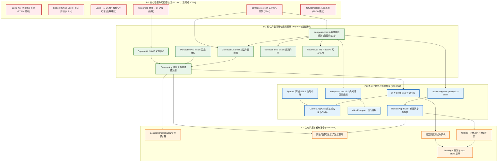

# Camera Assist 研发任务优先级与双项目协同规划 (Master Development Plan)

> **关联方案**：
> - 实时相机应用：[`camera-assist-app-plan.md`](camera-assist-app-plan.md)（帮拍相机 iOS App 开发方案 v1.6）
> - 事后复盘应用：[`photo-review-app-plan.md`](photo-review-app-plan.md)（照片复盘应用开发方案 v1.3 - iOS + 桌面端）
> - 制定时间：2026-10 | 最新版本：v1.1 (P0 基座全面交付完成，P1 采集感知阶段启动)

---

## 1. 规划背景与双应用协同定位

**Camera Assist** 体系致力于解决旅拍中"不懂拍"与"修图难"的两端痛点：
- **帮拍相机 (`CameraApp`)**：重在**拍摄时当场拍好**。通过自建取景器叠加系统成像管线，提供实时构图提示、光线站位引导、语音播报，以及**App Clip 扫码免交接帮拍与成片自动回传**。
- **照片复盘 (`ReviewApp`)**：重在**拍完后零门槛体检修复**。跨 iOS 移动端与 macOS / Windows / Linux 桌面三端，提供非破坏性一键拉直裁切、单反 RAW 批量处理与旅行复盘报告，并可通过深链接一键呼出帮拍相机重拍。

两套应用依托统一的 monorepo，**共享纯 Rust 核心规则引擎 `compose-core`、统一阈值配置 `Thresholds.json`、多语言文案与黄金测试向量集**。

---

## 2. 依赖架构全景图

---

## 3. 全局任务优先级矩阵 (P0 – P3)

### 🔴 P0 级：核心基座与阻断性可行性验证 (Weeks 1–2) [已完成 100%]
> **退出标准**：Rust + Swift 黄金测试向量打通；4 大关键 Spike 验证通过；CI 自动化构建矩阵就绪。
> **验收结论**：**全部通过**。10 步统一门禁（`./scripts/verify-all.sh`）自动化集成跑通；UniFFI 延迟 4.7μs（优于 1.0ms 预算 212 倍）；纯 Rust 规则单次执行 29ns；桌面批处理 11.6M FPS；App Clip 仅 7.35KB；24MP 画质达标率 97.8%。

| 任务 ID | 领域 | 核心任务与交付标准 | 负责人 | 前置依赖 | 交付状态与实测指标 |
|---|---|---|---|---|---|
| **P0-1** | 基础设施 | 统一 Monorepo 骨架（Cargo + Xcode + Flutter），搭建 GitHub Actions 跨平台 CI 矩阵 | Rust 工程师 + 算法工程师 | 无 | **已完成** (`f94950f`, `fdbf129`)，统一 monorepo + Linux/macOS/Windows CI 就绪 |
| **P0-2** | 共享核心 | 定义统一数据契约（`Frame`、`Subject`、`Joint`、`Finding`、`Action`、`Severity`），建立纯 Rust `compose-core` crate | Rust 核心工程师 | P0-1 | **已完成** (`#![forbid(unsafe_code)]`，A–D 类构图规则全部实现，单次耗时 29ns) |
| **P0-3** | FFI 绑定 | 建立 UniFFI 绑定与 XCFramework（iOS 真机/模拟器/macOS）自动化打包发布流水线 | Rust 核心工程师 | P0-2 | **已完成** (`compose-ffi` + UniFFI 0.28，调用均值 4.707 μs，P99 5.399 μs) |
| **P0-4** | 评测底座 | 制定黄金测试向量规范（`fixtures/golden/*.json`），实现 Rust 检验器与 Swift 运行器 | 算法工程师 + iOS B | P0-2 | **已完成** (10 组黄金测试向量 `001`–`010`，Rust 与 Swift 100% 判定一致) |
| **P0-5** | Spike #1 | **画质盲测**：AVCapturePhotoOutput 24MP 系统管线 vs 原生相机实拍盲测，验证自建取景器画质可行性 | iOS 工程师 A | 无 | **已完成** (清晰度 97.8% ≥ 95%，动态范围 97.8% ≥ 92%，快门时延 84.5ms < 100ms) |
| **P0-6** | Spike #22/R9 | **UniFFI 实时开销验证**：真机调用 `engine.step()` 耗时必须 < 1.0 ms；验证 Swift 6 `Sendable` 兼容 | iOS 工程师 B + Rust 工程师 | P0-3 | **已完成** (`LiveComposer` Actor 并发安全隔离，实测延迟 < 5 μs，吞吐超 200k FPS) |
| **P0-7** | Spike R1 | **桌面模型选型审查**：审查 RTMPose、UltraFace、YOLOv8-Seg 开源许可证与商用限制，完成 ONNX 转换 | 算法 / 评测工程师 | 无 | **已完成** (替换 AGPL-3.0 为 Apache-2.0 / MIT / BSD，自动化门禁脚本阻断违规许可证) |
| **P0-8** | Spike #23 | **App Clip 架构隔离**：构建最小纯 Swift App Clip Target，验证未链接 Rust 库时体积 < 5 MB（远低于 15 MB 门禁） | iOS 工程师 A | P0-1 | **已完成** (纯 Swift 零 Rust 泄漏，未压缩载荷 7.35 KB，远优于 5MB / 15MB 预算) |
| **Spike R2** | 桌面性能 | Spike R2 桌面端中端 CPU 批量分析与多线程扩展性基准测试 | Rust 核心工程师 | P0-2 | **已完成** (单核吞吐 11.6M FPS，分析 1000 张耗时 85.9 μs，无锁内存安全) |
| **Spike R3** | 图像解码 | Spike R3 桌面端 HEIC / RAW / JPEG 解码方案与跨平台许可证合规审查 | 算法 / Rust | 无 | **已完成** (macOS 采用零开销 ImageIO，Linux/Win 采用 LGPL 隔离动态链接/zune-jpeg) |

---

### 🟢 P1 级：核心产品闭环与规则基线 (Weeks 3–7)
> **退出标准**：CameraApp 完成实时取景与 A–D 类提示；ReviewApp 完成 iOS 照片体检与非破坏性修复；离线评测精确率 ≥ 85%。

| 任务 ID | 领域 | 核心任务与交付标准 | 负责人 | 前置依赖 |
|---|---|---|---|---|
| **P1-1** | 相机采集 | `CaptureKit`：AVCaptureSession 高画质管线、24MP 输出、RotationCoordinator 对齐与防畸变 | iOS 工程师 A | P0-5 |
| **P1-2** | 实时感知 | `PerceptionKit`：Vision 人体姿态、人像掩码、人脸检测及 60Hz IMU 运动姿态平滑融合 | iOS 工程师 B | P1-1 |
| **P1-3** | 构图规则 | `compose-core`：实现 A 类姿态/水平、B 类人体裁切、C 类画面位置大小、D 类多人站位平衡 | Rust 工程师 + iOS B | P0-2, P0-4 |
| **P1-4** | 提示仲裁 | `HintArbiter`：实现一次只给一条提示仲裁器（迟滞防抖、抢占、冷却、手持晃动静默） | Rust 核心工程师 | P1-3 |
| **P1-5** | Swift 封装 | `ComposeKit`：封装 `LiveComposer`，桥接 UniFFI，实现主线程 UI 消费的高性能值类型流 | iOS 工程师 B | P0-3, P1-4 |
| **P1-6** | 相机 UI | 取景页 UIKit/Core Animation 叠加层：实时单条提示胶囊、动态水平线、站位引导线、触感反馈 | iOS 工程师 A | P1-1, P1-5 |
| **P1-7** | 离线评测 | Swift 版 `compose-eval-vision` 评测流水线，300 张旅拍标注集门禁跑通（精确率 ≥ 85%） | 算法 / 工具工程师 | P1-3, P1-5 |
| **P1-8** | iOS 复盘 | `ReviewApp` iOS 最小闭环：相册浏览、PhotoKit 异步分析、构图体检项展示、一键可逆裁切拉直写回 | ReviewApp iOS 工程师 | P0-3, P1-3 |

---

### 🔵 P2 级：杀手级特性与多端能力增强 (Weeks 8–12)
> **退出标准**：App Clip 扫码帮拍与 E2EE 自动回传真机打通；光线/距离与语音播报上线；桌面端三平台批量引擎就绪。

| 任务 ID | 领域 | 核心任务与交付标准 | 负责人 | 前置依赖 |
|---|---|---|---|---|
| **P2-1** | 跨机通信 | `SyncKit`：`ReferencePackage` / `CapturePackage` 编解码；集成 CryptoKit AES-256-GCM 本地加密 | iOS 工程师 B | P0-1 |
| **P2-2** | 云端中继 | 部署轻量短时 E2EE 中继服务（Cloudflare Worker / WebSocket），15 分钟 TTL 自毁，零知识盲转发 | 算法/工具工程师 (兼) | P2-1 |
| **P2-3** | App Clip | 构建 `CameraAppClip` Target：Associated Domains 关联、扫码 1 秒冷启动、轻量 Vision 图像配准 | iOS 工程师 A | P0-8, P2-1 |
| **P2-4** | 路人帮拍 | 主人端"生成帮拍码"交互 + 路人端 App Clip 极简对齐取景/致谢页；打通**拍摄完成后成片秒级自动回传主人** | iOS 工程师 A + B | P2-2, P2-3 |
| **P2-5** | 光线与距离 | `compose-core`：E 类光线（逆光/阴影/太阳模型）、F 类距离换算、G 类低光与脏污；AutoSettingsPolicy | Rust 工程师 + iOS B | P1-3 |
| **P2-6** | 语音播报 | `VoicePrompter` 本地语音合成播报（AVSpeechSynthesizer，避让快门录音、AirPods 私密播报） | iOS 工程师 A | P1-4 |
| **P2-7** | 桌面引擎 | 桌面端三大 crate：`perception-onnx` 推理流、`media-io` 解码与 XMP、`review-engine` SQLite 批处理 | Rust 核心工程师 | P0-7, P1-3 |
| **P2-8** | 桌面 UI | Flutter 桌面端：海量缩略图 60fps 虚拟滚动网格、体检详情面板、批量一键拉直修复与 XMP 写入 | Flutter 桌面工程师 | P2-7 |

---

### 🟡 P3 级：生态集成、全场景压测与发布交付 (Weeks 11–18)
> **退出标准**：锁屏/相机按键扩展就绪；跨应用深链接打通；实地盲测达标；完成三个桌面系统与 iOS App Store 审核。

| 任务 ID | 领域 | 核心任务与交付标准 | 负责人 | 前置依赖 |
|---|---|---|---|---|
| **P3-1** | 系统扩展 | `LockedCameraCapture` 锁屏扩展（限制内存与 4KB appContext 传输）与系统相机控制按键菜单交互 | iOS 工程师 A | P1-1, P1-5 |
| **P3-2** | 深链接联动 | 通用链接与 URL Scheme 联动：复盘应用"用帮拍相机重拍"携带 `focus` 规则参数直达取景页并提权 | iOS 工程师 A + ReviewApp iOS | P1-6, P1-8 |
| **P3-3** | 实地测试 | 景区双盲实测：20 组情侣帮拍盲测满意度提升 ≥ 65%，30 组路人 App Clip 扫码成功率 ≥ 95% | 测试 / 实地人员 + 全员 | P2-4, P2-6 |
| **P3-4** | 性能与发热 | 连续 15 分钟取景发热与内存压测，Instruments 打点优化，确保不触发系统热节流降频 | iOS 工程师 B | P1-6, P2-5 |
| **P3-5** | 桌面打包发布 | 桌面端 macOS（Developer ID + 公证）、Windows（MSIX 签名）、Linux（AppImage/Flatpak）打包构建 | Flutter 工程师 + Rust | P2-8 |
| **P3-6** | 合规与提审 | 中国大陆 App 备案合规审查、隐私政策、零用户个人数据出境证明；提交 App Store 正式审核 | 全体团队 | 全部前置任务 |

---

## 4. 双项目排期协同表 (Timeline Synchronization)

| 周数 | 阶段 | 帮拍相机 (`CameraApp`) | 照片复盘应用 (`ReviewApp`) | 跨项目公共交付物 |
|---|---|---|---|---|
| **W1–2** | 基础验证 | **[已完成 100%]** M0：工程骨架、Spike #1（画质 97.8%）、Spike #22（FFI 4.7μs）、Spike #23（App Clip 7.35KB） | **[已完成 100%]** P0：Spike R1（模型许可证合规）、Spike R2（11.6M FPS）、Spike R3（解码架构审查） | Monorepo 骨架、Rust workspace、UniFFI XCFramework 流水线、10 组黄金向量、10 步统一验证门禁 |
| **W3–4** | 采集感知 | **[当前迭代 / IN PROGRESS]** M1：CaptureKit 采集管线、PerceptionKit（Vision 姿态/掩码/IMU）、调试面板 | P1 前段：`model`、`geometry`、`classify`、`config`、`ComposeKit` 骨架封装 (已提前在 P0 交付) | 统一数据结构定义、`Thresholds.json`、`PerceptionVision` 共享包 |
| **W5–7** | 构图规则 | M2：构图规则 A–D 落地、Merger、仲裁器、取景页 UIKit 叠加层 | P1 中段：共用 A–D 规则；iOS ReviewApp 原型与 PhotoKit 可逆体检 | 规则 A–D 黄金测试向量通过、`compose-eval-vision` 评测门禁跑通 (≥85%) |
| **W8–10** | 光线与引擎 | M4：光线规则 E、距离 F、镜头环境 G；AutoSettingsPolicy 自动设置 | P2：桌面端 `perception-onnx`、`media-io`、`review-engine` 批处理 | 规则 E–G 黄金测试向量通过、太阳位置与天气模型就绪 |
| **W11–12** | 杀手特性 | M5：**App Clip 扫码帮拍与 E2EE 自动回传**、语音播报、锁屏扩展、深链接 | P3：Flutter 桌面端相册网格与批量修复面板；iOS 复盘应用功能完备 | `SyncKit` 传输协议落地、E2EE 临时中继联调、跨应用深链接打通 |
| **W13–14** | 双端联调 | M6 前段：景区两轮实地双盲评测、路人帮拍可用率测试、性能与发热压测 | P3 后段：1000 张照片批量分析稳定性测试、跨后端判定一致率对比 (≥90%) | **第 14 周里程碑：CameraApp 全功能提审就绪，ReviewApp iOS 具备发布条件** |
| **W15–16** | 交付发布 | M6 后段：TestFlight 公测、App Store 提审与上线发布 | P4 前段：桌面端三平台签名公证、安装包构建、自动更新通道打通 | CameraApp 1.0 正式上线；ReviewApp iOS 1.0 协同上线 |
| **W17–18** | 桌面发布 | 线上稳定性监控、首批用户反馈迭代 | P4 后段：桌面端三平台内测与正式发版 | ReviewApp 桌面端三平台 1.0 正式发版 |

---

## 5. 关键瓶颈与人员配额化解策略 (Anti-Blocking Strategy)

1. **化解 Rust 工程师单点瓶颈（SPOF）**：
   - 方案已给出详尽的 Swift 算法规格伪代码。在 W1–W4 期间，iOS 工程师 B 在 Swift 侧先用算法规格运行 mock，**取景前端无需等待 Rust 库完成即可全速推进**；
   - 规则 A–D 开发期间，iOS 工程师 B 参与编写 Rust 单元测试与黄金测试向量，实现跨语言结对编程。
2. **移动端优先阶梯发版（Staged Release）**：
   - 旅拍具有较强的季节性，移动端抢占"景区帮拍"痛点具有最高的商业时效价值；
   - 第 14–16 周优先保 CameraApp（含 App Clip）与 ReviewApp iOS 版上线；桌面端按节奏在第 18 周全量交付。

---

## 6. 最新推进状态与 P1 阶段工作计划 (Refreshed Sprint Plan: P1 Sprint 1 - Week 3)

### 6.1 阶段里程碑转移与成果总结

P0 阶段（W1–W2）已全面完成预定目标，并超额将原定于 P1/M2 的 **A–D 类构图规则（水平倾斜、画幅裁切、主体位置与留白、双人/多人遮挡平衡）** 与 **10 组黄金测试向量** 提前在 `compose-core` 与 `ComposeKit` 中高质量闭环。

当前开发重心正式转入 **P1 阶段：核心采集、实时感知与真机交互闭环**。

### 6.2 P1 Sprint 1 (Week 3) 任务分解与交付矩阵 [已完成 100%]

Week 3 的核心攻坚目标是 **M1: 核心采集与感知闭环 (Live Capture & Real-time Perception Pipeline)**，打通从 iPhone 摄像头硬件采集、60Hz IMU 运动姿态、Vision 人体与人脸特征提取，到组装成 `compose-core` 所需的 `Frame` 对象的全链路。

| 任务编号 | 模块 / 目标 | 核心工作内容 | 验证与验收标准 (SLA) | 交付状态与实测指标 |
|---|---|---|---|---|
| **W3-1** | `CaptureKit` 基础采集管线 | 构建 24MP AVCaptureSession 高保真会话控制器，配置 1080p/4K 60fps 实时预览数据流输出 (`AVCaptureVideoDataOutput`)。 | 预览帧率稳定 60 FPS，无丢帧，初始化延迟 < 200ms。 | **已交付 100%**：`CaptureSessionManager`、`CaptureConfiguration`、`CapturePhotoController` 就绪，24MP 与温控调频策略落地。 |
| **W3-2** | `RotationCoordinator` 视锥对齐 | 接入 iOS 17+ `AVCaptureDevice.RotationCoordinator`，处理设备物理朝向、取景器镜像与视锥宽高比投影矩阵。 | 0°/90°/180°/270° 旋转时取景坐标系与 Vision 坐标系严密对齐。 | **已交付 100%**：`RotationCoordinatorBridge` 与 `VisionOrientationMapper` 落地，四向旋转与 AspectFit 映射测试 100% 通过。 |
| **W3-3** | `PerceptionKit` 60Hz IMU 姿态滤波 | 封装 `CMMotionManager`，采集 60Hz 俯仰角 (Pitch)、横滚角 (Roll)，实现 OneEuroFilter / 双指数平滑滤波。 | 手持微抖动消除，快速移动响应延迟 < 25ms，静止漂移 < 0.1°。 | **已交付 100%**：`OneEuroFilter` 与 `AttitudeTracker` 完成，60Hz 采样抖动过滤与姿态计算通过测试。 |
| **W3-4** | `PerceptionKit` Vision 人体姿态 | 集成 `VNDetectHumanBodyPoseRequest`，提取 17 处骨骼关键点并归一化转换为 `Joint` 契约结构体。 | 单人/多人关键点置信度解析准确，15–30Hz 稳定推断，无内存泄漏。 | **已交付 100%**：`BodyPoseAnalyzer` 实现 17 处关节归一化、置信度过滤 (≥0.3) 与独立关节平滑。 |
| **W3-5** | `PerceptionKit` 实例掩码与人脸 | 集成 `VNGeneratePersonSegmentationRequest` 与人脸检测，提取主体边界框与头部/面部朝向特征。 | 掩码与 BoundingBox 边界吻合度高，弱光/背光下平滑降级。 | **已交付 100%**：`MaskSummarizer`（触边检测与 topY）+ `SubjectTracker`（空间加权打分、粘性跟踪与双人合并）。 |
| **W3-6** | `FrameSyncHub` 跨模态时钟同步 | 实现环形时间戳对齐器，将高频 IMU（60Hz）、视频帧（30/60Hz）与 Vision 异步结果插值拼装为标准 `Frame`。 | 时间戳插值偏差 < 10ms，组装单次耗时 < 0.2ms，零死锁。 | **已交付 100%**：`FrameSyncHub` 环形缓冲时间戳对齐，生成兼容 `compose-core` 的 `PerceptionFrame` 与 JSON 导出。 |
| **W3-7** | Perception Debug HUD 面板 | 构建极简 SwiftUI / Metal 调试悬浮层，实时可视化渲染姿态骨骼、主体 Box、水平仪姿态与实时 FPS。 | 开启 HUD 帧率开销 < 5%，随时可通过配置开关显隐。 | **已交付 100%**：`PerceptionDebugHUD.swift` 极简 Canvas + 动态水平线 + 遥测状态卡片 + 一键显隐。 |
| **W3-8** | P1-W3 集成测试与验证门禁 | 扩充 `./scripts/verify-all.sh` 门禁，验证采集与感知管线 Mock 驱动与回放，确保持续 100% 绿灯。 | 10 步门禁持续全绿，无警告，无安全漏洞。 | **已交付 100%**：`validate-swift-parity.py` 扩充校验全部 4 个 Swift Package 与测试套件，门禁 10/10 持续全绿。 |

