# Camera Assist 研发任务优先级与双项目协同规划 (Master Development Plan)

> **关联方案**：
> - 实时相机应用：[`camera-assist-app-plan.md`](camera-assist-app-plan.md)（帮拍相机 iOS App 开发方案 v1.7）
> - 事后复盘应用：[`photo-review-app-plan.md`](photo-review-app-plan.md)（照片复盘应用开发方案 v1.3 - iOS + 桌面端）
> - 制定时间：2026-10 | 最新版本：v1.3 (2026-11-03 同步 TASK-02/04/06/10 完成状态)【原 v1.1 表述“P0 基座全面交付完成，P1 采集感知阶段启动”经审计与专项攻坚后，P0/P0.5 基础门禁已全面加固，规则、采集、跨机通信核心模块已实装交付】
> - **执行顺序权威**：本文档是执行顺序的唯一权威，与其它文档冲突时以本文档为准。
> - **状态图例**：已完成 / 部分完成 / 未开始 / 阻塞。判定规则：只有真机数据或真实 Rust 引擎验证过的才算“已完成”，合成自测、mock、源码字节统计只能算“部分完成”。

---

## 1. 规划背景与双应用协同定位

**Camera Assist** 体系致力于解决旅拍中"不懂拍"与"修图难"的两端痛点：
- **帮拍相机 (`CameraApp`)**：重在**拍摄时当场拍好**。通过自建取景器叠加系统成像管线，提供实时构图提示、光线站位引导、语音播报，以及**App Clip 扫码免交接帮拍与成片自动回传**。
- **照片复盘 (`ReviewApp`)**：重在**拍完后零门槛体检修复**。跨 iOS 移动端与 macOS / Windows / Linux 桌面三端，提供非破坏性一键拉直裁切、单反 RAW 批量处理与旅行复盘报告，并可通过深链接一键呼出帮拍相机重拍。

两套应用依托统一的 monorepo，**共享纯 Rust 核心规则引擎 `compose-core`、统一阈值配置 `Thresholds.json`、多语言文案与黄金测试向量集**。

---

## 2. 依赖架构全景图

```mermaid
graph TD
    classDef p0 fill:#ffebee,stroke:#c62828,stroke-width:2px;
    classDef p1 fill:#e8f5e9,stroke:#2e7d32,stroke-width:2px;
    classDef p2 fill:#e3f2fd,stroke:#1565c0,stroke-width:2px;
    classDef p3 fill:#fff3e0,stroke:#ef6c00,stroke-width:2px;

    subgraph Phase0["P0: 核心基座与可行性验证 (W1-W2) [名义完成 / 实际部分完成]"]
        Spike1["Spike #1: 相机画质盲测 (仅合成自测, 无真机数据)"]:::p0
        Spike22["Spike #22/R9: UniFFI 开销 (桌面微基准 4.7μs, 真机未验)"]:::p0
        SpikeR1["Spike R1: ONNX 选型与许可证 (许可证已审 / 转换未验)"]:::p0
        RepoInit["Monorepo 骨架与 CI 矩阵 (脚本可运行)"]:::p0
        CoreContract["compose-core 数据契约与骨架 (29ns 微基准)"]:::p0
        GoldenInit["fixtures/golden 13 组 (断言偏松 >=10)"]:::p0
    end

    subgraph Phase05["P0.5: 门禁与 FFI 链接加固"]
        TASK01["TASK-01: ComposeKit 链接 libcompose_ffi.a, 禁止静默 mock"]:::p1
        TASK02["TASK-02: 替换自证式门禁 (精确断言 / 量真实产物)"]:::p1
        TASK03["TASK-03: 修 multi.unbalanced 排序与 placement.center_tol 硬编码"]:::p1
    end

    subgraph Phase1["P1: 核心产品闭环与规则基线 (W3-W7) [部分交付]"]
        CaptureKit["CaptureKit: 24MP 采集管线 (帧回调丢弃 CVPixelBuffer)"]:::p1
        PerceptionKit["PerceptionKit: Vision 未真正执行 (仅解析关键点)"]:::p1
        RulesAD["compose-core: A-D 规则 (12 条已实现 / E-G 未开始)"]:::p1
        ComposeKit["ComposeKit: Swift 封装 (未链接静态库, mock 兜底)"]:::p1
        CameraUI["CameraApp 取景页 (占位, 端到端未接线)"]:::p1
        EvalVision["compose-eval-vision 评测门禁 (未开始)"]:::p1
        ReviewKit["ReviewApp iOS PhotoKit 可逆体检 (未开始)"]:::p1
    end

    subgraph Phase2["P2: 差异化特色与体验增强 (W8-W12)"]
        SyncKit["SyncKit: 跨机 E2EE 临时中继 (仅数据模型)"]:::p2
        AppClipTarget["CameraAppClip: 源码 7.35 KB (非编译产物)"]:::p2
        StrangerUI["路人帮拍扫码与双向引导 (未开始)"]:::p2
        LightOptics["compose-core: E-G 类光线距离规则 (未开始)"]:::p2
        VoicePrompt["VoicePrompter: 语音播报 (未开始)"]:::p2
        DesktopEngine["review-engine + perception-onnx (未开始)"]:::p2
        FlutterUI["ReviewApp Flutter 桌面网格与报告 (未开始)"]:::p2
    end

    subgraph Phase3["P3: 生态扩展与发布准备 (W11-W18)"]
        LockedExt["LockedCameraCapture 锁屏扩展 (未开始)"]:::p3
        DeepLink["跨应用通用链接/深链接联动 (未开始)"]:::p3
        FieldTest["景区双盲测试与调优 (未开始)"]:::p3
        DesktopPkg["桌面端三平台签名与自动更新 (未开始)"]:::p3
        AppStoreAudit["TestFlight 外测与 App Store 提审 (未开始)"]:::p3
    end

    %% Dependencies
    CoreContract --> RulesAD
    RepoInit --> CaptureKit
    CoreContract --> ComposeKit
    RulesAD --> ComposeKit
    CaptureKit --> CameraUI
    PerceptionKit --> CameraUI
    ComposeKit --> CameraUI
    RulesAD --> EvalVision
    RulesAD --> ReviewKit

    %% P0.5 gating edges
    TASK01 --> ComposeKit
    TASK02 --> TASK01
    TASK03 --> RulesAD

    CameraUI --> StrangerUI
    SyncKit --> AppClipTarget
    StrangerUI --> AppClipTarget
    RulesAD --> LightOptics
    LightOptics --> VoicePrompt
    RulesAD --> DesktopEngine
    DesktopEngine --> FlutterUI

    CameraUI --> LockedExt
    CameraUI --> DeepLink
    FlutterUI --> DeepLink
    StrangerUI --> FieldTest
    FlutterUI --> DesktopPkg
    FieldTest --> AppStoreAudit
    DesktopPkg --> AppStoreAudit
```

---

## 3. 全局任务优先级矩阵 (P0 – P3)

### 🔴 P0 级：核心基座与阻断性可行性验证 (Weeks 1–2) [名义完成 / 实际部分完成]
> **退出标准**：Rust + Swift 黄金测试向量打通；4 大关键 Spike 验证通过；CI 自动化构建矩阵就绪。
> **验收结论（修订）**：10 步统一门禁（`./scripts/verify-all.sh`）脚本可运行，但多项为自断言，尚不构成验收证据；原 v1.1 的「全部通过」表述已被审计推翻（见第 7 节）。具体限定：UniFFI 延迟 4.7μs 为桌面侧微基准（iOS 真机未测）；纯 Rust 规则单次 29ns 为微基准；桌面批处理 11.6M FPS 为合成输入；App Clip 7.35 KB 为**源码字节统计**（脚本跳过 `xtool/`），非编译产物；24MP 画质 97.8% 与快门时延 84.5ms 均为脚本硬编码的**合成自测**（`scripts/evaluate-capture-quality.py:19-53`），无真机盲测数据。

| 任务 ID | 领域 | 核心任务与交付标准 | 负责人 | 前置依赖 | 当前真实状态 |
|---|---|---|---|---|---|
| **P0-1** | 基础设施 | 统一 Monorepo 骨架（Cargo + Xcode + Flutter），搭建 GitHub Actions 跨平台 CI 矩阵 | Rust 工程师 + 算法工程师 | 无 | **已完成** (`f94950f`, `fdbf129`)，统一 monorepo + Linux/macOS/Windows CI 就绪 |
| **P0-2** | 共享核心 | 定义统一数据契约（`Frame`、`Subject`、`Joint`、`Finding`、`Action`、`Severity`），建立纯 Rust `compose-core` crate | Rust 核心工程师 | P0-1 | **已完成**（A–G 共 19 条规则全量实现，见 TASK-04）。`#![forbid(unsafe_code)]`，单次 29ns 为微基准 |
| **P0-3** | FFI 绑定 | 建立 UniFFI 绑定与 XCFramework（iOS 真机/模拟器/macOS）自动化打包发布流水线 | Rust 核心工程师 | P0-2 | **部分完成**（TASK-01 已修复声明）：已声明 `.binaryTarget` 链接 `ComposeCore.xcframework` 并禁止静默 mock；下一步随 TASK-05 扩展 FFI 契约 |
| **P0-4** | 评测底座 | 制定黄金测试向量规范（`fixtures/golden/*.json`），实现 Rust 检验器与 Swift 运行器 | 算法工程师 + iOS B | P0-2 | **已完成（TASK-02 / TASK-04）**：全量 20 组（`001`–`020`）黄金测试向量；Rust `golden_runner.rs` 精确校验 finding 集合与数量（`== 20`）；Swift 模式校验器 `validate-swift-parity.py` 20 组全绿并通过字段级 Schema 比对 |
| **P0-5** | Spike #1 | **画质盲测**：AVCapturePhotoOutput 24MP 系统管线 vs 原生相机实拍盲测，验证自建取景器画质可行性 | iOS 工程师 A | 无 | **已规范（TASK-02）**：无真实拍摄输入时门禁显式标注 `[SYNTHETIC_SELF_TEST]`，消除自证虚假 SLA；真机盲测待实机测试套件采集 |
| **P0-6** | Spike #22/R9 | **UniFFI 实时开销验证**：真机调用 `engine.step()` 耗时必须 < 1.0 ms；验证 Swift 6 `Sendable` 兼容 | iOS 工程师 B + Rust 工程师 | P0-3 | **部分完成**（真机未验证）：4.7μs（P99 5.399μs）为桌面侧 FFI 微基准；`Sendable` 隔离代码存在，未在 iOS 真机测量 |
| **P0-7** | Spike R1 | **桌面模型选型审查**：审查 RTMPose、UltraFace、YOLOv8-Seg 开源许可证与商用限制，完成 ONNX 转换 | 算法 / 评测工程师 | 无 | **部分完成**：许可证审查已做（AGPL-3.0 → Apache-2.0 / MIT / BSD，门禁脚本可阻断违规）；ONNX 转换未验证 |
| **P0-8** | Spike #23 | **App Clip 架构隔离**：构建最小纯 Swift App Clip Target，验证未链接 Rust 库时体积 < 5 MB（远低于 15 MB 门禁） | iOS 工程师 A | P0-1 | **已完成（TASK-02 / TASK-10）**：零 Rust/UniFFI 令牌扫描生效；`check-appclip-size.py` 优先测量真实 compiled `.app` bundle 体积并阻断超 15MB 违规（无产物时回退源码并显式告警）；`SyncKit` 纯 Swift 零 Rust 泄漏 |
| **Spike R2** | 桌面性能 | Spike R2 桌面端中端 CPU 批量分析与多线程扩展性基准测试 | Rust 核心工程师 | P0-2 | **部分完成**（静态自测）：11.6M FPS / 1000 张 85.9μs 为合成输入微基准，未跑真实照片集 |
| **Spike R3** | 图像解码 | Spike R3 桌面端 HEIC / RAW / JPEG 解码方案与跨平台许可证合规审查 | 算法 / Rust | 无 | **部分完成**（静态自测）：解码选型与许可证结论有代码/文档依据，无真实 HEIC/RAW 批量验证 |

---

### 🟢 P1 级：核心产品闭环与规则基线 (Weeks 3–7)
> **退出标准**：CameraApp 完成实时取景与 A–D 类提示；ReviewApp 完成 iOS 照片体检与非破坏性修复；离线评测精确率 ≥ 85%。

| 任务 ID | 领域 | 核心任务与交付标准 | 负责人 | 前置依赖 | 当前真实状态 |
|---|---|---|---|---|---|
| **P1-1** | 相机采集 | `CaptureKit`：AVCaptureSession 高画质管线、24MP 输出、RotationCoordinator 对齐与防畸变 | iOS 工程师 A | P0-5 | **已完成（TASK-06，2026-11-03）**：24MP 采集管线重构；`CVPixelBuffer` 与 EXIF/相机内参/曝光元数据完整透传；`RotationCoordinatorBridge` 接入真实 KVO 监听并做设备物理朝向对齐与旋转归一化；系统热状态监听自动执行 60→30fps 平滑节流并在降温后恢复；并发与 Sendable 隔离安全 |
| **P1-2** | 实时感知 | `PerceptionKit`：Vision 人体姿态、人像掩码、人脸检测及 60Hz IMU 运动姿态平滑融合 | iOS 工程师 B | P1-1 | **部分完成（下一步 TASK-07）**：`OneEuroFilter` 与 `AttitudeTracker` 已就绪；待接入 TASK-06 透出的像素与元数据，执行真实 Vision 推理与时钟运动插值 |
| **P1-3** | 构图规则 | `compose-core`：实现 A 类姿态/水平、B 类人体裁切、C 类画面位置大小、D 类多人站位平衡 | Rust 工程师 + iOS B | P0-2, P0-4 | **已完成（TASK-03，TASK-04，2026-11-03）**：A–G 核心规则已在 `compose-core` 落地（共 19 条规则；暂缓项：`light.sun_in_frame`、`lens.smudge`、`distance.fill_range`）；`multi.unbalanced` 排序与 `placement.center_tol` 硬编码已由 TASK-03 修复；HFOV 范围安全与相冲突焦段建议去重在 Merger 闭环 |
| **P1-4** | 提示仲裁 | `HintArbiter`：实现一次只给一条提示仲裁器（迟滞防抖、抢占、冷却、手持晃动静默） | Rust 核心工程师 | P1-3 | **已完成（TASK-04，2026-11-03）**：已实现按规则进入延迟覆盖 `enterDelayOverride`（支持精确匹配与 glob 前缀），全量迟滞/冷却/静默/提权机制已闭环 |
| **P1-5** | Swift 封装 | `ComposeKit`：封装 `LiveComposer`，桥接 UniFFI，实现主线程 UI 消费的高性能值类型流 | iOS 工程师 B | P0-3, P1-4 | **部分完成（下一步 TASK-05）**：TASK-01 已声明 `.binaryTarget` 链接 `ComposeCore.xcframework` 并移除静默 mock；待根据 TASK-04 规则扩展 FFI 契约、输出 severity/完整 action/target 与数值提示 |
| **P1-6** | 相机 UI | 取景页 UIKit/Core Animation 叠加层：实时单条提示胶囊、动态水平线、站位引导线、触感反馈 | iOS 工程师 A | P1-1, P1-5 | **未开始**（TASK-09）；现仅有调试用 `PerceptionDebugHUD` |
| **P1-7** | 离线评测 | Swift 版 `compose-eval-vision` 评测流水线，300 张旅拍标注集门禁跑通（精确率 ≥ 85%） | 算法 / 工具工程师 | P1-3, P1-5 | **未开始** |
| **P1-8** | iOS 复盘 | `ReviewApp` iOS 最小闭环：相册浏览、PhotoKit 异步分析、构图体检项展示、一键可逆裁切拉直写回 | ReviewApp iOS 工程师 | P0-3, P1-3 | **未开始** |

---

### 🔵 P2 级：杀手级特性与多端能力增强 (Weeks 8–12)
> **退出标准**：App Clip 扫码帮拍与 E2EE 自动回传真机打通；光线/距离与语音播报上线；桌面端三平台批量引擎就绪。

| 任务 ID | 领域 | 核心任务与交付标准 | 负责人 | 前置依赖 | 当前真实状态 |
|---|---|---|---|---|---|
| **P2-1** | 跨机通信 | `SyncKit`：`ReferencePackage` / `CapturePackage` 编解码；集成 CryptoKit AES-256-GCM 本地加密 | iOS 工程师 B | P0-1 | **已完成（TASK-10，2026-11-03）**：`SyncKit` 100% 纯 Swift 实现（零 C/Rust 依赖）：Curve25519 + HKDF-SHA256 + AES-GCM 256 位 E2EE；`ReferencePackage`（含鬼影叠层）与 `CapturePackage` 编解码；会话令牌管理与二维码 payload；抽象 WebSocket 与 Bonjour 局域网传输层；17 项单元测试全部通过 |
| **P2-2** | 云端中继 | 部署轻量短时 E2EE 中继服务（Cloudflare Worker / WebSocket），15 分钟 TTL 自毁，零知识盲转发 | 算法/工具工程师 (兼) | P2-1 | **协议层就绪（随 TASK-10）**：`SyncKit` 传输层抽象已支持 WebSocket 中继接入，待服务部署实联 |
| **P2-3** | App Clip | 构建 `CameraAppClip` Target：Associated Domains 关联、扫码 1 秒冷启动、轻量 Vision 图像配准 | iOS 工程师 A | P0-8, P2-1 | **未开始**（TASK-11）；Target 仅骨架，体积由真实 `.app` 编译门禁严格管控 |
| **P2-4** | 路人帮拍 | 主人端"生成帮拍码"交互 + 路人端 App Clip 极简对齐取景/致谢页；打通**拍摄完成后成片秒级自动回传主人** | iOS 工程师 A + B | P2-2, P2-3 | **未开始**（TASK-11） |
| **P2-5** | 光线与距离 | `compose-core`：E 类光线（逆光/阴影/太阳模型）、F 类距离换算、G 类低光与脏污；AutoSettingsPolicy | Rust 工程师 + iOS B | P1-3 | **规则层已完成（TASK-04，2026-11-03）**：实现 E 类光线（`light.backlit`, `light.harsh_top`, `light.flat_front`, `light.side_harsh`）、F 类距离换算（`distance.distortion`, `distance.ultra_wide_edge`）、G 类低光（`light.low_light`）；规则层实际消费 `ctx.light`；AutoSettingsPolicy 待后续任务实现；暂缓规则：`light.sun_in_frame`, `lens.smudge`, `distance.fill_range` |
| **P2-6** | 语音播报 | `VoicePrompter` 本地语音合成播报（AVSpeechSynthesizer，避让快门录音、AirPods 私密播报） | iOS 工程师 A | P1-4 | **未开始**（TASK-12） |
| **P2-7** | 桌面引擎 | 桌面端三大 crate：`perception-onnx` 推理流、`media-io` 解码与 XMP、`review-engine` SQLite 批处理 | Rust 核心工程师 | P0-7, P1-3 | **未开始** |
| **P2-8** | 桌面 UI | Flutter 桌面端：海量缩略图 60fps 虚拟滚动网格、体检详情面板、批量一键拉直修复与 XMP 写入 | Flutter 桌面工程师 | P2-7 | **未开始** |

---

### 🟡 P3 级：生态集成、全场景压测与发布交付 (Weeks 11–18)
> **退出标准**：锁屏/相机按键扩展就绪；跨应用深链接打通；实地盲测达标；完成三个桌面系统与 iOS App Store 审核。

| 任务 ID | 领域 | 核心任务与交付标准 | 负责人 | 前置依赖 | 当前真实状态 |
|---|---|---|---|---|---|
| **P3-1** | 系统扩展 | `LockedCameraCapture` 锁屏扩展（限制内存与 4KB appContext 传输）与系统相机控制按键菜单交互 | iOS 工程师 A | P1-1, P1-5 | **未开始**（TASK-13 之后的发布链） |
| **P3-2** | 深链接联动 | 通用链接与 URL Scheme 联动：复盘应用"用帮拍相机重拍"携带 `focus` 规则参数直达取景页并提权 | iOS 工程师 A + ReviewApp iOS | P1-6, P1-8 | **未开始** |
| **P3-3** | 实地测试 | 景区双盲实测：20 组情侣帮拍盲测满意度提升 ≥ 65%，30 组路人 App Clip 扫码成功率 ≥ 95% | 测试 / 实地人员 + 全员 | P2-4, P2-6 | **未开始** |
| **P3-4** | 性能与发热 | 连续 15 分钟取景发热与内存压测，Instruments 打点优化，确保不触发系统热节流降频 | iOS 工程师 B | P1-6, P2-5 | **未开始** |
| **P3-5** | 桌面打包发布 | 桌面端 macOS（Developer ID + 公证）、Windows（MSIX 签名）、Linux（AppImage/Flatpak）打包构建 | Flutter 工程师 + Rust | P2-8 | **未开始** |
| **P3-6** | 合规与提审 | 中国大陆 App 备案合规审查、隐私政策、零用户个人数据出境证明；提交 App Store 正式审核 | 全体团队 | 全部前置任务 | **未开始** |

---

## 4. 双项目排期协同表 (Timeline Synchronization)

| 周数 | 阶段 | 帮拍相机 (`CameraApp`) | 照片复盘应用 (`ReviewApp`) | 跨项目公共交付物 |
|---|---|---|---|---|
| **W1–2** | 基础验证 | **[名义完成 / 实际部分完成]** M0：工程骨架、Spike #1（97.8% 为合成自测，无真机盲测）、Spike #22（桌面 FFI 微基准 4.7μs）、Spike #23（App Clip 源码 7.35 KB，非编译产物） | **[名义完成 / 实际部分完成]** P0：Spike R1（许可证合规，ONNX 转换未验证）、Spike R2（合成输入 11.6M FPS）、Spike R3（解码架构静态审查） | Monorepo 骨架、Rust workspace、UniFFI 打包流水线（Swift 侧尚未链接）、13 组黄金向量、10 步统一验证门禁（含自证项，见 TASK-02） |
| **W3–4** | 采集感知 | **[名义完成 / 实际部分完成]** M1：CaptureKit 采集管线、PerceptionKit（Vision 姿态/掩码/IMU）、调试面板 | P1 前段：`model`、`geometry`、`classify`、`config`、`ComposeKit` 骨架封装 (已提前在 P0 交付，但未链接静态库) | 统一数据结构定义、`Thresholds.json`、`PerceptionVision` 共享包 |
| **W5–7** | 构图规则 | M2：构图规则 A–D 落地、Merger、仲裁器、取景页 UIKit 叠加层 | P1 中段：共用 A–D 规则；iOS ReviewApp 原型与 PhotoKit 可逆体检 | 规则 A–D 黄金测试向量通过、`compose-eval-vision` 评测门禁跑通 (≥85%) |
| **W8–10** | 光线与引擎 | M4：光线规则 E、距离 F、镜头环境 G；AutoSettingsPolicy 自动设置 | P2：桌面端 `perception-onnx`、`media-io`、`review-engine` 批处理 | 规则 E–G 黄金测试向量通过、太阳位置与天气模型就绪 |
| **W11–12** | 杀手特性 | M5：**App Clip 扫码帮拍与 E2EE 自动回传**、语音播报、锁屏扩展、深链接 | P3：Flutter 桌面端相册网格与批量修复面板；iOS 复盘应用功能完备 | `SyncKit` 传输协议落地、E2EE 临时中继联调、跨应用深链接打通 |
| **W13–14** | 双端联调 | M6 前段：景区两轮实地双盲评测、路人帮拍可用率测试、性能与发热压测 | P3 后段：1000 张照片批量分析稳定性测试、跨后端判定一致率对比 (≥90%) | **第 14 周里程碑：CameraApp 全功能提审就绪，ReviewApp iOS 具备发布条件** |
| **W15–16** | 交付发布 | M6 后段：TestFlight 公测、App Store 提审与上线发布 | P4 前段：桌面端三平台签名公证、安装包构建、自动更新通道打通 | CameraApp 1.0 正式上线；ReviewApp iOS 1.0 协同上线 |
| **W17–18** | 桌面发布 | 线上稳定性监控、首批用户反馈迭代 | P4 后段：桌面端三平台内测与正式发版 | ReviewApp 桌面端三平台 1.0 正式发版 |

> **当前真实位置**：P0.5 门禁加固与核心基础模块攻坚已全面交付（TASK-01、TASK-02、TASK-03、TASK-04、TASK-06、TASK-10 均全绿）。Sprint 2 正在推进，当前优先执行 TASK-05（FFI 契约扩展与 Swift 重新绑定）、TASK-07（PerceptionKit 真实 Vision 推理与插值）以及 TASK-08（CameraApp 端到端接线）。

---

## 5. 关键瓶颈与人员配额化解策略 (Anti-Blocking Strategy)

1. **化解 Rust 工程师单点瓶颈（SPOF）**：
   - 方案已给出详尽的 Swift 算法规格伪代码。在 W1–W4 期间，iOS 工程师 B 可在 Swift 侧按算法规格搭本地原型，但 **mock 仅限本地原型，合并前必须切换真实引擎**（TASK-01 后缺 `ComposeCore.xcframework` 会编译失败，不再有静默 mock），不得以 mock 通过作为验收依据；
   - 规则 A–D 开发期间，iOS 工程师 B 参与编写 Rust 单元测试与黄金测试向量，实现跨语言结对编程。
2. **移动端优先阶梯发版（Staged Release）**：
   - 旅拍具有较强的季节性，移动端抢占"景区帮拍"痛点具有最高的商业时效价值；
   - 第 14–16 周优先保 CameraApp（含 App Clip）与 ReviewApp iOS 版上线；桌面端按节奏在第 18 周全量交付。

---

## 6. 最新推进状态与 P1 阶段工作计划 (Refreshed Sprint Plan: P1 Sprint 1 名义完成（部分交付） -> Sprint 2 Week 4)

### 6.1 阶段里程碑转移与深度加固总结

P0 阶段（W1–W2）与 P1 Sprint 1（W3）基础门禁与核心算法已全面完成加固与交付（逐项状态见第 3、6.2、7 节）：
- **跨语言数据契约对齐**：`PerceptionKit` (`PerceptionModels.swift`) 与 `compose-core` (`Frame`、`Subject`、`Joint`、`JointType` 19 骨骼点含 `Neck`/`Root`、`NormalizedRect`、`MaskSummary` 三段列跨度、`Posture` 含 `angular_speed`/`is_flatish`) 按同一 JSON 结构序列化，并由 `validate-swift-parity.py` 实施字段级结构体与 19-joint 枚举 Schema 深度校验（TASK-02）。
- **`compose-core` A–G 算法全面闭环（TASK-03 / TASK-04 已交付）**：
  - `classify.rs`：实现 `facing_yaw`、`classify_facing` 与带时间迟滞（`switch_hold = 0.4s`、`ankle_lost_hold = 0.5s`）的 `ShotClassifierState`。
  - A–G 类全套规则（19 条默认规则）：`TiltRule`（含平拍 `is_flatish` 豁免与退出迟滞）、`PitchRule`、`HeadCropRule`（掩码顶带与头区重叠校验 + 鼻颈几何回退）、`JointCropRule`（3 关节肢体链线段与画幅求交 + 缺失末端关节外推）、`FeetFloatingRule`（`feet.floating`）、`PlacementRule`、`HeadroomRule`、`LeadRoomRule`（`placement.lead_room`）、`ScaleRule`（`placement.scale`）、`EdgeCrowdRule`（`edge.crowd`）、多人规则（`multi.unbalanced` 排序由 TASK-03 修复）、光线规则（`light.backlit`、`light.harsh_top`、`light.flat_front`、`light.side_harsh`）、距离规则（`distance.distortion`、`distance.ultra_wide_edge`）与低光规则（`light.low_light`）。暂缓项记录：`light.sun_in_frame`、`lens.smudge`、`distance.fill_range`。
  - `merger.rs` (`Merger`)：实现 `feet.floating` + `tilt.vertical` 合并为 `combo.lower_vertical`、相冲突焦段建议去重、HFOV 范围安全与统一优先级排序。
  - `arbiter.rs` (`HintArbiter`)：实现 7 大防抖机制与按规则进入延迟覆盖 `enterDelayOverride`（支持精确匹配与 `<prefix>.*` glob，光线规则默认 1.0s），全量迟滞、防抖、冷却、静默与提权机制已闭环。
  - 黄金测试向量扩充为 **20 组 (`001`–`020`)** 且全部通过；校验器严格断言数量 `== 20` 且 finding 集合精确相等（TASK-02 / TASK-04）。

### 6.2 P1 Sprint 1 (Week 3) 任务分解与交付矩阵 [核心已交付]

| 任务编号 | 模块 / 目标 | 核心工作内容 | 验证与验收标准 (SLA) | 交付状态与实测指标 |
|---|---|---|---|---|
| **W3-1** | `CaptureKit` 24MP 采集管线 | 构建 24MP `AVCaptureSession` 高保真会话控制器，配置 `maxPhotoDimensions`、`setPreparedPhotoSettingsArray`、iOS 18 Camera Control 滑块、点击对焦/测光、PhotoKit 与沙盒双路落盘。 | 预览帧率稳定 60 FPS，无丢帧，初始化延迟 < 200ms。 | **已交付（TASK-06，2026-11-03）**：`CaptureSessionManager`、`CaptureConfiguration`、`CapturePhotoController` 已落地；`CVPixelBuffer` 与 EXIF/相机内参/曝光完整透传；热状态监听自动 60→30fps 降帧与恢复。 |
| **W3-2** | `RotationCoordinator` 视锥对齐 | 接入 iOS 17+ `AVCaptureDevice.RotationCoordinator`，处理设备物理朝向、取景器镜像与视锥宽高比投影矩阵。 | 0°/90°/180°/270° 旋转时取景坐标系与 Vision 坐标系严密对齐。 | **已交付（TASK-06，2026-11-03）**：`RotationCoordinatorBridge` 接入真实 KVO 监听与物理朝向对齐，旋转变更即时归一化生效。 |
| **W3-3** | `PerceptionKit` 60Hz IMU 姿态滤波 | 封装 `CMMotionManager` (`xArbitraryZVertical` 60Hz)，采集俯仰角、横滚角、角速度 (`angular_speed`) 与平拍标志 (`is_flatish`)，实现 `OneEuroFilter` 滤波。 | 手持微抖动消除，快速移动响应延迟 < 25ms，静止漂移 < 0.1°。 | **已交付（未做真机漂移/延迟验收）**：`OneEuroFilter` 与 `AttitudeTracker` 完成，模拟回放可用。 |
| **W3-4** | `PerceptionKit` Vision 人体姿态 | 集成 `VNDetectHumanBodyPoseRequest` 与 `VNDetectFaceRectanglesRequest` 回退，提取 19 处骨骼关键点（含合成 `Neck`/`Root`）并转换为 `compose-core` 契约结构体。 | 单人/多人关键点置信度解析准确，15Hz 稳定推断，无内存泄漏。 | **部分完成（待 TASK-07）**：缺口=未执行 Vision 请求，仅解析传入关键点。 |
| **W3-5** | `PerceptionKit` 实例掩码与多率调度 | 集成 `VNGeneratePersonSegmentationRequest` 128×96 网格扫描器与 `PerceptionScheduler`（15/8/10/4Hz 多率调度 + 温控降频 + Y 平面逆光探针）。 | 掩码三段列跨度与触边检测准确，`.serious`/`.critical` 热状态自动降频。 | **部分完成（待 TASK-07）**：缺口=无分割推理执行，`MaskSummarizer` 仅处理已有掩码数据。 |
| **W3-6** | `FrameSyncHub` 跨模态时钟同步 | 实现环形时间戳对齐器，将高频 IMU（60Hz）、视频帧（30/60Hz）与 Vision 异步结果插值拼装为标准 `Frame`。 | 时间戳插值偏差 < 10ms，组装单次耗时 < 0.2ms，零死锁。 | **部分完成（待 TASK-07）**：缺口=最近邻取帧，无时间戳插值/EXIF 拼装。 |
| **W3-7** | Perception Debug HUD 面板 | 构建极简 SwiftUI Canvas 调试悬浮层，实时可视化渲染 19 骨骼连线、主体 Box、水平仪姿态与实时 FPS。 | 开启 HUD 帧率开销 < 5%，随时可通过配置开关显隐。 | **已交付（仅调试用途）**：`PerceptionDebugHUD.swift` 支持 PascalCase/camelCase 骨骼渲染、动态水平线与遥测状态卡片；**不是**面向用户引导 HUD（见 TASK-09）。 |
| **W3-8** | P1-W3 集成测试与验证门禁 | 扩充 `./scripts/verify-all.sh` 门禁，新增跨语言 Schema 一致性校验与 20 组黄金向量回归。 | 10 步门禁持续全绿，无警告，无安全漏洞。 | **已交付（TASK-02 / TASK-04）**：10 步门禁脚本升级完成，20 组黄金向量精确相等、真实 compiled `.app` bundle 尺寸测量、`SYNTHETIC_SELF_TEST` 标识与字段级 Parity 均全绿。 |

### 6.3 P1 Sprint 2 (Week 4) 任务分解与推进计划 (Next Up)

> **前置**：TASK-01、TASK-02、TASK-03、TASK-04、TASK-06、TASK-10 已全面完成。W4 现聚焦于 TASK-05（FFI 契约扩展）、TASK-07（PerceptionKit 执行 Vision）与 TASK-08（CameraApp 端到端接线）。

Week 4 的核心目标是打通 **`PerceptionKit` (TASK-07) → `ComposeKit` (`LiveComposer`, TASK-05) → `CameraApp` (TASK-08) 实时取景叠加层与触觉/语音反馈闭环**，并在 iOS 端启动 `ReviewApp` PhotoKit 体检原型：

| 任务编号 | 模块 / 目标 | 核心工作内容 | 验证与验收标准 (SLA) |
|---|---|---|---|
| **W4-1** | `ComposeKit` 实时流桥接 | 将 `FrameSyncHub` 输出与 `LiveComposer` (`LiveEngine.step_json`) 连接为 `AsyncStream<LiveOutput>`，加载 `Thresholds.json` 与双语文案字典 `Hints.json`。 | 端到端单帧推理 < 1ms，主线程零阻塞。 |
| **W4-2** | `CameraApp` 单条提示胶囊与水平仪 UI | 实现取景器顶部/底部单条构图提示胶囊 (`HintPillView`)、高精度动态水平仪 (`HorizonIndicatorView`) 与脚底目标线 (`TargetLineOverlay`)。 | 60fps 丝滑动画，与 `ArbiterOutput` 状态机严密同步。 |
| **W4-3** | "构图不错，可以拍" 绿框与触觉反馈 | 当进入 `ArbiterOutput::Good` 状态时，渲染主体绿色呼吸框并触发 `UIImpactFeedbackGenerator(.light)` 触觉确认。 | 连续稳定 0.6s 触发，无误报抖动。 |
| **W4-4** | `ReviewApp` iOS 相册非破坏性体检原型 | 基于 PhotoKit 与 `ComposeKit` 实现 iOS 端单张/多张照片构图体检评分与一键可逆拉直/裁切 (`PHAdjustmentData`) 原型。 | 100% 可逆写回系统相册，不破坏原片 EXIF/Live Photo。 |

---

## 7. 审计发现的文档—代码矛盾

> 本节记录 2026-10-30 代码审计中「文档声称」与「代码事实」的偏差，作为上表状态判定的依据。行号为审计时的快照。

| 矛盾点 | 文档原表述 | 代码事实（文件:行） | 处置 |
|---|---|---|---|
| Spike #1 画质/时延 | 已完成：清晰度 97.8%、动态范围 97.8%、快门时延 84.5ms | `scripts/evaluate-capture-quality.py:19-53` 硬编码 native/assist 两组指标后自断言，无拍摄输入 | **已由 TASK-02 规范（2026-11-03）**：改判「部分完成（仅合成自测）」；无真实输入时门禁显式标注 `[SYNTHETIC_SELF_TEST]`，消除自证虚假 SLA |
| Spike #2 / ComposeKit 链接 | 「UniFFI 绑定打通，Rust 与 Swift 判定一致」 | `apple/Packages/ComposeKit/Package.swift:19-30` 未链接 `libcompose_ffi.a`；`LiveComposer` 初始化失败静默转 mock，Swift 测试仅 `createMock()` 2 条 | **已由 TASK-01 修复（2026-10-30）**：改为 `.binaryTarget` 链接 XCFramework 并移除静默 mock（审计时事实保留）；Swift 真链接/`swift test` 待 macOS 验证 |
| 黄金向量数量与断言 | 「10 组 `001`–`010`，Rust 与 Swift 100% 判定一致」 | `core/compose-core/tests/golden_runner.rs:98-102` 仅断言 `count >= 10`；fixture 实为 13 组（`001`–`013`） | **已由 TASK-02 与 TASK-04 修复（2026-11-03）**：黄金向量已扩充至 20 组（`001`–`020`），Rust `golden_runner.rs` 断言 `== 20` 且精确比对 finding 集合；Swift 模式校验器完成 20 组字段级 Schema 比对 |
| App Clip 体积 | 「未压缩载荷 7.35 KB，远优于 5MB / 15MB 预算」 | `scripts/check-appclip-size.py:48,81` 累加**源码字节**并跳过 `xtool/` 构建目录 | **已由 TASK-02 修复（2026-11-03）**：`check-appclip-size.py` 优先测量真实 compiled `.app` bundle 体积并阻断超 15MB 违规，若无产物则回退至源码统计并输出显式 WARNING |
| CaptureKit 采集管线 | 「W3-1 / W3-2 已交付 100%，预览无丢帧、四向旋转严密对齐」 | `CaptureSessionManager.swift:9-29,270-290` 的 `VideoSampleFrame` 丢弃 `CVPixelBuffer`；`RotationCoordinatorBridge` 无真实 KVO；热节流不降帧 | **已由 TASK-06 修复（2026-11-03）**：`VideoSampleFrame` 透出 `CVPixelBuffer` 与完整 EXIF/相机内参/曝光元数据；`RotationCoordinatorBridge` 接入真实 KVO 监听与物理朝向对齐；系统热状态监听自动执行 60→30fps 平滑降帧并在降温后恢复；并发与 Sendable 隔离安全 |
| PerceptionKit 感知 | 「`BodyPoseAnalyzer` 实现 Vision 真实调用、`MaskSummarizer` 就绪」 | `BodyPoseAnalyzer` / `MaskSummarizer` 不执行 Vision 请求；`FrameSyncHub` 最近邻取帧、无插值/EXIF | 改判「部分完成」；待 TASK-07 基于 TASK-06 透出数据真正执行 Vision 请求并做运动插值 |
| 规则排序与阈值 | 「A–D 全量闭环，`Merger` 统一优先级排序；规则名 `level.roll`」 | `core/compose-core/src/rules/multi_subject.rs:46` 发 `multi.unbalanced`，`merger.rs:17` 只排 `multi.balance` → 落兜底 rank 500；`rules/placement.rs:19` 硬编码 `0.15` 而非 `cfg.placement.center_tol`（`Thresholds.json` = 0.05）；规则名为 `tilt.level` | **已由 TASK-03 修复**（2026-10-30；原描述保留为审计时事实：`merger.rs:17` 旧键 `multi.balance` → 兜底 500；`placement.rs:19` 硬编码 0.15）；文档统一改 `tilt.level` |
| 规则覆盖与上层功能 | 「E–G 属 P2 待办；P1 采集感知阶段已启动、Sprint 2 进行中」 | `rules/mod.rs` 仅 12 条规则；`compose-ffi/src/lib.rs:88-113` 已解析并传入 `LightContext`，但 `RulesEngine` 的 12 条规则无一消费 `ctx.light`；`settings.*`、`analyze_still`、`Thresholds.still`、`reload(config:)`、per-rule `enterDelayOverride` 均未实现；CameraApp 端到端、用户 HUD、SyncKit 传输、App Clip 流程、TTS、ReviewApp 仍为占位/桩/仅数据模型 | **规则 E–G、`enterDelayOverride` 已由 TASK-04 完成（2026-11-03）**（共 19 条默认规则，实际消费 `ctx.light` 与镜头内参，Merger 支持焦段去重与 HFOV 范围安全，通过 20 组黄金向量精确断言）；**SyncKit 纯 Swift E2EE 与传输已由 TASK-10 完成（2026-11-03）**；下一步优先推进 TASK-05（FFI 契约扩展）、TASK-07（PerceptionKit Vision 执行与插值）、TASK-08（CameraApp 端到端接线） |

---

## 8. 修订后的待办任务序列

**排序原则**：质量门禁/链接阻塞 → Rust 依赖前置 → P0 用户可见 → P1 → P2/P3。

| ID | 任务 | 规模 | 依赖 | 验收要点 |
|---|---|---|---|---|
| TASK-01 | ComposeKit 链接 Rust 静态库并禁止静默 mock | M | 无 | host `swift test` 与 xtool iOS 构建均链接 `ComposeCore.xcframework`（内含 `libcompose_ffi.a`），13 向量走真实 `LiveComposer` 且 `isMockMode == false`。**状态：已完成（2026-10-30），Swift 侧真链接待 macOS 验证**；本环境未验证：`swift test` 13 向量实跑、`xtool dev build`、真机 `isMockMode == false` |
| TASK-02 | 替换自证式门禁脚本 | M | 01 | **已完成（2026-11-03）**：实现 20 组黄金向量精确断言（exact finding-set parity）、`check-appclip-size.py` 测量真实 compiled `.app` bundle 体积并阻断超 15MB 违规（无产物时回退并显式告警）、Spike #1 采集与图片解码标注 `SYNTHETIC_SELF_TEST` 避免虚假 SLA、`validate-swift-parity.py` 实施字段级结构体与 19 关节枚举 Schema 深度比对 |
| TASK-03 | 修 `multi.unbalanced` 排序与 `placement.center_tol` 硬编码 | S | 无 | **已完成（2026-10-30）**：`merger.rs` 给 `multi.unbalanced` 排 80（`high` 档，< `edge.crowd` 130）、`placement.rs` 读 `cfg.placement.center_tol`（0.05）；`cargo test --workspace` / `clippy -D warnings` / `fmt --check` 全绿；golden 向量无失败 |
| TASK-04 | 实现规则 E/F/G + per-rule `enterDelayOverride` | M | 03 | **已完成（2026-11-03）**：实现 E 类光线（`light.backlit`, `light.harsh_top`, `light.flat_front`, `light.side_harsh`）、F 类距离换算（`distance.distortion`, `distance.ultra_wide_edge`）、G 类低光（`light.low_light`），共 19 条默认规则，实际消费 `ctx.light` 与镜头内参；实现 `enterDelayOverride` 仲裁器延迟覆盖（支持精确匹配与 `<prefix>.*` glob，光线规则默认 1.0s 延迟）；在 Merger 中实现相冲突的焦段建议去重与 HFOV 范围安全检查；新增黄金向量 014–020 并通过 exact finding-set parity 验收；暂缓规则记录：`light.sun_in_frame`, `lens.smudge`, `distance.fill_range` |
| TASK-05 | 扩展 FFI 契约并重生成 Swift 绑定 | M | 04 | **【当前优先执行】** 输出 severity、完整 action（含 switchZoom/stepForward/lowerPhone）、数值 target、hint 文本；导出 `reload_config`/`analyze_still` |
| TASK-06 | CaptureKit 透出 CVPixelBuffer+EXIF、真实旋转、热节流降帧 | M | 无 | **已完成（2026-11-03）**：`CaptureKit` 全量重构：帧回调向后传递未压缩 `CVPixelBuffer` 与完整 EXIF/曝光/相机内参矩阵元数据；`RotationCoordinatorBridge` 接入真实 KVO 监听并做设备物理朝向对齐与旋转归一化；监听系统热状态通知，在 `.serious`/`.critical` 时将帧率平滑节流至 30fps，降温后自动恢复 60fps；全程保证 Sendable 与并发安全 |
| TASK-07 | PerceptionKit 真正执行 Vision + 运动插值 | M | 06 | **【当前优先执行】** VisionFrameProcessor 按 15/8/10/4Hz 跑姿态/分割/人脸/亮度；FrameSyncHub 线性插值并组装 Exposure/Intrinsics/Light |
| TASK-08 | CameraApp 端到端接线（P0，W4-1） | L | 01,05,06,07 | **【当前优先执行】** CameraCoordinator+真实取景预览+镜头切换+快门拍照落盘+HUD 开关；`make rust-ios && make dev-camera-app` 通过 |
| TASK-09 | 用户引导 HUD（P0，W4-2） | M | 05,08 | 水平仪/提示胶囊/箭头/目标框/绿框+触觉；`shared/hints/*.json` 按 hintKey 解析 |
| TASK-10 | SyncKit 纯 Swift E2EE+传输（P1） | L | 无 | **已完成（2026-11-03）**：`SyncKit` 100% 纯 Swift 实现（零 C/Rust 依赖，满足 App Clip 隔离要求）：基于 CryptoKit Curve25519 + HKDF-SHA256 派生会话密钥与 AES-GCM 256 位端到端加密；实现 `ReferencePackage`（含鬼影叠层与取景参数）与 `CapturePackage`（成片全分辨率传输）编解码；会话令牌管理与二维码 URL payload；抽象 WebSocket 与 Bonjour 局域网传输层协议；包含 17 项单元测试（加解密、篡改拒绝、重放防御、会话过期、传输状态机），CI 门禁零 Rust 令牌泄漏 |
| TASK-11 | App Clip 助手流程（P1） | L | 10 | 解析调用 URL 取包、预览+鬼影叠层+目标框、拍照、本地保存+上传、免注册完成页；补相册权限；真实 `.app` < 8MB |
| TASK-12 | 语音 TTS + iOS 18 ControlWidget（P2） | M | 09 | 按 `HintItem.spoken` 播报带去重/冷却；ControlWidget 启动 App |
| TASK-13 | 照片复盘 App 与离线评测工作区（P3） | XL | 04,05 | `compose-eval` CLI + `review-engine` + `ReviewApp` |

**关键路径与推进节奏**：
- **已完成任务**：`TASK-01`、`TASK-02`、`TASK-03`、`TASK-04`、`TASK-06`、`TASK-10`（共 6 项基础与模块任务全绿）。
- **当前并行执行队列**：
  1. **TASK-05**（Rust 核心 → FFI 契约扩充）：依赖 TASK-04，输出最新规则数据与 Swift 绑定。
  2. **TASK-07**（感知层真实 Vision 推理与插值）：依赖 TASK-06 透出的像素与内参。
  3. **TASK-08**（CameraApp 端到端串联）：在 TASK-05 与 TASK-07 就绪后立即完成主 App 闭环。
- **后续任务链**：主端交互 HUD（`08→09`）、App Clip 助手流（`10→11`，前置 SyncKit 已交付）、语音播报（`09→12`）、复盘应用（`04,05→13`）。

